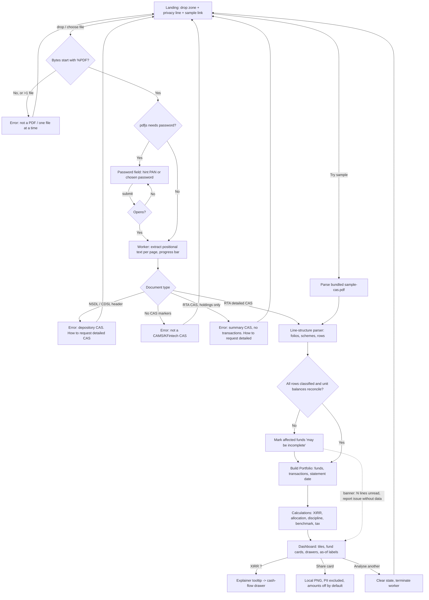

# SIP Lens v1.0 — Feature spec

Source: derived from the product owner's PRD of 2026-10-26. Every decision, feature, metric, roadmap item, stack choice and launch channel from that PRD is kept; it has been restructured into the stage 0 spec format and factually corrected where noted in "Corrections to the source PRD". The original technical sections are carried over as appendices for system design.

**Core promise (owner's words):** Drop your CAS PDF, see your real returns in under 10 seconds. No login. No ads. No account. No server.

---

## Corrections to the source PRD

Each correction states what the PRD said, what is actually the case, and the assumption this spec proceeds on. None of these removes a feature.

| # | PRD said | Correction | Assumption taken |
|---|---|---|---|
| C1 | "Nifty 50 historical values ... sourced from AMFI" (section 08) | AMFI publishes mutual fund NAVs, not Nifty 50 index levels. Index levels come from NSE Indices, whose redistribution terms are not licence-clean for an open-source bundle. | The benchmark is the NAV series of a Nifty 50 index fund's direct-growth plan, sourced from AMFI's free NAV history. It is licence-clean, already includes expense ratio and tracking difference (so the comparison is against something the investor could actually have bought), and is bundled at build time as before. **System design confirms the specific fund** (oldest direct-growth Nifty 50 index fund on AMFI; direct plans exist only from January 2013, so earlier transactions are excluded from the comparison and flagged). File renamed from `nifty50Nav.json` to `benchmarkNav.json` in intent; the folder layout otherwise stays. |
| C2 | "the CAS PDF that CAMS or KFintech sends" — implied the monthly emailed statement | The statement most investors receive monthly by email is the **NSDL or CDSL depository CAS**, a different document: holdings across demat, MF and other instruments, with few or no MF transactions. The RTA statements SIP Lens needs are the **CAMS or KFintech detailed CAS** (request type "Detailed", period "since inception", via the CAMS/KFintech "mailback" CAS page), which list every transaction per folio. There is also an RTA **summary** CAS that has holdings but no transactions. | v1 parses CAMS and KFintech detailed statements only. It **detects** a summary CAS and a depository CAS and tells the user, in plain words with the exact menu path, how to request the detailed one. See stories US-05 and US-06. |
| C3 | No mention of passwords | Nearly every CAS PDF is password-protected (the password is commonly the PAN, or a password the investor typed when requesting the statement). | The app asks for the password in the browser and passes it to pdfjs locally. It is never stored, never logged, never leaves the tab, and is discarded from memory once the document opens. See US-03. |
| C4 | "Current value (from NAV in the CAS)" | Without live NAV, "current value" means value **as of the statement date** printed in the CAS, which can be weeks or months old. | Every rupee value and every XIRR is labelled "as of DD Mon YYYY (statement date)". The word "current" is not used in the UI. See US-15. |
| C5 | "Tax rules — FY 2026-27" with 12.5% LTCG above ₹1.25L, 20% STCG, debt at slab | Those are the **Budget 2024** rules (effective 23 July 2024). They may well still apply in FY 2026-27, but that must be verified against the Finance Act in force before engine work starts. | Rules live in **one versioned config file** (`src/calculations/taxRules.ts` or similar; system design decides) with the FY and the "last verified" date shown in the UI next to the preview and in the disclaimer. The table in Appendix E is the starting content, marked "to verify". |
| C6 | Sample regex in 7.2 `/(\d{2}-\w{3}-\d{4})\s+(Purchase\|SIP\|Redemption\|Switch)\s+.../` | Real CAS rows do not look like that. Descriptions include "Systematic Investment (1)", "Purchase - via myCAMS", "Purchase-BSE", "*** Stamp Duty ***", "*** Reversal ***", "Switch In - From <fund>", "Switch Out - To <fund>", "IDCW Reinvestment", "Dividend Reinvested", "Redemption - via Online", and multi-line descriptions with the amount, units, NAV and unit balance in separate columns. Section headers carry folio, PAN, KYC flags, ISIN in brackets, scheme names with "- Direct Plan - Growth" suffixes, and page breaks split rows. | System design specifies a **line-structure parser** (positional text items from pdfjs, grouped into rows by y-coordinate, then classified), not a single regex. The folder layout from 6.3 stays; `casParser.ts` keeps its name and its comment changes. |
| C7 | "The app works offline after first load" (section 08) | That needs a **service worker** (pre-caching the bundle, pdfjs worker and benchmark data); none is in the stack table. | Treated as a **Could-have** story (US-37). System design decides whether to ship it in v1 and with what caching strategy; the privacy rule applies to the service worker too (no network beyond static assets). |
| C8 | "KFintech (formerly Karvy)"; `Karvy` in folder/variable names; "SRI hashes for CDN scripts" | Karvy Fintech was renamed KFintech in 2019; use **KFintech** throughout the product, code and docs. Subresource Integrity hashes apply to scripts loaded from third-party CDNs; a Vite-bundled app loads its own hashed assets from the same origin, so SRI adds nothing. | "KFintech" everywhere. The SRI line is dropped; the **CSP** requirement is kept (and tightened: `connect-src 'self'` so any accidental network call fails loudly). |

---

## 1. Problem statement

**The job to be done.** An Indian mutual fund investor who has been running SIPs for a few years wants one honest answer: *what have my investments actually returned, and is that good?*

**Who has it.** Anyone with SIPs across one or more AMCs, bought through Zerodha Coin, Groww, Kuvera, Paytm Money, a bank RM or directly. The PRD estimates this at millions of SIP investors; roughly 10 crore SIP accounts exist, and almost none of their owners can name their XIRR.

**How they do it today.**
- They look at the platform app, which shows "absolute returns" or "total returns" (current value minus invested, as a percentage). For a SIP this number is meaningless: a 20% absolute return over five years of monthly investing is a very different thing from 20% over one lump sum.
- The diligent ones download a CAS once a year, open it next to Excel or Google Sheets, retype or copy dates and amounts into two columns, and call `=XIRR()`. This takes an evening, breaks on switch transactions and stamp duty lines, and gets repeated the next year from scratch.
- Some upload the CAS to Kuvera, INDmoney or MProfit, which means handing their PAN, folio numbers and full transaction history to a company whose business model is selling them something.
- Most do neither and carry a vague unease that the app's percentage is not the real story.

**Cost of the workaround.** A wasted evening per year for the diligent; for everyone else, decisions (stop a SIP, switch a fund, "equity isn't working") made on a number that does not account for timing. Nobody ever compares against what a plain Nifty 50 index fund would have done with the same cash on the same dates, so active-fund underperformance stays invisible.

**What SIP Lens does.** It is the free, open-source, local-first portfolio analyser the owner describes: drop the CAMS or KFintech detailed CAS PDF and, inside the browser, get the honest picture the AMC dashboard doesn't: actual XIRR, vs-index comparison, SIP discipline score and a simple tax preview. No data ever leaves the device.

**Done looks like.** The investor reads one XIRR they trust, understands why it differs from the app's number, sees whether an index fund would have done better, and closes the tab having sent nothing to anyone.

## 2. Goals and non-goals

### Goals (owner's, kept verbatim in substance)

**Primary**
- Solve a real, recurring pain point for millions of Indian SIP investors who don't know their actual returns.
- Achieve GitHub traction: 100 stars in 30 days, 500 in 90 days, by being genuinely useful, not gimmicky.
- Build recruiter and client credibility: demonstrates financial domain knowledge, TypeScript, data parsing, and open-source ownership.

**Secondary**
- Product Hunt launch: "Product of the Day" in the Finance category.
- Lay groundwork for a future paid API or SaaS tier (data pipeline already proven).
- LinkedIn showcase: a project non-developers can understand and share.

**Product goals added by this spec**
- An investor with a valid detailed CAS reaches a trusted XIRR in under ten seconds, including typing the password.
- Every number has a visible "how we computed this" path and an as-of date.
- Every privacy claim is literally true in the code and checkable in the browser's network panel.

### Non-goals for v1.0 (section 05 of the PRD, kept)

Stocks / equity · NPS / PPF / FD · User accounts · Server storage · Fund recommendations · Buy / sell transactions · Real-time NAV fetch · Portfolio alerts.

**Owner's principle:** SIP Lens v1.0 is a read-only analyser. It takes a PDF and returns numbers. It never writes, never stores, never recommends.

Also out of scope for v1.0 (added for clarity): parsing the NSDL/CDSL depository CAS or the RTA summary CAS (detected and explained, not parsed), merging several CAS files (v1.2), realised-gains tax reports for a past FY, and any projection or forecast of future value.

## 3. Personas and scenarios

**Priya, the salaried professional.** 31, Bengaluru, ₹15,000/month across three funds on Groww for four years. "Groww says 18% returns. My friend says that's not the real number. I don't want to make a spreadsheet, I just want to know if this is working or if I should have put it in an index fund. And I'm not uploading my PAN anywhere." She requests the CAMS detailed CAS, drops it, types her PAN as the password, and sees 13.2% XIRR as of 30 Sep 2026 versus 14.1% for the index fund. She reads the tooltip, understands why 18% was not the right number, and screenshots the share card.

**Rohan, the DIY investor.** 42, Pune, nine funds across Zerodha Coin, direct AMC sites and a bank-sold ELSS from 2017. "No app shows me everything. MF Central sort of does but I had to sign up and it's clunky. I have a Sheets XIRR but it broke when I switched two funds last year and I never fixed it." He drops both the CAMS and KFintech statements (one at a time in v1), checks each fund's cash flows against his own sheet, finds that his large-cap fund has lagged the index by 2.3 points a year, and notes which units are still short-term before he rebalances.

**Anjali, the developer.** 27, builds fintech backends, posts on r/IndiaInvestments. "I'll believe 'no server' when I see the network tab empty. If the XIRR tests check against a spreadsheet and the parser has fixtures for both RTAs, I'll star it and maybe send a PR for the KFintech edge case I know about." She opens DevTools, drops the sample CAS, confirms the only requests are static assets, reads `src/calculations/xirr.ts` and the fixtures, stars and forks.

## 4. User stories with acceptance criteria

Numbering is stable; MoSCoW tag in brackets. Acceptance criteria are Given/When/Then and are the basis for Vitest and browser verification. "Statement date" means the date printed on the CAS as the statement's as-of date.

### Epic A — Getting a statement in (parser, PRD 4.1)

**US-01 Drop or choose a CAS PDF [Must]**
- Given the landing page, when it loads, then it shows a large drop zone labelled "Drop your CAS PDF here", a "choose file" button, a one-line privacy statement ("Parsed in your browser. Nothing is uploaded, nothing is stored.") and a link "Try with a sample CAS".
- Given the drop zone, when the user drops or picks a `.pdf`, then parsing starts immediately with no further clicks (unless a password is needed, US-03).
- Given a phone at 360px width, when the page loads, then the drop zone, button and sample link are all visible without scrolling and the tap target is at least 44px.

**US-02 Error: not a PDF [Must]**
- Given a dropped file whose bytes do not start with the PDF header (regardless of extension), when the file is read, then the app shows "That's not a PDF. SIP Lens reads the CAS PDF from CAMS or KFintech." with a "Try another file" action and a link to "How to get your CAS".
- Given more than one file dropped at once, when the drop happens, then the app shows "One statement at a time, please" and parses nothing.
- Then no parsing worker is started and no partial state is shown.

**US-03 Error: password required [Must]**
- Given a password-protected PDF, when pdfjs reports it needs a password, then the app shows an inline password field with the hint "CAS PDFs are usually protected with your PAN (in capitals) or the password you chose when requesting the statement."
- Given the field, when the user submits a password, then it is passed to pdfjs in the worker and parsing continues; a wrong password shows "That password didn't open the file" and keeps the field focused for another try, with no attempt limit.
- Then the password is never written to `localStorage`, `sessionStorage`, IndexedDB, cookies, the URL, console output or any network request; the password field is cleared and the string released once the document opens.
- Then the field has a show/hide toggle and `autocomplete="off"`.

**US-04 Error: a PDF that is not a CAS [Must]**
- Given a PDF that opens but contains none of the CAS markers (RTA header text, "Consolidated Account Statement", folio/PAN section structure), when text extraction finishes, then the app shows "This doesn't look like a CAMS or KFintech CAS" with the "How to get your CAS" instructions.
- Then no dashboard, no partial numbers and no "0 funds" screen is shown.

**US-05 Error: summary CAS without transactions [Must]**
- Given an RTA CAS whose sections contain holdings/valuation rows but no transaction rows, when detection runs, then the app shows "This is a summary CAS. It shows what you hold but not your transactions, so XIRR can't be computed. Request the **detailed** statement instead:" followed by the exact steps (CAMS: camsonline.com → Investor Services → CAS – CAMS+KFintech → Statement type **Detailed**, Period **Since inception**, choose password; KFintech equivalent).
- Then the fund names and the statement date that *were* found are shown so the user knows the file was read, and no XIRR or value is displayed.

**US-06 Error: depository CAS (NSDL/CDSL) [Must]**
- Given a PDF whose header identifies NSDL or CDSL (the monthly emailed consolidated statement), when detection runs, then the app shows "This is the NSDL/CDSL depository statement. It lists holdings, not mutual fund transactions. SIP Lens needs the CAMS/KFintech detailed CAS." with the same request steps as US-05.
- Then nothing from the depository CAS is parsed or displayed beyond the detection message.

**US-07 Parse progress [Must]**
- Given a valid detailed CAS, when parsing runs, then a progress bar advances per page ("Page 7 of 23") and the UI stays responsive (parsing runs in a WebWorker).
- Given a typical CAS (up to ~40 pages, ~1,500 transactions), when parsed on a 2022 mid-range Android phone in Chrome, then parsing finishes in under 3 seconds and the dashboard appears without a page reload.

**US-08 Partial parse [Must]**
- Given a CAS where some folio sections parse and some rows or sections are not recognised, when parsing completes, then the dashboard is shown for the parsed folios with a persistent, non-dismissible banner: "We couldn't read N lines in M folios. Numbers for those funds may be incomplete." listing the affected scheme names.
- Then the banner links to a "Report a parsing issue" page that explains how to describe the problem (RTA, statement period, the transaction description text) **without** attaching the CAS or pasting PAN/folio, and reminds the user that SIP Lens has no way to see their file.
- Given a fund with unrecognised rows, when its card is shown, then its XIRR carries a "may be incomplete" marker and is excluded from the portfolio XIRR tile, with the tile saying "excludes N funds with read errors".

**US-09 Every transaction type is extracted [Must]**
- Given detailed CAS fixtures from both CAMS and KFintech, when parsed, then each of these row kinds is classified: Purchase (lump sum, including "Purchase - via myCAMS", "Purchase-BSE", "Purchase - Systematic"), SIP ("Systematic Investment (n)", "SIP Purchase"), Switch-In, Switch-Out, Redemption (incl. SWP), Dividend/IDCW reinvestment, Dividend/IDCW payout, Stamp Duty, STT/TDS lines, Reversal (and the row it reverses), and Segregated-portfolio/bonus/unit-adjustment rows as "Other" with no cashflow effect.
- Then each classified row yields a typed `Transaction` with: RTA, folio number, scheme name, ISIN (where printed), AMFI scheme code if printed, date, description text, amount (₹), units, NAV, unit balance, and type.
- Then stamp duty rows are attached to the purchase they belong to so the investor's cash outflow equals what left their bank; reversals cancel the row they reverse; switch-out/switch-in pairs are recorded as a redemption cashflow from one fund and a purchase cashflow into the other on the same date.
- Then golden JSON outputs exist for every fixture and the test suite fails on any difference.

**US-10 Parsing scope and output contract [Must]**
- Given a parsed CAS, when the worker returns, then the main thread receives a `Portfolio` object: investor-level metadata limited to statement date and statement period; `Fund[]` grouped by ISIN (falling back to scheme name + folio when ISIN is absent); each fund with its `Transaction[]`, closing units, closing NAV and closing value as printed in the CAS.
- Then the parsed PAN, email and postal address are **not** included in the `Portfolio` object (they are never needed downstream); investor name is included only for the optional greeting and never rendered on the share card.
- Then closing units computed from transactions are reconciled against the unit balance printed in the CAS; a mismatch beyond 0.001 units flags the fund as "may be incomplete" (US-08).

**US-11 Try with a sample CAS [Must]**
- Given a first-time visitor, when they click "Try with a sample CAS", then a bundled, fully synthetic, unprotected CAS PDF (`public/sample-cas.pdf`) is parsed through the identical code path and the dashboard appears with a "Sample data" ribbon.
- Then the sample contains both CAMS- and KFintech-style sections, at least one of every transaction type from US-09, one ELSS, one debt fund and one fund with a switch, so the demo exercises the whole product.

### Epic B — The dashboard and XIRR (PRD 4.2)

**US-12 Summary tiles [Must]**
- Given a parsed portfolio, when the dashboard renders, then four tiles appear first: Portfolio XIRR (%), Total invested (₹), Value as of statement date (₹), and SIP discipline score (0–100; shows "—" if US-25 is not shipped or no SIP detected).
- Then each tile shows its unit (₹, %, /100) and the as-of date (US-15), and fits in one row on desktop and a 2×2 grid at 360px.

**US-13 Per-fund cards [Must]**
- Given a parsed portfolio, when the dashboard renders, then below the tiles is a scrollable list of per-fund cards, each showing scheme name (cleaned of RTA boilerplate but keeping plan and option, e.g. "Direct Plan – Growth"), folio number(s), invested (₹, net of redemptions and switch-outs), value as of statement date (₹), units held, fund XIRR (%), and category badge (US-18).
- Then the list is sorted by value descending by default with a toggle for XIRR and name; sorting does not re-run calculations.

**US-14 Portfolio and per-fund XIRR [Must]**
- Given a fund's transactions, when XIRR is computed, then outflows are purchases, SIPs, switch-ins and attached stamp duty (negative), inflows are redemptions, switch-outs and dividend payouts (positive), dividend reinvestments are both (net zero cash, units up), and the terminal inflow is units held × closing NAV on the statement date.
- Given the portfolio, when portfolio XIRR is computed, then all funds' cashflows are pooled into one series (not averaged) with one terminal value on the statement date.
- Then results match a spreadsheet `XIRR()` within 0.01 percentage points on every fixture, including a fixture with switches and one with a full redemption.
- Given a fund with a single transaction and no terminal value difference, or fewer than two non-zero cashflows, then XIRR shows "—" with a tooltip "Not enough history to compute XIRR".
- Given non-convergence after the configured iterations, then the UI shows "—" with "Couldn't compute; see cash flows" and never shows a wrong number.
- Given a negative XIRR, then it is displayed as a valid number, in the loss colour, with the text label "loss" (US-19).

**US-15 Everything is "as of statement date" [Must]**
- Given any rupee value or return on the dashboard, when it is rendered, then it is labelled "as of DD Mon YYYY" where the date is the statement date parsed from the CAS, and the page header says "Statement date: DD Mon YYYY · Period: DD Mon YYYY – DD Mon YYYY".
- Then the word "current" does not appear in any UI string; "value" or "value as of statement date" is used.
- Given a statement date older than 60 days at the time of viewing, then a soft note appears: "This statement is N days old. Request a fresh CAS for today's picture."

**US-16 XIRR explainer tooltip [Must]**
- Given the first appearance of "XIRR" on the page (the portfolio tile), when the user hovers or taps the "?" next to it, then a tooltip opens with: one sentence on what XIRR is ("the yearly rate that makes all your investments, with their dates, grow to today's value"), one sentence on why the app's "absolute return" differs, and a link "See the cash flows we used" (US-17).
- Given a phone, when the "?" is tapped, then the tooltip opens as a bottom sheet dismissible by tap-outside or swipe; it is readable at 360px without horizontal scroll.
- Then the tooltip appears automatically on the first dashboard render of a session (not on later renders in the same session), and keyboard users can open it with Enter/Space and close it with Escape.

**US-17 "How we computed this" cash-flow view [Must]**
- Given any XIRR (portfolio or fund), when the user opens "See the cash flows we used", then a drawer lists every dated cashflow (date, description as printed, ₹ in/out, source fund), the terminal value line (units × NAV as of statement date), and the resulting XIRR, with a "Copy as CSV" button that copies to the clipboard only (no download request, no network).
- Then the list makes clear which rows were ignored (e.g. "Other" rows, reversed pairs) and why.

**US-18 Asset allocation [Must]**
- Given parsed funds, when the dashboard renders, then an allocation bar or donut shows value by category: Equity, Debt, Hybrid, Other/Unclassified, with ₹ and %.
- Then categories come from a bundled ISIN→category map derived from AMFI/SEBI scheme categorisation (static JSON at build time); an ISIN not in the map is "Unclassified" and the bar says "N funds unclassified; tell us the ISIN on GitHub".
- Then ELSS is flagged as a sub-type of Equity for tax (US-33).

**US-19 Units, colour and accessibility [Must]**
- Given any number, when rendered, then it carries its unit: ₹ with Indian digit grouping (₹12,34,567), % to one decimal, years to one decimal where used.
- Given gains and losses, when coloured, then red/green are used only for gain/loss, every coloured value also has a text label ("gain"/"loss" or "ahead"/"behind"), and the colours pass WCAG AA contrast in both themes.
- Given `prefers-color-scheme: dark`, then the dashboard renders in dark mode; the theme choice is the only value ever stored.

**US-20 Privacy: no network request after load [Must]**
- Given the app has loaded, when a user drops a CAS, enters a password, views every section, opens every drawer and exports a share card, then the browser's network panel shows zero requests other than the static asset load (HTML, JS, CSS, fonts self-hosted, pdfjs worker, bundled data JSON, sample PDF).
- Then the repository contains no `fetch`, `XMLHttpRequest`, `sendBeacon`, WebSocket, `` beacon, third-party script, font CDN or analytics tag, and a CI test greps for these and fails the build if found outside an allow-list.
- Then the deployed CSP includes `connect-src 'self'` (plus `default-src 'self'`) so any regression fails loudly in the console.

**US-21 Privacy: nothing is stored [Must]**
- Given a completed session, when the tab is reloaded or closed, then nothing from the CAS, the password or the computed numbers survives: `localStorage`, `sessionStorage`, IndexedDB, Cache API and cookies contain only the theme preference (and the service worker's static asset cache if US-37 ships).
- Given the "Start over" button (US-22), when clicked, then the `Portfolio` object is dropped, the worker is terminated and the drop zone returns.
- Then the privacy statement on the drop zone links to a plain-language "How we keep your data on your device" page that describes exactly this, and to the source file(s) that implement it.

**US-22 Start over [Must]**
- Given the dashboard, when the user clicks "Analyse another statement", then the app returns to the drop zone with all state cleared (US-21) and without a page reload.

### Epic C — SIP discipline score (PRD 4.3)

**US-23 Detect SIPs [Should]**
- Given a fund-folio's purchases, when at least three purchases of the same amount (±1%) recur at roughly monthly (28–35 days), quarterly or weekly spacing, or carry the "Systematic Investment"/"SIP" description, then a SIP is detected with its amount, frequency, first date and last observed date.
- Then the fund card shows "SIP ₹5,000 monthly since Mar 2021" and a "How we detected this" tooltip listing the instalments.

**US-24 Count missed months [Should]**
- Given a detected SIP, when expected instalment dates are generated from the first date to the later of the last observed instalment or the statement date (configurable grace of 7 days), then each expected date with no matching purchase is a "missed" instalment; a SIP whose last instalment is more than two periods before the statement date is marked "stopped" from that point and later periods are not counted as missed.
- Then the per-fund breakdown shows expected, made, missed and stopped-since, and the user can see which months were missed.

**US-25 Discipline score ring (0–100) [Should]**
- Given all detected SIPs, when the score is computed, then it is 100 × (instalments made ÷ instalments expected), weighted by instalment amount, rounded to an integer; funds with no detected SIP do not affect the score; no SIP detected anywhere shows "—" with "No regular SIP found in this statement".
- Then the summary tile shows the score as a ring chart with a breakdown by fund below, each with its own percentage.
- Then the score is described as "how consistently you kept your SIPs going", not as a quality judgement of the funds.

**US-26 Compounding cost of missed SIPs [Should]**
- Given missed instalments, when the cost is computed, then it is the value on the statement date those instalments would have had if invested on their expected dates at the fund's actual NAV on those dates (NAV interpolated from the nearest transaction NAVs in the CAS, labelled as an estimate), minus the cash not invested.
- Then the number is shown as "Missed SIPs cost you about ₹X in growth (estimate)" with a "How we computed this" drawer, and is never framed as a prediction of future returns.

### Epic D — vs Index comparison (PRD 4.4)

**US-27 Shadow-invest the same cash flows in the index fund [Should]**
- Given the portfolio's dated cashflows (excluding dividend reinvestments and reversed pairs), when the comparison runs, then each outflow buys units of the benchmark Nifty 50 index fund (direct-growth) at its AMFI NAV on that date (previous business day's NAV if the date is a holiday), each inflow sells proportionally, and the terminal value is units × benchmark NAV on the statement date.
- Then the dashboard shows: your XIRR vs the benchmark XIRR, the gap in percentage points, and the estimated value difference in ₹ ("ahead"/"behind" with label), for the portfolio and per fund.

**US-28 Benchmark assumptions shown [Should]**
- Given the comparison, when rendered, then a line under it names the benchmark fund and plan, the data source (AMFI NAV history), the data's last bundled date, and says "Index fund NAV already includes its expense ratio".
- Given transactions dated before the benchmark series starts (direct plans begin January 2013) or after its last bundled date, then those cashflows are excluded, the comparison is marked "partial", and the excluded amount is stated.
- Then the comparison never says "you should have" or recommends switching; wording is "would have been worth".

**US-29 Benchmark data bundled at build time [Should]**
- Given the build, when it runs, then the benchmark NAV series is a static JSON bundled into the app, refreshed by a monthly CI job that commits the updated file; the app makes no runtime call for it.
- Then the JSON carries its source URL, licence note and generation date.

### Epic E — Tax impact estimator (PRD 4.5)

**US-30 Unrealised gains preview with FIFO [Should]**
- Given units held on the statement date, when the preview is computed, then each fund's lots are matched FIFO (oldest units first, including units acquired via switch-in and dividend reinvestment at their own dates and NAVs), each lot's gain is (closing NAV − lot NAV) × units, and lots are split into long-term and short-term by the holding-period rule for the fund's category.
- Then the dashboard shows, per fund and in total: short-term gain, long-term gain, the ₹1.25L equity LTCG exemption applied once across the portfolio, and the estimated tax if everything were redeemed on the statement date.
- Then the preview is explicitly "if you redeemed everything on the statement date"; realised gains from past redemptions are listed as a count with "not included in v1".

**US-31 Rules from one versioned config, FY shown [Should]**
- Given the tax rules, when the engine runs, then every rate, threshold and holding-period comes from a single config file that carries the FY, the Finance Act reference and a "last verified" date; no rate is hard-coded elsewhere.
- Then the UI heading reads "Tax preview · FY 2026-27 rules · last verified DD Mon YYYY" and the Appendix E table is reproduced in a "Rules we used" drawer.

**US-32 Debt at slab [Should]**
- Given debt or international funds (any holding period, post-April 2023), when shown, then the preview reports the gain amount and says "taxed at your income-tax slab"; it does not ask the user for their slab and does not compute a rupee tax for these lots.

**US-33 ELSS lock-in [Should]**
- Given an ELSS fund, when lots are under three years old on the statement date, then they are shown as "locked until DD Mon YYYY" and excluded from the "if redeemed" total; lots past lock-in follow the equity LTCG rule.

**US-34 Tax disclaimer and no-advice wording [Should]**
- Given the tax section, when rendered, then the disclaimer appears above the numbers, not below, in full: "Tax calculations are estimates based on the information provided and publicly available rules for FY 2026-27. Tax laws change. This is not tax advice. Consult a Chartered Accountant before filing." and additionally the owner's short form "This is an estimate only. Consult a CA." on the summary.
- Then no string anywhere in the app recommends redeeming, holding, switching or buying any fund, and no string projects a future value; a CI lint on UI strings fails on "should buy", "should sell", "will grow", "expected return", "projected".

### Epic F — Sharing and offline

**US-35 Shareable summary card (PNG) [Could]**
- Given the dashboard, when the user clicks "Share card", then a PNG is rendered locally (canvas) showing: portfolio XIRR, benchmark XIRR and gap, discipline score, statement date and period, number of funds, and "Made with SIP Lens, computed in my browser" with the URL.
- Then the card **never** includes PAN, investor name, email, address, folio numbers or the password; absolute ₹ amounts (invested, value, difference) are **off by default** behind a toggle labelled "Include rupee amounts"; fund names are off by default behind "Include fund names".
- Then the PNG is offered via the browser's download, in a 1200×630 size for LinkedIn/Twitter cards and a 1080×1080 square, with no network request.

**US-36 Share card wording stays within the tool/advice line [Could]**
- Given the card, when rendered, then every number carries its as-of date and the words "XIRR" and "vs Nifty 50 index fund" appear verbatim so a viewer cannot read it as a forecast or a recommendation.

**US-37 Works offline after first load [Could]**
- Given a prior visit, when the user opens the URL without connectivity, then the app loads from the service worker cache and parses a CAS exactly as online.
- Then the service worker caches only the app's own static assets, makes no other request, and the privacy page explains what it caches.

### Won't have in v1.0 (PRD section 05)

Stocks / equity · NPS / PPF / FD · User accounts · Server storage · Fund recommendations · Buy / sell transactions · Real-time NAV fetch · Portfolio alerts · parsing of depository or summary CAS · multi-file merge · realised-gains FY report.

## 5. Flow



Every branch runs on the device; the only network traffic in this diagram is the initial static load before node A.

## 6. Competitive reference

| Product | How it handles the job | SIP Lens v1 position |
|---|---|---|
| **MF Central** (CAMS + KFintech joint, SEBI-mandated) | Official consolidated view across both RTAs after PAN + OTP signup; holdings, transactions, CAS download, some service requests. XIRR is not the headline; the UI is utilitarian and slow. | **Behind** on data completeness (it has live data and both RTAs merged). **Ahead** on no account, no server, instant XIRR with explanation, index comparison. We take: the detailed-CAS request path (we send users there), and the idea that CAMS+KFintech together is the complete picture. |
| **Kuvera** | Imports CAS by email forwarding or upload with password, shows per-fund and portfolio XIRR, trade-ready. Requires an account; the PDF and password go to Kuvera's servers. Import UX is the best in the market. | **Parity** on XIRR. **Ahead** on privacy and zero-signup. **Behind** on live NAV and ongoing tracking. We take: the "import your external funds" framing and its fund-card density. |
| **INDmoney** | Account-aggregator pull of MF, stocks, EPF; XIRR shown; heavy cross-sell and notifications. | **Ahead** on privacy, focus and honesty of the number. **Behind** on breadth (we do only MF) and on automatic refresh. We take: nothing in UI; we position explicitly against "give us everything". |
| **Groww** | Shows returns and XIRR for holdings bought on Groww; external folios via limited CAS import. Clean, mobile-first, but no index comparison and "absolute returns" is the default view. | **Ahead** on consolidated view across platforms and on the vs-index comparison. **Parity** on mobile polish is the bar we must meet. We take: three-step simplicity and typography. |
| **MProfit** | Paid desktop/cloud portfolio manager for serious investors and advisors; imports CAS, strong capital-gains reports (FIFO, grandfathering, realised gains by FY) and audit-ready exports. Data on their servers. | **Behind** on tax completeness (realised gains, grandfathering, past FYs) and multi-asset. **Ahead** on free, local, ten-second time to number. We take: FIFO lot view per fund and "show your lots" transparency. |
| **freefincal CAS-to-Excel / "mutual fund tracker" tools** | Pattabiraman's spreadsheet tools convert a CAS to rows and use Excel `XIRR()`; trusted by r/IndiaInvestments precisely because the math is visible. Manual, desktop-only, breaks on format changes. | **Ahead** on ease (no Excel, phone works). **Parity** on trust only if we expose cash flows (US-17) and test against a spreadsheet. We take: the "show me the cash flows" culture and the audience. |
| **casparser** (open-source Python) | Parses CAMS and KFintech detailed CAS, handles passwords, outputs JSON/CSV, classifies many transaction types (purchase, SIP, redemption, switch, stamp duty, STT, dividend, reversal, segregation). CLI; needs Python. | **Behind** on parser maturity and edge-case coverage. **Ahead** on zero-install browser flow and the analytics on top. We take: its transaction-type taxonomy as the starting checklist for US-09, its approach to fixtures, and we credit it in the README. |

## 7. Success metrics

### Owner's traction metrics (kept)

| Metric | 30 days | 90 days |
|---|---|---|
| GitHub stars | 100 | 500 |
| Forks | 20 | 80 |
| Unique visitors | 500 | 3,000 |
| Community posts | 5 | — |
| PRs from community | — | 2 |

Unique visitors are read from GitHub Pages' own traffic insights, not from any script in the app.

### Product metrics (added)

There is no telemetry and there never will be, so each metric names how it is measured without one.

| Metric | Type | Target | How measured |
|---|---|---|---|
| Parse success on the fixture corpus | Leading | 100% of fixtures match golden JSON; corpus ≥ 12 fixtures covering CAMS and KFintech, 2019–2026 layouts, every US-09 type, summary CAS, depository CAS, password-protected | CI on every PR |
| Parse success on real-world statements reported by users | Lagging | ≥ 90% "worked" at 30 days, ≥ 95% at 90 days | Voluntary "Did it work?" GitHub issue template with RTA + statement year + outcome; no file, no PII; tallied monthly in the README |
| Time to first number | Leading | ≤ 10 s from drop to portfolio XIRR including password entry; parse ≤ 3 s for a 40-page CAS on a 2022 mid-range Android | Vitest timing on fixtures; manual check on a reference device before each release |
| Share of sessions that reach the dashboard | Lagging | ≥ 80% of sessions with a valid detailed CAS; ≥ 60% of all sessions including people who arrive with the wrong statement | Moderated usability sessions (≥ 10 users before launch, ≥ 10 after) and the issue template; never analytics |
| Trust check | Leading | ≥ 8 of 10 usability participants can say in their own words why XIRR differs from their app's number after seeing the tooltip | Moderated sessions |
| Privacy check | Leading | 0 non-static requests in the network panel across the full flow; 0 findings in CI grep | Browser verification per CLAUDE.md on every release |

## 8. Priority and scope cuts

### MoSCoW

| Bucket | Stories | PRD feature |
|---|---|---|
| **Must** | US-01 to US-22 | 4.1 parser (incl. all error states, password, partial parse), 4.2 dashboard with XIRR, allocation, as-of labelling, explainer, cash-flow view, privacy guarantees, sample CAS |
| **Should** | US-23 to US-26 (discipline), US-27 to US-29 (index comparison), US-30 to US-34 (tax preview) | 4.3, 4.4, 4.5 |
| **Could** | US-35, US-36 (share card PNG), US-37 (offline after first load) | section 10 share card, section 08 offline |
| **Won't** | section 05 list plus depository/summary parsing, multi-file merge, realised-gains FY report | — |

### The smallest release that still earns trust

Ship **Must only** as v1.0-rc: drop a CAMS or KFintech detailed CAS, handle every wrong-file case with a helpful message, type the password locally, see portfolio and per-fund XIRR with the explainer and the cash flows behind it, every number dated to the statement, and an empty network panel. This alone beats the spreadsheet workaround and is what the developer persona will audit and star. The discipline score tile shows "—" until US-25 ships.

Add Should stories in the order the owner's Phase 2 lists them: discipline score, index comparison, tax preview. The index comparison is the single biggest reason an investor will share the link; the tax preview is the most likely to generate corrections, so it ships last and behind the config file of C5.

Could stories ship in Phase 3 if the privacy review of the service worker and the PII exclusions of the share card are clean.

## 9. Dependencies and risks

| Risk / dependency | Impact | Mitigation in this spec |
|---|---|---|
| **CAS format drift** across CAMS and KFintech (new description strings, column shifts, page-break splits, new sections such as segregated portfolios) | Silent wrong numbers or hard failures after a layout change | Line-structure parser (C6) rather than regex; unit-balance reconciliation per fund (US-10) turns silent drift into a visible "may be incomplete"; fixture corpus by RTA and year; "Report a parsing issue" path without data (US-08) |
| **Password handling** | A single leak (log, URL, storage, error reporter) destroys the privacy promise | Password lives in the worker call only (US-03); CI grep for storage and network APIs (US-20); no error reporter of any kind |
| **Depository CAS confusion** | Most users' first file is the NSDL/CDSL monthly email; a bare "parse failed" loses them | Detect and explain with exact request steps (US-05, US-06); "How to get your CAS" linked from the landing page; the sample CAS lets them see value before fetching their own |
| **Tax-rule change** between writing and FY 2026-27, or mid-year | Wrong tax numbers are the fastest way to lose trust and attract liability | Single versioned config with FY and "last verified" in the UI (US-31); disclaimer above the numbers (US-34); tax ships last |
| **SEBI line between a calculation tool and investment advice** | Any recommendation or forecast language could read as unregistered investment advice | No recommendations, no forecasts, no "should"; string lint (US-34); benchmark wording "would have been worth" (US-28); discipline score framed as consistency, not fund quality (US-25) |
| **Benchmark data licensing** | NSE index data is not freely redistributable; bundling it in an MIT repo is a legal exposure | Use an index fund's NAV series from AMFI (C1), with source, licence note and date embedded in the JSON (US-29) |
| **pdfjs bundle size on mobile** | pdfjs-dist is several hundred KB gzipped plus the worker; slow 4G users may bounce before the drop zone is usable | Lazy-load pdfjs and the worker on first file drop or sample click, not on page load; code-split the dashboard; budget: landing interactive ≤ 1.5 s on a 4G phone; system design sets exact budgets |
| Dependency: AMFI NAV history availability and the benchmark fund's inception date | Comparison is partial for pre-2013 SIPs | Flag partial comparison with excluded amount (US-28) |
| Dependency: ISIN→category map | Unknown ISINs reduce allocation and tax usefulness | "Unclassified" bucket with a GitHub path to add ISINs (US-18); map refreshed by the same monthly CI job |

## 10. Open questions

Only questions that change scope. Each carries the assumption the pipeline proceeds on; the owner can overturn any of them at approval.

| # | Question | Assumption taken |
|---|---|---|
| Q1 | Which Nifty 50 index fund is the benchmark, and how do we handle SIPs older than direct plans (Jan 2013)? | The oldest Nifty 50 index fund with a direct-growth plan on AMFI; cashflows before its first NAV are excluded and the comparison labelled "partial" with the excluded ₹ (US-28). System design confirms the fund. |
| Q2 | Does v1 accept more than one CAS per session (e.g. a CAMS and a KFintech file, or a spouse's)? | No. One statement per session; "Analyse another statement" clears state. Multi-file merge is v1.2 Family portfolio. Note: since 2023 a single RTA CAS request can cover both RTAs' folios, so one file is usually enough. |
| Q3 | Is the tax preview unrealised-only ("if you redeemed today") or does it also report realised gains within the statement period? | Unrealised-only as of the statement date, FIFO (US-30). Realised gains are counted and shown as "not included in v1". |
| Q4 | What exactly is a SIP and a missed month for the discipline score? | Three or more equal (±1%) purchases at monthly/quarterly/weekly spacing or carrying the SIP description; a missed instalment is an expected date with no purchase within 7 days; a SIP silent for more than two periods is "stopped", not "missed" (US-23, US-24). Backend engineer may refine within these rules. |
| Q5 | How are stamp duty rows treated in cashflows? | Attached to the purchase they follow so the outflow equals the bank debit (US-09). STT on redemption likewise reduces the inflow. |
| Q6 | What happens to funds whose ISIN is not in the bundled category map? | Shown as "Unclassified" in allocation; excluded from the tax preview with a note; XIRR unaffected (US-18, US-30). |
| Q7 | Does the service worker (offline) ship in v1.0? | Could-have; ships only if system design's privacy review is clean and the bundle budget allows (US-37). The PRD's "works offline after first load" claim is removed from the README until it does. |

---

# Appendices — carried over from the owner's PRD for system design

These sections are the owner's technical intent, kept so that nothing is lost. Where a correction above applies, it is noted inline; otherwise the content is as supplied.

## Appendix A — Local-first principle (PRD 6.1)

**Non-negotiable:** No PDF, transaction, or portfolio data ever leaves the user's browser. There is no backend. There is no database. There is no analytics.

All PDF parsing, XIRR computation, tax estimation, and chart rendering happen in the browser. The only network calls are the initial page load (GitHub Pages CDN) and the benchmark NAV data bundled at build time (served as part of the static assets, not fetched at runtime from a third party).

## Appendix B — Tech stack (PRD 6.2)

| Layer | Technology | Why |
|---|---|---|
| UI framework | React 18 + TypeScript | Type safety for financial data; large community; recruiter-recognisable |
| Build tool | Vite | Fast dev, small bundles, good WebWorker support |
| PDF parsing | pdfjs-dist | Mozilla's battle-tested parser; browser-native; no server needed |
| Charts | Recharts | React-native charting; composable; good TypeScript types |
| Styling | Tailwind CSS | Utility-first; fast iteration; small production CSS |
| Testing | Vitest | Fast, Vite-native; same config as build |
| Hosting | GitHub Pages | Free, zero-config CDN; reinforces the open-source narrative |
| CI/CD | GitHub Actions | Auto-deploy on merge to main; run tests on PR |
| (Could, C7) Offline | Service worker (e.g. via a Vite PWA plugin) | Required for "works offline after first load"; system design decides |

## Appendix C — Folder structure (PRD 6.3)

Layout kept as supplied. Comments updated for C1 and C6.

```
sip-lens/
├── src/
│   ├── parser/
│   │   ├── pdfWorker.ts        // WebWorker wrapper for pdfjs-dist (password passed in, never stored)
│   │   ├── casParser.ts        // Line-structure transaction extractor (C6); detects summary/depository CAS
│   │   └── types.ts            // Transaction, Fund, Portfolio types
│   ├── calculations/
│   │   ├── xirr.ts             // Newton-Raphson XIRR engine
│   │   ├── discipline.ts       // SIP Discipline Score (0-100)
│   │   ├── tax.ts              // LTCG/STCG FIFO estimator (rules from one versioned config, C5)
│   │   └── indexCompare.ts     // Benchmark index-fund parallel XIRR (C1)
│   ├── data/
│   │   └── nifty50Nav.json     // Bundled benchmark NAV series (Nifty 50 index fund, direct-growth, AMFI; C1)
│   ├── components/
│   │   ├── DropZone.tsx
│   │   ├── ParseProgress.tsx
│   │   ├── Dashboard.tsx
│   │   ├── FundCard.tsx
│   │   ├── DisciplineScore.tsx
│   │   ├── IndexComparison.tsx
│   │   └── TaxEstimate.tsx
│   ├── App.tsx
│   └── main.tsx
├── tests/
│   ├── xirr.test.ts
│   ├── discipline.test.ts
│   └── tax.test.ts
├── public/
│   └── sample-cas.pdf          // Synthetic sample for demo
├── vite.config.ts
└── README.md
```

System design may add `tests/fixtures/` with golden JSON, a `data/isinCategory.json`, and the error-state components; the owner's layout is the baseline.

## Appendix D — XIRR via Newton-Raphson (PRD 7.1)

XIRR requires iterative numerical solving. Newton-Raphson convergence, the same method Excel uses.

```ts
// Input: cashflows: { date: Date; amount: number }[]
// Amounts: negative = investment (outflow), positive = redemption or value as of statement date
function xirr(cashflows, guess = 0.1, maxIter = 100, tol = 1e-6): number {
  let rate = guess;
  for (let i = 0; i < maxIter; i++) {
    const npv = cashflows.reduce((sum, cf) => {
      const t = daysDiff(cashflows[0].date, cf.date) / 365;
      return sum + cf.amount / Math.pow(1 + rate, t);
    }, 0);
    const dnpv = cashflows.reduce((sum, cf) => {
      const t = daysDiff(cashflows[0].date, cf.date) / 365;
      return sum - t * cf.amount / Math.pow(1 + rate, t + 1);
    }, 0);
    const newRate = rate - npv / dnpv;
    if (Math.abs(newRate - rate) < tol) return newRate;
    rate = newRate;
  }
  throw new Error("XIRR did not converge");
}
// Edge cases: single transaction → "—"; convergence failure → "—" in UI; negative XIRR is valid, shown in the loss colour with a text label.
```

Note for system design: the sketch assumes `cashflows[0]` is the earliest date; sort first. Consider a bisection fallback when Newton-Raphson diverges, so "—" is rare. Tests must cross-check against spreadsheet `XIRR()` per CLAUDE.md.

## Appendix E — CAS PDF parser outline (PRD 7.2, corrected per C6)

```
1. FileReader API reads PDF bytes → ArrayBuffer
2. WebWorker loads pdfjs-dist; opens the document (with the user-supplied password if required)
3. Detect document type from header text: NSDL/CDSL depository CAS, RTA summary CAS, RTA detailed CAS, or not a CAS
4. For a detailed CAS: extract positional text items per page; group into rows by y-coordinate; stitch rows split across page breaks
5. Walk rows as a state machine: folio header (folio no., PAN masked, KYC) → scheme header (scheme name, ISIN, advisor/RTA code) → transaction rows → closing balance / valuation row
6. Classify each transaction row by description (see US-09 list) → typed Transaction; attach stamp duty to the preceding purchase; pair reversals
7. Group transactions by ISIN (fallback: scheme name + folio) → Fund[]; reconcile computed units with the printed unit balance
8. Return Portfolio object (no PAN, email or address) to the main thread
```

The owner's original regex example is retained here only as the record of intent: `"01-Jan-2024  Purchase  10,000.00  52.3456  191.02"`. It will not match real rows and is not the implementation.

## Appendix F — Tax rules, FY 2026-27 (PRD 7.3; to be verified per C5)

| Fund type | Holding period | Tax rate | Notes |
|---|---|---|---|
| Equity / hybrid (≥65% equity) | > 1 year | 12.5% on gains above ₹1.25L | LTCG; ₹1.25L exempt per FY |
| Equity / hybrid (≥65% equity) | ≤ 1 year | 20% | STCG; no exemption |
| Debt / international | Any | Income slab rate | Post Apr 2023; no indexation |
| ELSS | < 3 years | Locked, cannot redeem | Enforce in UI |
| ELSS | ≥ 3 years | Same as equity LTCG | After lock-in |

Status: these are the Budget 2024 rules (from 23 July 2024). Before engine work, verify against the Finance Act applicable to FY 2026-27 and record the verification date in the config file. Hybrid funds between 35% and 65% equity (and debt funds bought before 1 April 2023) have different treatment; v1 classifies by the bundled category map and notes the simplification in the "Rules we used" drawer.

Disclaimer shown in UI: "Tax calculations are estimates based on the information provided and publicly available rules for FY 2026-27. Tax laws change. This is not tax advice. Consult a Chartered Accountant before filing."

## Appendix G — Data sources (PRD 08, corrected per C1)

| Data | Source | How |
|---|---|---|
| Transaction history, NAV per transaction | CAS PDF (user-supplied) | Parsed locally; no API |
| Value as of statement date (closing units × closing NAV) | CAS PDF | Parsed locally |
| Benchmark NAV series (Nifty 50 index fund, direct-growth plan) | AMFI NAV history (free; includes expense ratio) | Bundled at build time as JSON; refreshed monthly in CI; fund choice confirmed by system design |
| Fund category (equity / debt / hybrid / ELSS) | Bundled category map by ISIN | Static JSON; derived from AMFI scheme master and SEBI categorisation |

No runtime API calls. "Works offline after first load" is a Could-have pending a service worker (C7).

## Appendix H — Security and privacy (PRD 09, corrected per C8)

- No server component of any kind
- No data transmission; the CAS PDF never leaves the browser tab
- No analytics, tracking scripts, or cookies
- No localStorage of financial data (session memory only)
- Source code fully open; anyone can audit it
- CSP headers on the GitHub Pages deployment (`default-src 'self'; connect-src 'self'`; GitHub Pages does not set custom headers, so deliver via `<meta http-equiv="Content-Security-Policy">`; system design confirms)
- PDF parsing in an isolated WebWorker context
- No third-party scripts beyond the bundled framework
- Password for protected PDFs handled in-memory only (C3)
- (Dropped per C8: SRI hashes for CDN scripts; there are no CDN scripts in a Vite-bundled app)

**Privacy as a feature.** The local-first constraint is the core value proposition. Lead with it in the README, landing page and every mention.

## Appendix I — UX and design guidelines (PRD 10)

**Flow:** Drop zone → Parse progress → Dashboard. Three states, zero unnecessary steps (plus the password step and the error states when needed, each a single screen that returns to the drop zone).
- Drop zone: large PDF drop area, "Drop your CAS PDF here", with a sample PDF link for first-time visitors and a "How to get your CAS" link.
- Parse progress: animated bar showing pages parsed; under 3 seconds for a typical CAS.
- Dashboard: summary tiles (XIRR, total invested, value as of statement date, discipline score), then scrollable per-fund breakdown.

**Principles:** mobile-first; dark mode via `prefers-color-scheme`; no jargon, explain XIRR in a tooltip on first appearance; red/green only for gains/losses with labels for colour-blind users; every number labelled with unit (₹, %, years) and with its as-of date; shareable summary card (PNG export) for LinkedIn and Twitter with PII excluded.

## Appendix J — Development phases (PRD 11)

| Phase | Weeks | Scope |
|---|---|---|
| 1 Core engine | 1–3 | PDF parser (pdfjs-dist WebWorker) · document-type detection and error states · password handling · transaction type parsing · XIRR engine with tests · basic dashboard (no charts) with explainer and cash-flow view · repo setup and CI/CD |
| 2 Analytics layer | 4–5 | Recharts integration · SIP discipline score · vs Nifty 50 index fund comparison · tax estimator with FIFO behind versioned rules config · mobile-responsive polish |
| 3 Launch prep | 6 | Synthetic sample CAS · shareable summary card · (Could) service worker · README with screenshots and GIF · Product Hunt assets · r/IndiaInvestments post · LinkedIn post |

## Appendix K — Future roadmap (PRD 13)

- **v1.1 Shareable report**: export the analysis as a shareable PDF or link (encrypted, expiry-based, no server)
- **v1.2 Family portfolio**: merge CAS PDFs from multiple family members; aggregated XIRR and allocation
- **v1.3 Goal tracker**: map portfolio to goals; show progress and projected shortfall (note: projections must be reviewed against the no-advice rule before this ships)
- **v2.0 Paid API**: REST API for XIRR and CAS parsing for fintechs and advisors; paid tier from ₹999/mo
- **v2.5 SaaS**: optional cloud sync with E2E encryption; automatic CAS import; advisor sharing

## Appendix L — Open source setup and launch (PRD 14)

| Item | Value |
|---|---|
| License | MIT |
| Repo name | sip-lens |
| GitHub topics | mutual-funds india sip xirr portfolio-tracker react typescript local-first |
| Description | "Open-source XIRR portfolio analyser for Indian mutual fund investors. No server. No signup. Drop your CAS PDF." |

**README must include:** demo GIF of drop → parse → dashboard; one-line value prop; dashboard screenshot with synthetic data; privacy statement; XIRR explainer; how to get the detailed CAS (and why the NSDL/CDSL email is not it); how to contribute with good-first-issues; the "Did it work?" issue template; tech stack table; local dev instructions; credit to `casparser` for the transaction taxonomy.

**Launch channels:** r/IndiaInvestments (primary), r/IndianStreetBets, Twitter/X GIF thread, LinkedIn developer angle, Product Hunt on a Tuesday in week 6.

---
Approved by: ajvelhal on 2026-10-26
