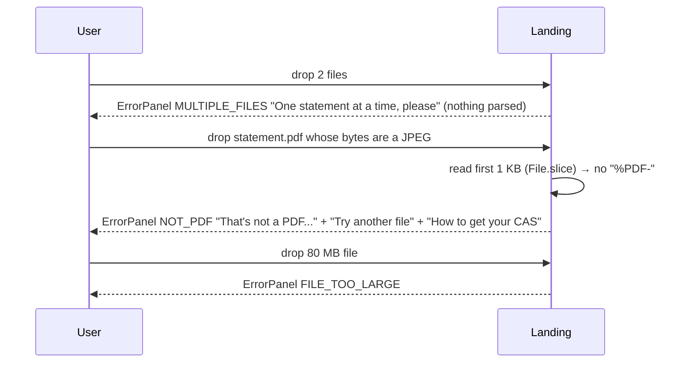
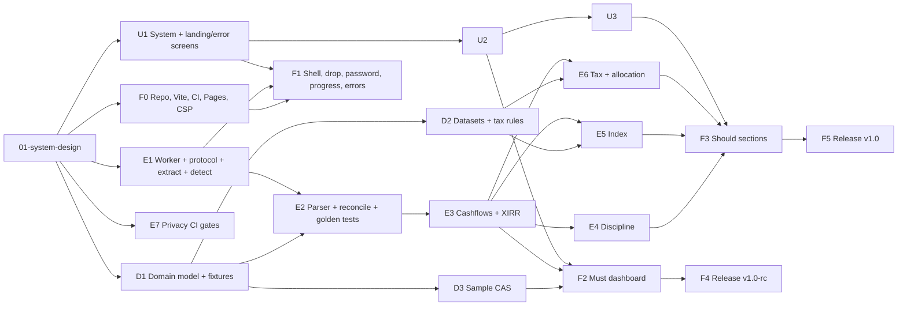

# SIP Lens v1.0 — System design

Input: `docs/features/sip-lens-v1/00-spec.md` (approved by ajvelhal on 2026-10-26).
Downstream readers: `dba` (02-database-design.md), `ui-design` (03-ui-design.md), `backend-engineer`, `ui-developer`.
Status: design complete for Must (US-01 to US-22) and Should (US-23 to US-34) stories; Could stories (US-35 to US-37) get a placement note only.

Conventions used in this document: "statement date" is the as-of date printed on the CAS; "RTA" is CAMS or KFintech; money is rupees; all dates in types are ISO calendar dates (`YYYY-MM-DD`) with no time or timezone; sign conventions are stated per type and per function, never assumed.

---

## 1. Problem and scope

### 1.1 What the spec asks

A static, local-first web app that takes one CAMS or KFintech **detailed** Consolidated Account Statement PDF, parses it inside a WebWorker in the browser, and shows: portfolio and per-fund XIRR with the cashflows behind them (Epic B), SIP discipline (Epic C), a shadow investment of the same cashflows in a Nifty 50 index fund (Epic D), and an unrealised-gains tax preview under versioned rules (Epic E). Every number is labelled "as of statement date". Every wrong-file case (not a PDF, password, not a CAS, summary CAS, depository CAS, partial parse) gets a specific message (Epic A). Zero network requests after the static load, zero persistence of financial data (US-20, US-21).

### 1.2 Out of scope (from the spec, restated so nobody designs for it)

Parsing of NSDL/CDSL depository CAS or RTA summary CAS (detected and explained only); merging several files in one session; realised-gains FY reports; live NAV; projections; recommendations; accounts; server; analytics. Share card PNG (US-35, US-36) and service worker (US-37) are Could: not in the v1.0 build, but the design leaves a slot for each (section 9.6).

### 1.3 Assumptions made where the spec is silent or ambiguous

Each assumption is numbered and referenced from the sections that depend on it. Any of them can be overturned by the owner; section 10 lists the ones that would change the design materially.

| # | Assumption | Why | Depends |
|---|---|---|---|
| A1 | **Benchmark fund is UTI Nifty 50 Index Fund – Direct Plan – Growth** (AMFI scheme code believed to be 120716; data design confirms the code against the AMFI scheme master). | Q1 says "oldest direct-growth Nifty 50 index fund". All direct plans start on 1 Jan 2013, so age does not discriminate between UTI, HDFC, SBI, ICICI Pru, Franklin and Nippon Nifty 50 index funds. UTI's is the largest by AUM, has had among the lowest TER and tracking difference over the whole 2013–2026 window, has an unbroken daily NAV series on AMFI from 1 Jan 2013, and is what most "just buy an index fund" advice in India actually names, so the comparison is against something the investor could realistically have bought. Fallback if the series proves gappy: HDFC Index Fund – Nifty 50 Plan – Direct – Growth. | §5.1 |
| A2 | **Units reconciliation tolerance is 2 units of the printed precision** (0.002 when the CAS prints 3 decimals, 0.0002 at 4 decimals), applied per row to the running "unit balance" column and to the closing balance. | The spec's flat 0.001 is below the rounding noise of two 3-decimal figures added and compared to a third (worst case 0.0015), so it would produce false "may be incomplete" flags on long SIP histories. 2 ULP catches every missing row (the smallest real row is ≥ 0.001 units) without false positives. Listed in §10 for confirmation. | §4.4, §6 |
| A3 | **Multi-PAN (joint/family) statements are parsed in full**, with an information banner "This statement covers N investors; numbers are combined", and `Portfolio.investorCount`. PAN itself is never retained. | Parsing is per folio and PAN-agnostic; rejecting would lose users with joint holdings. Multi-file merge (Q2) is a different feature. | §2, §6 |
| A4 | **Scanned/image-only PDFs are rejected under US-04's message** with an extra line: "This PDF has no selectable text, so it is probably a scan or a photo. SIP Lens needs the original PDF from CAMS or KFintech." Error code `NO_TEXT`. | OCR is out of the question for size and accuracy. | §2, §6 |
| A5 | **Benchmark series staleness**: if the bundled series ends before the statement date by ≤ 45 days, the last NAV is carried forward for valuation and for any cashflow in the gap, and the comparison is labelled "benchmark NAV carried forward N days (data ends DD Mon YYYY)". Beyond 45 days the comparison section is replaced by "Benchmark data ends DD Mon YYYY and is too old for this statement; a refresh is pending on GitHub". | The monthly CI refresh means a fresh CAS will almost always be days to weeks ahead of the bundle. Hiding the comparison in that case would hide it for most users; carrying forward for more than a refresh cycle plus slack would mislead. | §4.7, §5.1 |
| A6 | **Shadow-portfolio redemption model** for the index comparison: outflows buy benchmark units with the same rupees on the same date; an inflow sells the **same fraction of the shadow's units** as the investor sold of their fund's units ("proportionally", US-27). The rupee gap shown is the **total-wealth difference**: (shadow terminal value + shadow cash received) − (actual terminal value + actual cash received). For a pure SIP without redemptions this reduces to the terminal-value difference. | Same-rupee selling can drive the shadow negative; proportional never does and is what the spec says. Total wealth is the only comparable quantity once the two paths pay out different rupees. | §4.7 |
| A7 | **"Not enough history" for XIRR** means: fewer than two non-zero cashflows, or all cashflows on one calendar day, or all cashflows with the same sign. A single purchase plus a terminal value on a later date **is** computed (it is the CAGR). | The spec's "single transaction and no terminal value difference" is read as the same-date / same-sign case. | §4.5 |
| A8 | **Multiple XIRR roots**: the root nearest to zero is returned with `warning: 'multiple-roots'`; the UI shows the number with a caution marker and the cashflow drawer explains. | Never showing a number at all would hit exactly the investors with the most complex histories; the nearest-to-zero root is the conventional and spreadsheet-consistent choice. | §4.5 |
| A9 | **Day count** is actual days / 365 (spreadsheet `XIRR()` convention). Dates are calendar days; no `Date` objects with time cross the module boundary. | Matches the ±0.01 pp test target against spreadsheets. | §4.5 |
| A10 | **Statement date** is the end date of the "statement period" line, unless a valuation row prints an explicit "as on" date, in which case that date wins. | CAS valuations are as of the period end. | §4.1 |
| A11 | **No webfont**; system font stack (`ui-sans-serif, system-ui, ...` plus `"Noto Sans"` where present for the rupee sign). | Zero font bytes on the landing path and no font-src surface. | §7, §8 |
| A12 | **Service worker does not ship in v1.0** (Q7). The build keeps a slot for `vite-plugin-pwa` in precache-only mode. | Bundle budget and privacy review time; the "works offline" README line stays off. | §9.6 |
| A13 | **Browser floor**: Chrome/Edge ≥ 100, Firefox ≥ 100, Safari ≥ 15.4 (iOS 15.4+). Older browsers get an "unsupported browser" panel before any file is read. | Module workers, `structuredClone`, `BigInt`-free pdfjs modern build. | §7 |
| A14 | **Hard input limits**: file ≤ 50 MB, pages ≤ 400. Beyond either, reject before parsing with a specific message. | Worker memory budget (§7). | §2, §7 |
| A15 | **Tax class for hybrids**: the ISIN→category map carries a `taxClass` (`equity`, `debt`, `hybrid-other`, `unknown`) pinned by data design from the SEBI category (aggressive hybrid, arbitrage, equity index/ETF/FoF-domestic-equity → `equity`; debt, liquid, international, gold, FoF-overseas → `debt`; balanced advantage, dynamic asset allocation, multi-asset, conservative hybrid, equity savings → `hybrid-other`). `hybrid-other` lots show the gain and "special hybrid rules; not computed in v1". | Appendix F says 35–65% hybrids differ; v1 does not model per-fund equity share. | §4.8, §5.2 |
| A16 | **Exemption and losses**: equity long-term gains and losses are netted across the portfolio, the ₹1.25L exemption applies once to a positive net, short-term is netted separately; no loss carry-forward, no set-off between ST and LT. | Simplest defensible reading of US-30. | §4.8 |
| A17 | **Rule selection**: the rules config is keyed by FY; the engine selects by the statement date's FY; if absent, the latest FY in the config is used and the UI adds "rules for FY X applied to a statement dated in FY Y". | US-31 shows the FY in the heading; the statement, not today, decides. | §4.8, §5.3 |
| A18 | **SIP step-up**: when three or more consecutive instalments recur at a new amount (outside ±1%), the SIP continues with the new amount from that date (not a new SIP, not a missed one). **Top-ups** (one-off purchases in a SIP scheme that break the amount and spacing pattern) are excluded from the SIP and do not count as instalments. | Q4 allows the engineer to refine within the rules; this pins the two cases that would otherwise distort the score. | §4.6, §6 |
| A19 | **Discipline weighting**: each expected instalment is weighted by its expected amount; score = 100 × Σ(amount of made) / Σ(amount of expected). | US-25 "weighted by instalment amount". | §4.6 |
| A20 | **Joint RTA CAS**: since 2023 one CAS can carry both RTAs' folios. The document has one `issuer` (who generated it) and each folio has its own `rta`. Both are parsed. | C2 / Q2 note. | §2, §4.1 |
| A21 | Older KFintech statements branded "Karvy" are accepted (marker alias); the product and the `rta` value say `KFINTECH`. | C8. | §2 |
| A22 | **Fund identity** is ISIN; several folios with the same ISIN become one `Fund` with several `Folio` entries. Without ISIN, identity is normalised scheme name + folio. | US-10. | §4.1 |
| A23 | **Incomplete funds and the tiles**: Portfolio XIRR and Total invested exclude funds flagged "may be incomplete" (both are computed from transactions); Value as of statement date includes them (it is printed in the CAS), with a footnote. | US-08 only specifies the XIRR tile. | §4.4 |
| A24 | **pdfjs runs single-threaded inside our own worker** (no nested worker), with `isEvalSupported: false`, and CMaps and standard fonts self-hosted under `/pdfjs/`. | Nested workers are unreliable on older Safari; `new Function` is blocked by the CSP; pdfjs may request CMaps for CID fonts and would otherwise hit a third-party URL. | §3, §8 |
| A25 | **Missed-SIP cost NAV** is interpolated linearly in time between the nearest earlier and later transaction NAVs of the same fund; if there is no later NAV, the closing NAV is used; if there is no earlier NAV, the first transaction NAV is used. Labelled "estimate". | US-26. | §4.6 |
| A26 | **Dividend payouts are investor inflows** (as the spec says) even though the investor did not act; the cashflow drawer labels them "IDCW payout". Dividend reinvestments are zero-cash events that add a lot. | US-14. | §4.3 |
| A27 | **Transactions dated after the statement date** are a data error: the fund is flagged `may be incomplete` with warning `FUTURE_DATED_ROW`; XIRR for it is suppressed. | Would otherwise give a negative time exponent. | §6 |
| A28 | **Investor name** is kept in `Portfolio.investorName` (first name block only) for the optional greeting, never on the share card, never in any report payload. | US-10. | §4.1, §8 |

---

## 2. Inputs and their variants

### 2.1 Detection pipeline

Detection runs in the worker in this order and stops at the first match. Steps 1–2 run on the main thread before the worker is created (no worker is started for non-PDFs or multiple files, US-02).

1. **Main thread, bytes**: more than one file → `MULTIPLE_FILES`. Size > 50 MB → `FILE_TOO_LARGE`. The first 1,024 bytes do not contain `%PDF-` → `NOT_PDF` (the PDF spec allows junk before the header, so this is a scan of the first 1 KB, not a strict offset-0 test).
2. **Main thread**: file passes → lazy-load the worker client, create the worker, transfer the `ArrayBuffer`.
3. **Worker, pdfjs open**: `PasswordException` → `needs-password` event (reason `required` or `incorrect`), loop until it opens or the user cancels. `InvalidPDFException` / `UnexpectedResponseException` → `PDF_CORRUPT`. Page count > 400 → `TOO_MANY_PAGES`.
4. **Worker, page 1–3 text**: extract positioned text items for the first three pages (or fewer if the document is shorter). Normalise: uppercase, collapse whitespace.
   - Total characters < 200 across those pages → `NO_TEXT` (A4).
   - Any of `NSDL`, `NATIONAL SECURITIES DEPOSITORY`, `NSDL CAS`, `CAS ID`, `DP ID` with `CLIENT ID` → `DEPOSITORY_CAS` with `depository: 'NSDL'`.
   - Any of `CDSL`, `CENTRAL DEPOSITORY SERVICES`, `BO ID`, `MYEASI` → `DEPOSITORY_CAS` with `depository: 'CDSL'`.
   - Otherwise require **both** an RTA marker and a CAS marker:
     - RTA markers: `CAMS`, `COMPUTER AGE MANAGEMENT SERVICES`, `CAMSONLINE`, `MYCAMS`, `KFINTECH`, `KFIN TECHNOLOGIES`, `KARVY` (A21), `MF CENTRAL`, `MFCENTRAL`.
     - CAS markers: `CONSOLIDATED ACCOUNT STATEMENT`, or (`FOLIO NO` and `PAN`) in the same page.
     - Neither or only one → `NOT_CAS`.
   - `issuer` = `CAMS` if a CAMS marker appears before any KFintech marker in reading order on page 1, else `KFINTECH`.
5. **Worker, full walk**: parse all pages into sections (§3.4). After the walk:
   - Zero folio sections → `NOT_CAS` (a document that mentions CAMS but has no folio structure, e.g. a CAMS service letter).
   - ≥ 1 scheme section, **zero transaction rows** in the whole document, ≥ 1 valuation row ("Closing Balance", "Market Value", "Valuation", "Cost Value") → `SUMMARY_CAS`, with the scheme names and statement date found (US-05 requires showing them).
   - Otherwise → detailed CAS; continue to classification, reconciliation and the `Portfolio`.

Statement-period line detection (used for `statementDate`, A10): a row matching `/(\d{2}-[A-Za-z]{3}-\d{4})\s*(To|TO|-)\s*(\d{2}-[A-Za-z]{3}-\d{4})/` within the first two pages, or a `dd/MM/yyyy` equivalent. Absent → warning `MISSING_STATEMENT_DATE` and the latest transaction date is used with the UI label "as of DD Mon YYYY (latest transaction; statement date not found)".

### 2.2 Decision table

| Variant | How detected (markers, page) | v1 behaviour | Story / code |
|---|---|---|---|
| **CAMS detailed CAS** (incl. MF Central-issued and the joint CAS carrying KFintech folios, A20) | Page 1: CAMS marker + "Consolidated Account Statement"; statement-period line. Full walk: folio sections with "Opening Unit Balance" rows and dated transaction rows with amount/units/NAV/balance columns. | **Parses fully.** `issuer: 'CAMS'`, `rta` per folio from the section header (`KFINTECH` for KFintech-serviced AMC sections). | US-07 to US-10 |
| **CAMS summary CAS** | Same page-1 markers. Full walk finds scheme sections with valuation rows (Closing Balance / Market Value / Cost Value) and zero transaction rows. | **Rejects** with US-05 message, plus the scheme names and statement date that were read. No XIRR, no values. | US-05, `SUMMARY_CAS` |
| **KFintech detailed CAS** | Page 1: `KFINTECH` / `KFIN TECHNOLOGIES` / `KARVY` + "Consolidated Account Statement". Full walk: "Opening Unit Balance" rows, transaction rows. KFintech prints amount with the units/NAV in the same order but different x-columns and uses `(1,234.56)` for negatives more often; the column-assignment step (§3.4) handles that by header-row calibration, not by RTA branching. | **Parses fully.** `issuer: 'KFINTECH'`. | US-07 to US-10 |
| **KFintech summary CAS** | As CAMS summary with KFintech markers. | **Rejects** with US-05 message (KFintech request steps), scheme names and statement date shown. | US-05, `SUMMARY_CAS` |
| **NSDL depository CAS** (monthly e-CAS) | Page 1–3: `NSDL` / `NATIONAL SECURITIES DEPOSITORY` / `CAS ID` / `DP ID`+`CLIENT ID`. Checked **before** RTA markers because the NSDL CAS also prints "Consolidated Account Statement" and lists MF folios serviced by CAMS/KFintech. | **Rejects** with US-06 message; nothing else from the file is surfaced (`depository: 'NSDL'` only). | US-06, `DEPOSITORY_CAS` |
| **CDSL depository CAS** | Page 1–3: `CDSL` / `CENTRAL DEPOSITORY SERVICES` / `BO ID` / `MYEASI`. Same precedence as NSDL. | **Rejects** with US-06 message (`depository: 'CDSL'`). | US-06, `DEPOSITORY_CAS` |
| **Password-protected PDF** (any of the above) | pdfjs throws `PasswordException` with `PasswordResponses.NEED_PASSWORD` (1) or `INCORRECT_PASSWORD` (2) on open. | **Asks** for the password inline, no attempt limit; wrong password re-prompts with "That password didn't open the file". Then continues to type detection. Owner-password-only PDFs (open without a user password) are treated as unprotected. | US-03, event `needs-password` |
| **Scanned / image-only PDF** | Opens; pages 1–3 yield < 200 characters of text in total. | **Rejects** with US-04 message plus the "no selectable text" line (A4). | US-04, `NO_TEXT` |
| **Multi-PAN / family CAS** | Full walk finds > 1 distinct masked PAN or > 1 investor-name block across folio headers. | **Parses fully** (A3). `Portfolio.investorCount = N`; UI banner "This statement covers N investors; numbers are combined". PANs are not retained. | US-10, warning `MULTI_PAN` |
| **Non-PDF** (any extension; bytes lack `%PDF-` in the first 1 KB) | Main thread, before any worker. | **Rejects** with US-02 message; no worker started. | US-02, `NOT_PDF` |
| **Multiple files** dropped or picked at once | Main thread `DataTransfer.files.length > 1` or `<input multiple>` disallowed. | **Rejects** with "One statement at a time, please"; nothing parsed. | US-02, `MULTIPLE_FILES` |
| PDF that opens but is not a CAS (bank statement, random PDF) | Page 1–3 text ≥ 200 chars; no depository markers; RTA marker and CAS marker not both present; or full walk finds zero folio sections. | **Rejects** with US-04 message and "How to get your CAS". | US-04, `NOT_CAS` |
| Corrupt / truncated PDF | pdfjs `InvalidPDFException`, `MissingPDFException`, `FormatError` at open. | **Rejects**: "This PDF seems damaged or incomplete. Re-download it from the CAMS/KFintech email and try again." | US-02 family, `PDF_CORRUPT` |
| Over the hard limits (A14) | Main thread size check; worker `numPages > 400`. | **Rejects** with the limit stated. | `FILE_TOO_LARGE`, `TOO_MANY_PAGES` |
| Detailed CAS with unrecognised rows or sections | Full walk: rows inside a scheme section that classify as `unknown`, running-balance jumps, missing closing balance, pages whose extraction threw. | **Parses partially**; affected funds flagged `may be incomplete`; persistent banner; "Report a parsing issue" flow (§7.5). | US-08, warnings |
| Detailed CAS with zero transactions after filtering (every row reversed or `other`) | Post-parse: `Portfolio.funds` non-empty but no fund has a cashflow-bearing transaction. | **Dashboard with an empty-state panel**: "We found N funds but no transactions we can compute returns from" and the fund list; no XIRR. | US-14 "—" path |

---

## 3. Architecture

### 3.1 Module boundaries

The owner's Appendix C layout is the baseline; additions are marked `+`. The `ui-developer` role's conventions (`src/pages`, `src/hooks`, `src/lib/format.ts`, `src/workers/client.ts`) are adopted for the main-thread side; the worker entry stays where the owner put it.

```
sip-lens/
├── index.html                      // CSP meta is the first child of <head> (§8.1)
├── src/
│   ├── parser/                     // bytes -> Portfolio. No React. No returns math.
│   │   ├── pdfWorker.ts            // Worker entry: protocol handler, pdfjs lifecycle, password callback
│   │   ├── protocol.ts           + // WorkerRequest / WorkerEvent discriminated unions (§3.2)
│   │   ├── textExtract.ts        + // pdfjs TextContent -> PositionedItem[] -> Row[] (y-grouping, column calibration)
│   │   ├── detect.ts             + // DocumentType detection from pages 1-3 and the full walk (§2.1)
│   │   ├── casParser.ts            // Line-structure state machine: Row[] -> sections -> Transactions
│   │   ├── classify.ts           + // description -> TransactionKind via an ordered pattern table
│   │   ├── reconcile.ts          + // stamp-duty attachment, reversal pairing, running-balance checks
│   │   ├── schemeName.ts         + // name cleaning, ISIN / AMFI code extraction, plan/option retention
│   │   └── types.ts                // Transaction, Folio, Fund, Portfolio, ParseResult, ParseError, warnings
│   ├── calculations/               // pure functions over types.ts. No PDFs, no React, no Date.now().
│   │   ├── cashflows.ts          + // shared builder: Transaction[] -> Cashflow[] (§4.3)
│   │   ├── xirr.ts                 // bracketing + bounded Newton + bisection (§4.5)
│   │   ├── discipline.ts           // SIP detection, missed/stopped, score, missed-cost (§4.6)
│   │   ├── indexCompare.ts         // shadow portfolio in the benchmark fund (§4.7)
│   │   ├── tax.ts                  // FIFO lots, LT/ST split, exemption, ELSS lock (§4.8)
│   │   ├── taxRules.ts           + // THE versioned rules config (§5.3); no rate anywhere else
│   │   ├── fifo.ts               + // lot builder shared by tax.ts and the cashflow drawer
│   │   ├── dates.ts              + // ISODate helpers: dayNumber, addMonths, fyOf, daysBetween
│   │   └── money.ts              + // round2, round3, round4, sumExact (Kahan), tolerance helpers
│   ├── data/
│   │   ├── benchmarkNav.json       // UTI Nifty 50 Index Fund Direct Growth NAV series (§5.1)
│   │   ├── isinCategory.json     + // ISIN -> category / taxClass / ELSS flag (§5.2)
│   │   ├── benchmark.ts          + // typed lazy loader + navOnOrBefore(date), coverage()
│   │   └── categories.ts         + // typed lazy loader + categoryOf(isin)
│   ├── workers/
│   │   └── client.ts             + // main-thread typed wrapper: lazy Worker creation, EventTarget + promises
│   ├── app/
│   │   ├── state.ts              + // AppState discriminated union + reducer (§3.5)
│   │   └── theme.ts              + // the ONLY module allowed to touch localStorage (key: sip-lens.theme)
│   ├── hooks/                    + // useCasParser, usePortfolio, useAnalysis, useTheme, useBenchmark
│   ├── lib/
│   │   ├── format.ts             + // ₹ Indian grouping, %, dates "30 Sep 2026", "—"
│   │   └── report.ts             + // redacted parse-issue payload builder (§7.5)
│   ├── pages/                    + // Landing, Dashboard, HowToGetCas, Privacy, ReportIssue
│   ├── components/
│   │   ├── DropZone.tsx  ParseProgress.tsx  PasswordPrompt.tsx+  ErrorPanel.tsx+
│   │   ├── Dashboard.tsx  SummaryTiles.tsx+  FundCard.tsx  CashflowDrawer.tsx+  XirrTooltip.tsx+
│   │   ├── Allocation.tsx+  PartialBanner.tsx+  DisciplineScore.tsx  IndexComparison.tsx  TaxEstimate.tsx
│   │   └── ShareCard.tsx           // Could (US-35); not built in v1.0
│   ├── App.tsx
│   └── main.tsx
├── public/
│   ├── sample-cas.pdf              // synthetic, unprotected, generated by scripts/ (dba)
│   └── pdfjs/cmaps/, pdfjs/standard_fonts/   // copied from pdfjs-dist at build (A24)
├── scripts/                      + // Node, never shipped: refresh-benchmark.mjs, refresh-isin-map.mjs,
│                                   //   gen-fixtures.mjs, check-privacy.mjs, lint-ui-strings.mjs
├── tests/
│   ├── xirr.test.ts  discipline.test.ts  tax.test.ts   // owner's names kept
│   ├── parser/                   + // detect, classify, reconcile, golden-output tests
│   ├── privacy/                  + // source grep, runtime stub, dist scan (§8.3)
│   └── fixtures/                 + // *.pdf (synthetic only) + *.golden.json
├── vite.config.ts  tailwind.config.ts  vitest.config.ts
└── .github/workflows/ci.yml, deploy.yml, refresh-data.yml
```

Dependency direction (enforced by an ESLint `no-restricted-imports` rule in CI): `components → hooks → (workers/client, calculations, data) → parser/types`. `parser/*` imports only `parser/*` and `pdfjs-dist`. `calculations/*` imports only `calculations/*` and `parser/types`. `data/*` imports only its JSON and `calculations/dates`. Nothing under `parser`, `calculations` or `data` imports React, `workers/client`, or anything from `app`, `hooks`, `components`.

### 3.2 Worker protocol

File: `src/parser/protocol.ts`. Every message is a plain structured-cloneable object. `requestId` is a `crypto.randomUUID()` minted by the client per `open`; the worker echoes it on every event so a late event from a cancelled request is dropped by the client.

```ts
// src/parser/protocol.ts
import type { ParseResult, ParseError, ParseWarning, DocumentType } from './types';

export const PROTOCOL_VERSION = 1 as const;

export type WorkerRequest =
  | {
      type: 'open';
      requestId: string;
      /** Transferred, not copied: postMessage(msg, [msg.bytes]). The main thread's copy is detached. */
      bytes: ArrayBuffer;
      /** Optional first attempt (e.g. the user typed it before dropping). Never persisted. */
      password?: string;
      source: 'user' | 'sample';
      fileSizeBytes: number;
    }
  | {
      /** Answer to a needs-password event. */
      type: 'password';
      requestId: string;
      password: string;
    }
  | {
      /** Abort the request; worker replies with { type: 'cancelled' } and frees the document. */
      type: 'cancel';
      requestId: string;
    }
  | {
      /** Drop every document, buffer and callback the worker holds. Reply: 'reset-done'. The client
       *  then terminates the worker anyway (US-21); reset exists for the case where termination fails. */
      type: 'reset';
    }
  | {
      /** Capability handshake sent once after creation; worker replies 'ready'. */
      type: 'hello';
      protocolVersion: typeof PROTOCOL_VERSION;
    };

export type WorkerEvent =
  | { type: 'ready'; protocolVersion: typeof PROTOCOL_VERSION; pdfjsVersion: string }
  | {
      type: 'needs-password';
      requestId: string;
      reason: 'required' | 'incorrect';
      /** 1 for the first prompt, incremented on each wrong attempt. No limit. */
      attempt: number;
    }
  | { type: 'opened'; requestId: string; pageCount: number }
  | {
      type: 'progress';
      requestId: string;
      /** 1-based page just finished. */
      page: number;
      pageCount: number;
      /** 'extract' = pdfjs text extraction per page; 'parse' = state machine over all rows (reported as
       *  page = pageCount, so the bar reaches 100% only when the Portfolio is built). */
      phase: 'extract' | 'parse';
    }
  | {
      /** Emitted once after pages 1-3 so the UI can show "Reading a CAMS statement..." early. */
      type: 'detected';
      requestId: string;
      documentType: DocumentType;
    }
  | {
      /** Emitted during the walk whenever a fund is flagged, so the banner can build up live.
       *  The same warnings are also present in the final ParseResult; the UI dedupes by `id`. */
      type: 'partial-warning';
      requestId: string;
      warning: ParseWarning;
    }
  | { type: 'result'; requestId: string; result: ParseResult; elapsedMs: number }
  | { type: 'error'; requestId: string; error: ParseError }
  | { type: 'cancelled'; requestId: string }
  | { type: 'reset-done' };
```

Rules:
- The worker holds at most one open document. A second `open` while one is active implicitly cancels the first (emits `cancelled` for the old `requestId` first).
- `password` is only valid between `needs-password` and `opened`; otherwise ignored.
- The password string lives in two places for as short as possible: the `PasswordPrompt` input state (cleared on submit) and the worker's `updatePassword(pw)` call. The worker nulls its reference immediately after calling pdfjs. JavaScript strings cannot be zeroed; the honest guarantee is "not stored, not logged, not sent, dropped on first reference release, and the worker heap is destroyed on reset" (US-03, US-21).
- Errors are serialisable `ParseError` objects, never `Error` instances. A crash the worker cannot catch (`worker.onerror`, `messageerror`) is surfaced by the client as `{ code: 'WORKER_CRASH' }`.
- Events carry no statement contents except inside `result` (the `Portfolio`) and `partial-warning` (digit-masked row text, §7.5).

### 3.3 Lazy loading of pdfjs and the worker

Nothing PDF-related is in the landing chunk. The sequence on the first drop or "Try with a sample CAS" click:

1. `DropZone` calls `useCasParser().open(file)`.
2. `hooks/useCasParser.ts` does `const { createClient } = await import('../workers/client')` — a separate chunk (`workers-client-[hash].js`, ~3 KB gz).
3. `createClient()` constructs `new Worker(new URL('../parser/pdfWorker.ts', import.meta.url), { type: 'module', name: 'sip-lens-parser' })`. Vite emits the worker as its own entry (`pdfWorker-[hash].js`). The client sends `hello` and awaits `ready` (timeout 10 s → `WORKER_CRASH` with hint "unsupported browser").
4. Inside the worker, the first statement is `const pdfjs = await import('pdfjs-dist')`; Vite splits `pdfjs-dist` into its own chunk (`pdfjs-[hash].js`, ≈130 KB gz). The worker sets `pdfjs.GlobalWorkerOptions.workerSrc` to the Vite-resolved URL of `pdfjs-dist/build/pdf.worker.min.mjs` (`?url` import, ≈330 KB gz) **and** sets the loading task's `disableWorker`-equivalent so pdfjs runs its core in the current (worker) thread, i.e. the "fake worker" path where pdfjs dynamically imports `pdf.worker` into the same thread (A24). Net effect: one dedicated worker, two lazy chunks, no nested worker. The engine must verify this path in Safari 15.4 and document the fallback (nested worker) if pdfjs's current version refuses single-thread mode in a worker context.
5. The `bytes` are transferred, not copied. From here the main thread holds no copy of the PDF.
6. The dashboard chunk (Recharts, tiles, cards: `dashboard-[hash].js`) is prefetched with `<link rel="modulepreload">` injected **after** the worker's `opened` event, so it is usually ready when `result` arrives, but never competes with the landing paint.
7. `data/benchmark.ts` and `data/categories.ts` are `import()`-ed by `useAnalysis` when the dashboard mounts; they are not needed for the Must dashboard's first paint (allocation needs categories; it renders a skeleton for ~100 ms if the chunk is late).

### 3.4 Inside the worker: extraction and the line-structure parser

`textExtract.ts`:
- For each page: `page.getTextContent({ includeMarkedContent: false, disableNormalization: false })`, map each item to `PositionedItem { str, x, y, w, h, page, fontName }` with `y` flipped to top-down and rounded to 0.5 pt.
- **Row grouping**: sort by `y`, then cluster items whose `y` differ by ≤ 0.45 × median item height on that page into one `Row`; within a row, sort by `x`. Items in the same row with a gap < 0.6 × average char width are merged into one cell (handles kerned descriptions).
- **Column calibration**: each scheme section is preceded by a header row (`Date  Transaction  Amount (INR)  Units  NAV (INR)  Unit Balance` or RTA variants). The x-centre of each header token defines the column anchors for the rows beneath until the next header. Cells are assigned to the nearest anchor; a numeric cell to the right of the "Transaction" anchor without a header is a layout drift and raises `COLUMN_DRIFT`. This is why there is no RTA branching in classification: layout differences are absorbed here.
- **Page-break stitching**: a row at the top of page N+1 that has a description cell but no date, following a row at the bottom of page N that has a date but no amount, is merged (multi-line description split by the page). Repeated page headers/footers (RTA name, page x of y, disclaimers) are recognised by appearing on every page at the same `y` and dropped.
- `page.cleanup()` and dropping the `PDFPageProxy` after each page keep peak memory bounded (§7.2).

`casParser.ts` state machine over `Row[]`:

```
DOC_START ──(statement period row)──> DOC_META
DOC_META  ──(folio header: "Folio No", masked PAN, KYC)──> FOLIO
FOLIO     ──(scheme header: name + "ISIN:" + optional "Registrar"/"Advisor")──> SCHEME
SCHEME    ──("Opening Unit Balance")──> TXN_ROWS
TXN_ROWS  ──(dated row)──> TXN_ROWS (emit Transaction)
TXN_ROWS  ──(undated row with text only)──> TXN_ROWS (append to previous description)
TXN_ROWS  ──("Closing Unit Balance" / "Valuation" / "Market Value")──> SCHEME_CLOSE (emit closing)
SCHEME_CLOSE ──(scheme header)──> SCHEME | ──(folio header)──> FOLIO | ──(EOF)──> DONE
any       ──(row that matches nothing in state)──> emit UNCLASSIFIED_ROW warning; stay
```

`classify.ts`: an **ordered** table of `{ pattern: RegExp, kind: TransactionKind, flags? }` applied to the uppercased description; first match wins; nothing matches → `unknown`. The initial table (engine extends from fixtures; `casparser`'s taxonomy is the checklist, credited in README):

| Order | Pattern (case-insensitive, on description) | Kind |
|---|---|---|
| 1 | `\*\*\*\s*STAMP DUTY` or `STAMP DUTY` | `stamp_duty` |
| 2 | `\*\*\*\s*STT` , `STT PAID`, `TDS`, `\bTAX DEDUCTED` | `stt_tds` |
| 3 | `REVERSAL`, `REJECT`, `REVERSED`, `\*\*\*\s*REV` | `reversal` |
| 4 | `SEGREGAT`, `SIDE POCKET` | `segregated` |
| 5 | `SWITCH[- ]*IN`, `SWITCH IN - FROM`, `STP IN`, `LATERAL SHIFT IN` | `switch_in` |
| 6 | `SWITCH[- ]*OUT`, `SWITCH OUT - TO`, `STP OUT`, `LATERAL SHIFT OUT` | `switch_out` |
| 7 | `(IDCW|DIVIDEND).*(REINVEST)` | `dividend_reinvest` |
| 8 | `(IDCW|DIVIDEND).*(PAYOUT|PAID)` or bare `IDCW`/`DIVIDEND` with units = 0 | `dividend_payout` |
| 9 | `SYSTEMATIC INVESTMENT`, `\bSIP\b`, `PURCHASE - SYSTEMATIC`, `SIP PURCHASE` | `sip` |
| 10 | `REDEMPTION`, `REDEEM`, `\bSWP\b`, `SYSTEMATIC WITHDRAWAL` | `redemption` |
| 11 | `PURCHASE`, `SUBSCRIPTION`, `NFO`, `NEW PURCHASE`, `ADDITIONAL PURCHASE` | `purchase` |
| 12 | `BONUS`, `UNIT ADJUSTMENT`, `MERGER`, `CONSOLIDATION`, `TRANSFER IN`, `TRANSFER OUT`, `TRANSMISSION`, `CHANGE OF BROKER` | `unit_adjustment` |
| 13 | anything else | `unknown` |

A row with a date but whose kind is `unknown` is still emitted as a `Transaction` (so the cashflow drawer can show it as ignored) and raises `UNCLASSIFIED_ROW` for the fund.

`reconcile.ts` (per fund, after classification):
1. **Reversal pairing**: a `reversal` row is matched to the nearest earlier row in the same folio with the same |amount| and |units| (tolerance 0.005 and 0.0005) and the opposite sign; both get `reversedBy` / `reverses` ids and `excludedFromCashflows: true`. An unmatched reversal → `ORPHAN_REVERSAL` warning, excluded from cashflows, and the fund is flagged.
2. **Stamp-duty attachment**: a `stamp_duty` row attaches to the nearest earlier `purchase`/`sip`/`switch_in`/`dividend_reinvest` on the same date in the same folio; `attachedTo` is set on the levy and `levies[]` on the parent. No candidate → `ORPHAN_LEVY`; the levy still counts as an outflow on its own date (the cash did leave).
3. **STT/TDS attachment**: same rule against `redemption`/`switch_out` on the same date; it reduces the inflow (Q5).
4. **Running-balance check**: for each row `i` with a printed unit balance, assert `|printedBalance_i − (printedBalance_{i−1} + units_i)| ≤ tol` (A2, `tol = 2 × 10^-p`). The first violation marks `reconciliation.status = 'mismatch'` with the row index, so the issue report can say "gap after row k of fund n" without revealing anything.
5. **Closing-balance check**: `|Σunits (incl. opening balance) − closingUnits| ≤ tol`. Missing closing row → `status: 'no-closing-balance'` and the fund's value is unknown (§6).

### 3.5 Main-thread state machine

`src/app/state.ts`:

```ts
export type AppState =
  | { phase: 'landing'; lastError?: ParseError }
  | { phase: 'loading-engine' }                                   // worker chunk downloading
  | { phase: 'needs-password'; requestId: string; attempt: number; reason: 'required' | 'incorrect' }
  | { phase: 'parsing'; requestId: string; page: number; pageCount: number; documentType?: DocumentType;
      liveWarnings: ParseWarning[] }
  | { phase: 'rejected'; error: ParseError }                     // specific error panel, returns to landing
  | { phase: 'dashboard'; result: ParseResult; analysis: Analysis; source: 'user' | 'sample' }
  | { phase: 'unsupported-browser' };
```

`Analysis` (computed on the main thread in `useAnalysis`, synchronously; see §7 for why it is not in the worker) bundles `XirrResult`s, `DisciplineResult`, `IndexComparisonResult`, `TaxEstimateResult`, `AllocationResult`.

### 3.6 Sequence diagrams

Happy path, drop to dashboard:

```mermaid
sequenceDiagram
    autonumber
    participant U as User
    participant L as Landing (main thread)
    participant C as workers/client.ts
    participant W as pdfWorker.ts
    participant P as pdfjs (in worker)
    participant D as Dashboard (main thread)

    U->>L: drop file.pdf
    L->>L: 1 file? ≤50 MB? "%PDF-" in first 1 KB?
    L->>C: import() client chunk, createClient()
    C->>W: new Worker(pdfWorker)  ·  hello{v1}
    W->>P: import('pdfjs-dist'), workerSrc = pdf.worker url
    W-->>C: ready{v1, pdfjsVersion}
    C->>W: open{requestId, bytes (transferred), source:'user'}
    W->>P: getDocument({data, isEvalSupported:false, cMapUrl:'/pdfjs/cmaps/'})
    P-->>W: PDFDocumentProxy (23 pages)
    W-->>C: opened{pageCount:23}
    C-->>L: phase = parsing (0/23);  L prefetches dashboard chunk
    loop pages 1..3
        W->>P: getTextContent(page)
        W-->>C: progress{page, 23, 'extract'}
    end
    W->>W: detect() → RTA_DETAILED (CAMS)
    W-->>C: detected{RTA_DETAILED}
    loop pages 4..23
        W->>P: getTextContent(page); page.cleanup()
        W-->>C: progress{page, 23, 'extract'}
    end
    W->>W: casParser walk → classify → reconcile
    W-->>C: partial-warning{...} (0..n times)
    W-->>C: progress{23, 23, 'parse'}
    W-->>C: result{ParseResult, elapsedMs}
    C-->>D: phase = dashboard
    D->>D: useAnalysis: cashflows → xirr → discipline → (import data) → index, allocation, tax
    D-->>U: tiles, cards, banner if warnings, XIRR tooltip (first render in session)
```

Password branch:

```mermaid
sequenceDiagram
    autonumber
    participant U as User
    participant L as PasswordPrompt
    participant C as client
    participant W as worker
    participant P as pdfjs

    C->>W: open{bytes}
    W->>P: getDocument(...)
    P-->>W: onPassword(updatePassword, NEED_PASSWORD)
    W-->>C: needs-password{reason:'required', attempt:1}
    C-->>L: phase = needs-password (hint: PAN in capitals or chosen password)
    U->>L: types password, submit
    L->>C: password(pw); L clears its input state
    C->>W: password{requestId, pw}
    W->>P: updatePassword(pw); pw = null
    alt wrong password
        P-->>W: onPassword(updatePassword, INCORRECT_PASSWORD)
        W-->>C: needs-password{reason:'incorrect', attempt:2}
        C-->>L: "That password didn't open the file" (field stays focused, no limit)
    else opens
        P-->>W: PDFDocumentProxy
        W-->>C: opened{pageCount}
        Note over W,P: continue as in the happy path
    end
    opt user clicks "Try another file" while prompted
        L->>C: cancel()
        C->>W: cancel{requestId}
        W-->>C: cancelled
        C->>W: terminate()
    end
```

Wrong-file branches handled on the main thread (no worker):



Wrong-document branches decided in the worker:

```mermaid
sequenceDiagram
    participant C as client
    participant W as worker
    participant E as ErrorPanel
    C->>W: open{bytes}
    W-->>C: opened{pageCount}
    W->>W: extract pages 1-3, detect()
    alt depository markers (NSDL / CDSL)
        W-->>C: error{code:'DEPOSITORY_CAS', detail:{depository:'NSDL'}}
        C-->>E: US-06 message + request steps; nothing else shown
    else < 200 chars of text
        W-->>C: error{code:'NO_TEXT'}
        C-->>E: US-04 message + "no selectable text" line
    else no RTA+CAS markers
        W-->>C: error{code:'NOT_CAS'}
        C-->>E: US-04 message + How to get your CAS
    else RTA markers present
        W-->>C: detected{RTA_UNKNOWN_DEPTH}
        W->>W: full walk
        alt zero folio sections
            W-->>C: error{code:'NOT_CAS'}
        else sections but zero transaction rows
            W-->>C: error{code:'SUMMARY_CAS', detail:{schemeNames, statementDate, issuer}}
            C-->>E: US-05 message, exact request steps for the issuer, scheme names + statement date shown
        else detailed
            W-->>C: result{...}
        end
    end
    E->>C: "Try another file" → cancel/terminate → landing
```

Partial parse and the report flow:

```mermaid
sequenceDiagram
    participant W as worker
    participant C as client
    participant D as Dashboard
    participant B as PartialBanner
    participant R as ReportIssue page
    W-->>C: partial-warning{UNCLASSIFIED_ROW, fundId:f3, page:9, rowText:'PURCHASE - VIA ### ####'}
    W-->>C: partial-warning{UNIT_MISMATCH, fundId:f7, rowIndex:41, diff:0.512}
    W-->>C: result{portfolio, warnings[2], reconciliation per fund}
    C-->>D: dashboard; f3 and f7 flagged mayBeIncomplete
    D-->>B: "We couldn't read 1 line in 2 folios. Numbers for those funds may be incomplete." + scheme names
    Note over D: XIRR tile excludes f3, f7: "excludes 2 funds with read errors"; cards show "may be incomplete"
    B->>R: "Report a parsing issue"
    R->>R: lib/report.ts builds redacted payload (§7.5) from ParseResult — no amounts, names, PAN, folios, dates
    R-->>C: user reviews payload, "Copy to clipboard" (navigator.clipboard.writeText, no network)
    R-->>C: static link to GitHub issue template (no query string)
```

Cancel, reset and crash:

```mermaid
sequenceDiagram
    participant U as User
    participant D as Dashboard / Progress
    participant C as client
    participant W as worker
    U->>D: "Analyse another statement" (or cancel during parse)
    D->>C: reset()
    C->>W: cancel{requestId} (if active) then reset
    W-->>C: cancelled / reset-done  (document destroyed, buffers nulled)
    C->>W: terminate()
    C->>C: client = null; URL.revokeObjectURL for any blob; dispatch RESET
    D->>D: AppState = landing; Portfolio and Analysis references dropped
    Note over W: worker.onerror / messageerror at any point
    W-->>C: (uncaught)
    C->>C: emit error{code:'WORKER_CRASH'}; terminate(); client = null
    C-->>D: ErrorPanel "Something went wrong while reading the file" + redacted report option
```

---

## 4. Module contracts

All code in this section is the contract. `dba` may add fields but may not rename or remove; `backend-engineer` implements signatures exactly.

### 4.1 Domain types (`src/parser/types.ts`)

```ts
/** Calendar date with no time or zone: 'YYYY-MM-DD'. Branded to stop accidental Date mixing. */
export type ISODate = string & { readonly __brand: 'ISODate' };

export type Rta = 'CAMS' | 'KFINTECH';

/** Closed enum. Adding a member is a schemaVersion bump. */
export type TransactionKind =
  | 'purchase'            // lump sum incl. "Purchase - via myCAMS", "Purchase-BSE", NFO, additional purchase
  | 'sip'                 // "Systematic Investment (n)", "SIP Purchase", "Purchase - Systematic"
  | 'switch_in'           // incl. STP in, lateral shift in
  | 'switch_out'          // incl. STP out, lateral shift out
  | 'redemption'          // incl. SWP
  | 'dividend_payout'     // IDCW payout; cash to investor, units unchanged
  | 'dividend_reinvest'   // IDCW reinvestment; no cash, units added at NAV
  | 'stamp_duty'          // levy row; attaches to a purchase-like parent
  | 'stt_tds'             // STT / TDS / tax-deducted row; attaches to a redemption-like parent
  | 'reversal'            // cancels an earlier row (pairs via `reverses`)
  | 'segregated'          // segregated-portfolio / side-pocket unit creation; no cash
  | 'unit_adjustment'     // bonus, merger, transfer in/out, transmission, broker change; no cash
  | 'unknown';            // dated row whose description matched nothing; raises UNCLASSIFIED_ROW

export interface Transaction {
  /** Stable within a ParseResult: `${fundId}:${folioNumber}:${rowIndex}`. */
  id: string;
  rta: Rta;
  folioNumber: string;
  /** Scheme name as printed, after boilerplate removal, keeping plan and option. */
  schemeName: string;
  isin?: string;
  amfiCode?: string;
  date: ISODate;
  /** Description exactly as printed (multi-line joined with a single space). */
  description: string;
  kind: TransactionKind;
  /**
   * Rupees, SIGNED AS PRINTED in the CAS (scheme perspective): positive when money enters the scheme
   * (purchase, SIP, switch-in, dividend reinvested, levies), negative when it leaves (redemption,
   * switch-out). Dividend payout is printed positive. Reversal rows carry the opposite sign of the row
   * they reverse. 2 decimals. `undefined` for rows that print no amount (segregated, some adjustments).
   * The investor-perspective sign is applied by calculations/cashflows.ts, never here.
   */
  amount?: number;
  /** Units, SIGNED AS PRINTED (negative for redemption/switch-out). Printed precision (3 or 4 dp). */
  units?: number;
  /** NAV per unit as printed, 4 dp typical. */
  nav?: number;
  /** Running unit balance after this row as printed; used for reconciliation. */
  unitBalance?: number;
  /** Page the row started on (for the redacted report; never shown with content). */
  page: number;
  /** For stamp_duty / stt_tds: id of the parent row. */
  attachedTo?: string;
  /** For purchase-like / redemption-like rows: ids of levies attached to them. */
  levies?: string[];
  /** For reversal rows: id of the reversed row. For reversed rows: id of the reversal. */
  reverses?: string;
  reversedBy?: string;
  /** True for reversed pairs, segregated, unit_adjustment, unknown: shown as "ignored" in the drawer. */
  excludedFromCashflows: boolean;
}

export interface Folio {
  folioNumber: string;
  rta: Rta;
  /** Printed "Opening Unit Balance" (0 for folios opened in the period). */
  openingUnits: number;
  closingUnits?: number;
  closingNav?: number;
  /** Printed closing value (units x NAV as the RTA computed it). */
  closingValue?: number;
  /** As printed on the valuation row, if different from the statement date (A10). */
  valuationDate?: ISODate;
  transactions: Transaction[];
  reconciliation: FolioReconciliation;
}

export interface FolioReconciliation {
  status: 'ok' | 'mismatch' | 'no-closing-balance';
  computedClosingUnits: number;
  printedClosingUnits?: number;
  /** computed - printed, printed precision. */
  diff?: number;
  /** Index (into folio.transactions) of the first running-balance violation. */
  firstMismatchRow?: number;
  /** Tolerance used (A2): 2 x 10^-decimals. */
  toleranceUnits: number;
  decimals: 3 | 4;
}

export interface Fund {
  /** ISIN when printed; else `name:${normalisedSchemeName}|${folioNumber}` (A22). */
  id: string;
  isin?: string;
  amfiCode?: string;
  schemeName: string;
  /** Which AMC, extracted from the scheme header ("Mutual Fund" prefix) when printed. */
  amc?: string;
  folios: Folio[];
  /** Sum over folios of printed closing units / value; NAV is the common printed NAV. */
  closingUnits: number;
  closingNav?: number;
  closingValue?: number;
  /** True when any folio reconciliation is not 'ok' or any UNCLASSIFIED_ROW / ORPHAN_* / FUTURE_DATED_ROW
   *  warning references this fund. Drives "may be incomplete" everywhere (US-08). */
  mayBeIncomplete: boolean;
}

export type DocumentType =
  | 'RTA_DETAILED'
  | 'RTA_SUMMARY'
  | 'DEPOSITORY_NSDL'
  | 'DEPOSITORY_CDSL'
  | 'NOT_CAS'
  | 'NO_TEXT';

export interface Portfolio {
  /** Bump on any breaking change to this file. v1.0 ships 1. */
  schemaVersion: 1;
  /** Which RTA generated the document (the file as a whole). Folios carry their own rta. */
  issuer: Rta;
  statementDate: ISODate;
  statementPeriod: { from: ISODate; to: ISODate };
  /** Printed "generated on" date when the CAS prints one. */
  casGeneratedOn?: ISODate;
  /** When this object was produced (ISO 8601 datetime); the ONLY wall-clock value in the engine,
   *  injected by the worker, never read inside parsing. */
  parsedAt: string;
  /** First-name block for the optional greeting only. Never on share card or in reports (A28). */
  investorName?: string;
  /** Distinct investor blocks seen (A3). PANs are not retained. */
  investorCount: number;
  funds: Fund[];
  pageCount: number;
  /** Decimal places the CAS prints for units (3 or 4); informs tolerances. */
  unitDecimals: 3 | 4;
}

export type ParseWarningCode =
  | 'UNCLASSIFIED_ROW'        // dated row, kind 'unknown'
  | 'UNIT_MISMATCH'           // running or closing balance off by more than tolerance
  | 'NO_CLOSING_BALANCE'      // scheme section ended without a closing/valuation row
  | 'ORPHAN_LEVY'             // stamp duty / STT with no same-day parent
  | 'ORPHAN_REVERSAL'         // reversal with no matching original
  | 'MISSING_ISIN'            // identity fell back to name+folio
  | 'MISSING_STATEMENT_DATE'
  | 'FUTURE_DATED_ROW'        // transaction after statement date (A27)
  | 'COLUMN_DRIFT'            // numeric cell outside calibrated columns
  | 'PAGE_EXTRACT_FAILED'     // pdfjs threw for one page; parsing continued
  | 'DUPLICATE_SECTION'       // same folio+scheme header seen twice (duplicate pages)
  | 'MULTI_PAN';              // informational

export interface ParseWarning {
  id: string;                  // `${code}:${fundId ?? '-'}:${page ?? '-'}:${rowIndex ?? '-'}`
  code: ParseWarningCode;
  fundId?: string;
  folioNumber?: string;        // present in the UI banner; STRIPPED by lib/report.ts
  schemeName?: string;         // present in the UI banner; STRIPPED by lib/report.ts
  page?: number;
  rowIndex?: number;
  /** Description text with every digit replaced by '#'. Safe for the redacted report. */
  maskedRowText?: string;
  /** Severity: 'flag' marks the fund mayBeIncomplete; 'info' does not. */
  severity: 'flag' | 'info';
}

export interface ParseResult {
  portfolio: Portfolio;
  warnings: ParseWarning[];
  /** Per fund id: convenience projection of folio reconciliations (worst status wins). */
  reconciliation: Record<string, FolioReconciliation['status']>;
  stats: {
    pages: number;
    rows: number;
    transactions: number;
    unclassified: number;
    folios: number;
    funds: number;
    extractMs: number;
    parseMs: number;
  };
}

export type ParseErrorCode =
  | 'NOT_PDF'            // main thread
  | 'MULTIPLE_FILES'     // main thread
  | 'FILE_TOO_LARGE'     // main thread, > 50 MB
  | 'PDF_CORRUPT'        // pdfjs could not open (not a password problem)
  | 'TOO_MANY_PAGES'     // > 400
  | 'NO_TEXT'            // scanned / image-only (A4)
  | 'NOT_CAS'            // US-04
  | 'SUMMARY_CAS'        // US-05
  | 'DEPOSITORY_CAS'     // US-06
  | 'NO_FOLIOS_PARSED'   // detailed markers but the walk produced nothing usable (treated by UI as US-04)
  | 'CANCELLED'
  | 'WORKER_CRASH'
  | 'UNSUPPORTED_BROWSER'
  | 'INTERNAL';          // caught exception with a safe, content-free message

export type ParseError =
  | { code: 'NOT_PDF' | 'MULTIPLE_FILES' | 'TOO_MANY_PAGES' | 'PDF_CORRUPT' | 'NO_TEXT' | 'NOT_CAS'
          | 'NO_FOLIOS_PARSED' | 'CANCELLED' | 'WORKER_CRASH' | 'UNSUPPORTED_BROWSER';
      message: string }                                            // message is a fixed UI key, not content
  | { code: 'FILE_TOO_LARGE'; message: string; sizeBytes: number; limitBytes: number }
  | { code: 'SUMMARY_CAS'; message: string; issuer: Rta; schemeNames: string[]; statementDate?: ISODate }
  | { code: 'DEPOSITORY_CAS'; message: string; depository: 'NSDL' | 'CDSL' }
  | { code: 'INTERNAL'; message: string; stage: 'open' | 'extract' | 'detect' | 'parse' | 'reconcile';
      /** Error class name only (e.g. 'RangeError'); never the message, which could echo content. */
      errorName: string };
```

### 4.2 Calculation result types (`src/calculations/types.ts`)

```ts
import type { ISODate } from '../parser/types';

/** Investor-perspective cashflow: negative = money left the investor, positive = money came back. */
export interface Cashflow {
  date: ISODate;
  amount: number;                 // rupees, 2 dp, investor sign
  fundId: string;
  /** Which transactions produced it (parent + attached levies). */
  transactionIds: string[];
  kind: 'outflow' | 'inflow' | 'terminal';
  /** Human label for the drawer: 'SIP', 'Purchase + stamp duty', 'Redemption − STT', 'Switch out',
   *  'IDCW payout', 'Value as of statement date'. */
  label: string;
  /** For inflows that reduce units (redemption / switch_out): units sold / units held just before. 0..1.
   *  Used by indexComparison (A6). */
  fractionOfHolding?: number;
}

export interface IgnoredRow {
  transactionId: string;
  reason: 'reversed' | 'reversal' | 'dividend_reinvest' | 'segregated' | 'unit_adjustment' | 'unknown'
        | 'future_dated' | 'no_amount';
}

export interface CashflowSeries {
  cashflows: Cashflow[];          // sorted by date asc, then outflows before inflows on the same day
  ignored: IgnoredRow[];
  terminal?: Cashflow;            // present unless units are 0 or closing NAV unknown
  asOf: ISODate;
  /** Sum of outflows (positive number) and inflows, for the tiles. */
  totals: { invested: number; redeemed: number; terminalValue: number };
}

export type XirrResult =
  | { status: 'ok'; rate: number; iterations: number; method: 'newton' | 'bisection';
      warning?: 'multiple-roots' }
  | { status: 'insufficient'; reason: 'fewer-than-two' | 'same-day' | 'same-sign' }
  | { status: 'no-convergence'; reason: 'no-bracket' | 'iterations' };
```

### 4.3 Shared cashflow builder (`src/calculations/cashflows.ts`)

```ts
/**
 * Builds the investor-perspective cashflow series for one fund or a pooled portfolio.
 * Pure. Deterministic. Does not round inputs; rounds each emitted amount to 2 dp (round-half-away-from-zero).
 *
 * @param funds   one Fund for a fund series, all non-incomplete Funds for the portfolio series
 * @param asOf    statement date; the terminal cashflow is dated here
 * @param opts.includeIncomplete  default false: funds with mayBeIncomplete are skipped and listed in `skipped`
 */
export function buildCashflows(
  funds: Fund[],
  asOf: ISODate,
  opts?: { includeIncomplete?: boolean }
): CashflowSeries & { skippedFundIds: string[] };
```

Mapping table (investor sign; `amt = |transaction.amount|`):

| Kind | Cashflow | Notes |
|---|---|---|
| `purchase`, `sip`, `switch_in` | `−(amt + Σ attached stamp_duty)` on the row date | One cashflow per parent; levies fold in (Q5). Label notes "+ stamp duty" when non-zero. |
| `redemption`, `switch_out` | `+(amt − Σ attached stt_tds)` on the row date; `fractionOfHolding = |units| / unitsBefore` | STT reduces the inflow (Q5). `unitsBefore` from the running balance of the previous row (or recomputed if that is missing). |
| `dividend_payout` | `+amt` | A26. |
| `dividend_reinvest` | none; `ignored(reason:'dividend_reinvest')` | Net zero cash; the lot is still created by `fifo.ts`. |
| `stamp_duty`, `stt_tds` with `attachedTo` | none on their own | Folded into the parent above. |
| `stamp_duty` orphan | `−amt` on its date | Cash did leave (ORPHAN_LEVY warning already raised). |
| `stt_tds` orphan | `−amt` on its date | Same. |
| `reversal` and the row it reverses | none; `ignored(reason:'reversal' | 'reversed')` | Both excluded. |
| `segregated`, `unit_adjustment`, `unknown` | none; `ignored(...)` | No cash effect; `unknown` also flags the fund. |
| row dated after `asOf` | none; `ignored(reason:'future_dated')` | A27. |
| Terminal | `+ round2(closingUnits × closingNav)` dated `asOf`, `kind:'terminal'` | Omitted when `closingUnits === 0` (fully redeemed) or `closingNav` unknown (then the fund's XIRR is `insufficient` unless fully redeemed). Uses the **printed** closing units and NAV, not recomputed ones (C4, US-14). For the portfolio: one terminal = Σ fund terminals. |

Same-day ordering: outflows before inflows, then by transaction order. Pooled series are **not** merged per day; XIRR is invariant to that and the drawer shows each row.

### 4.4 Portfolio aggregates used by the tiles (A23)

- Portfolio XIRR: `xirr(buildCashflows(funds.filter(f => !f.mayBeIncomplete), asOf))`; tile footnote "excludes N funds with read errors" when `skippedFundIds.length > 0`.
- Total invested: `Σ outflows` of the same series (positive number, 2 dp). Per-fund "invested" on the card is **net**: `Σ outflows − Σ inflows` (US-13 "net of redemptions and switch-outs"), shown with the label "net invested".
- Value as of statement date: `Σ fund.closingValue` over **all** funds whose `closingValue` is known, footnote "N funds without a printed value excluded" when applicable.

### 4.5 XIRR (`src/calculations/xirr.ts`)

```ts
export interface XirrOptions {
  /** Max Newton iterations per bracket. Default 50. */
  maxNewtonIterations?: number;
  /** Max bisection iterations per bracket. Default 200 (bracket width 1e-12 reached far earlier). */
  maxBisectionIterations?: number;
  /** Convergence on rate. Default 1e-10. */
  rateTolerance?: number;
  /** Rate grid for bracketing. Default BRACKET_GRID below. */
  grid?: readonly number[];
}

export const BRACKET_GRID = [-0.9999, -0.99, -0.95, -0.9, -0.75, -0.5, -0.25, -0.1, 0, 0.05, 0.1, 0.2,
  0.35, 0.5, 0.75, 1, 1.5, 2, 3, 5, 10, 50, 100] as const;

/**
 * Annualised internal rate of return of dated cashflows (spreadsheet XIRR semantics).
 * Units: `rate` is a decimal fraction per year (0.132 = 13.2%). The UI formats to 1 dp.
 * Sign convention: investor perspective (outflows negative). Day count: actual/365 from the earliest date (A9).
 * Never throws for finite inputs; returns a discriminated result. Throws TypeError only on NaN/Infinity/invalid dates.
 * Pure and deterministic; no dependence on the order of `cashflows`.
 */
export function xirr(cashflows: ReadonlyArray<Pick<Cashflow, 'date' | 'amount'>>, opts?: XirrOptions): XirrResult;

/** Net present value at `rate` over the same series; exported for the drawer's "check this yourself" line. */
export function npv(cashflows: ReadonlyArray<Pick<Cashflow, 'date' | 'amount'>>, rate: number): number;
```

Algorithm (the engine implements exactly this; the Appendix D sketch is superseded):

1. Drop zero-amount flows. If `n < 2` → `insufficient('fewer-than-two')`. If all on one `date` → `insufficient('same-day')`. If no sign change in the multiset of amounts → `insufficient('same-sign')` (A7).
2. `t_i = daysBetween(d_min, d_i) / 365` as exact integers divided once; `f(r) = Σ a_i (1+r)^(−t_i)`, `f'(r) = Σ −t_i a_i (1+r)^(−t_i−1)`. Evaluate with `(1+r)^(−t)` computed as `Math.exp(−t · Math.log1p(r))` to stay finite near `r = −1`.
3. **Bracketing before Newton**: evaluate `f` on `BRACKET_GRID`; collect every adjacent pair with opposite signs (or an exact zero). None → `no-convergence('no-bracket')` (practically unreachable after step 1 for `r ∈ (−99.99%, 10000%)`).
4. For **each** bracket `[lo, hi]`: start Newton at the midpoint; stop when `|Δr| < rateTolerance`; if an iterate leaves `[lo, hi]`, `f'` is 0 or non-finite, or `maxNewtonIterations` is hit, switch to **bisection** on the same bracket until the width is below `rateTolerance` (bisection is guaranteed to converge because the bracket has a sign change). Record `method`.
5. **Root selection**: one bracket → that root. Several → the root with the smallest `|r|`, `warning: 'multiple-roots'` (A8); roots within `1e-6` of each other count as one.
6. Return `{ status: 'ok', rate, iterations, method, warning? }`. `rate` is **not** rounded; formatting is the UI's job. Tests assert `|rate − spreadsheet| ≤ 0.0001` (0.01 pp) on every fixture, plus: a two-flow CAGR case, a negative return, a fully redeemed fund (no terminal), an alternating-sign series with two roots, a series with flows on the same day, and a 2,000-row series finishing under 5 ms.

Cases:
- **Single cashflow / same day / same sign** → `insufficient`; UI "—" with "Not enough history to compute XIRR".
- **All redeemed**: no terminal; purchases and redemptions only; computes normally (the result is the realised return). If units are 0 but the CAS prints no closing row, treat as all redeemed only when the last running balance is 0.
- **Non-convergence** (`no-bracket` or `iterations`): UI "—" with "Couldn't compute; see cash flows" (US-14). Must be covered by a test that forces it (e.g. a grid that excludes the root).

### 4.6 Discipline score (`src/calculations/discipline.ts`)

```ts
export type SipFrequency = 'weekly' | 'monthly' | 'quarterly';

export interface DetectedSip {
  fundId: string;
  folioNumber: string;
  frequency: SipFrequency;
  /** Instalment amount history (step-ups, A18): [{ from, amount }], first entry at the first instalment. */
  amounts: { from: ISODate; amount: number }[];
  firstDate: ISODate;
  lastObserved: ISODate;
  /** Transactions counted as instalments. */
  instalmentIds: string[];
  /** Expected schedule from firstDate to min(stoppedSince ?? asOf) by frequency, same day-of-month
   *  (clamped to month end). */
  expected: { date: ISODate; amount: number; matchedId?: string; status: 'made' | 'missed' | 'stopped' }[];
  /** Set when the last instalment is > 2 periods before asOf (Q4). Expected dates after it are 'stopped'. */
  stoppedSince?: ISODate;
  counts: { expected: number; made: number; missed: number; stopped: number };
  /** 100 x Σamount(made) / Σamount(expected non-stopped), integer 0..100. */
  percent: number;
  /** How the SIP was identified: description marker, or amount/spacing pattern. */
  evidence: 'description' | 'pattern' | 'both';
}

export interface DisciplineResult {
  /** null when no SIP was detected anywhere (UI shows "—", "No regular SIP found in this statement"). */
  score: number | null;         // integer 0..100 (A19)
  sips: DetectedSip[];
  /** Fund ids with purchases but no detected SIP (do not affect the score). */
  fundsWithoutSip: string[];
}

export interface DisciplineOptions {
  /** Days a purchase may be late/early and still match an expected date. Default 7 (Q4). */
  graceDays?: number;
  /** Relative tolerance on "same amount". Default 0.01 (Q4). */
  amountTolerance?: number;
  /** Minimum instalments to call it a SIP. Default 3. */
  minInstalments?: number;
  /** Periods of silence before 'stopped'. Default 2. */
  stopAfterPeriods?: number;
}

/** Pure. Uses only purchase/sip rows that are not excludedFromCashflows. Deterministic. */
export function disciplineScore(portfolio: Portfolio, asOf: ISODate, opts?: DisciplineOptions): DisciplineResult;

export interface MissedCostResult {
  fundId: string;
  /** Σ over missed instalments of (amount / navOnDate) x closingNav. */
  wouldBeWorth: number;
  /** Σ missed amounts (cash that never left the bank). */
  notInvested: number;
  /** wouldBeWorth - notInvested, rounded to the rupee. May be negative (then shown as "would have lost"). */
  growthForgone: number;
  perInstalment: { date: ISODate; amount: number; navEstimate: number; navSource: 'interpolated' | 'nearest' | 'closing' }[];
}

/** NAV interpolated from the fund's own transaction NAVs (A25). Returns null when the fund has no closing NAV. */
export function missedSipCost(fund: Fund, sip: DetectedSip, asOf: ISODate): MissedCostResult | null;
```

Detection rules (Q4, A18): per fund-folio, take purchase-like rows (`purchase`, `sip`); rows with `evidence: 'description'` (kind `sip`) are instalments outright. Among the rest, cluster by amount (±1%) and sort by date; a cluster is a SIP if ≥ 3 members with spacing 6–8 days (weekly), 28–35 days (monthly) or 85–95 days (quarterly), allowing one skipped slot inside the run. Step-up: a run that continues at a new amount for ≥ 3 instalments extends the same SIP with a new `amounts` entry. Rows not in any run are top-ups and are excluded. Frequency = the modal spacing. Expected dates are generated on the first instalment's day-of-month (or weekday); a purchase within ±`graceDays` matches. Score: integer `Math.round`, never shows decimals.

### 4.7 Index comparison (`src/calculations/indexCompare.ts`)

```ts
export interface BenchmarkSeries {
  /** See §5.1 for the JSON. Dates ascending, NAV 4 dp. */
  fundName: string;              // 'UTI Nifty 50 Index Fund - Direct Plan - Growth'
  amfiCode: string;
  isin: string;
  firstDate: ISODate;
  lastDate: ISODate;
  /** NAV on or before `date` (previous business day's NAV on holidays). null before firstDate. */
  navOnOrBefore(date: ISODate): { date: ISODate; nav: number } | null;
}

export interface IndexComparisonOptions {
  /** Max days to carry the last NAV forward past lastDate (A5). Default 45. */
  maxCarryForwardDays?: number;
}

export interface ShadowLeg {
  date: ISODate;
  actual: number;                // investor cashflow (investor sign)
  shadow: number;                // shadow cashflow (investor sign)
  benchmarkNav: number;
  benchmarkNavDate: ISODate;     // may be earlier than `date` (holiday) or lastDate (carried forward)
  shadowUnitsAfter: number;
  excluded?: 'before-series' | 'after-carry-window';
}

export type IndexComparisonResult =
  | {
      status: 'ok' | 'partial';
      scope: 'portfolio' | 'fund';
      fundId?: string;
      yourXirr: XirrResult;
      benchmarkXirr: XirrResult;
      /** benchmark - yours, in percentage points (decimal, 0.023 = 2.3 pp); undefined if either XIRR not ok. */
      gapPoints?: number;
      /** Total-wealth difference, rupees to the nearest rupee (A6): positive = index would have been worth more. */
      valueDifference?: number;
      shadowTerminalValue: number;
      shadowCashReceived: number;
      actualTerminalValue: number;
      actualCashReceived: number;
      legs: ShadowLeg[];
      /** Σ |excluded outflows| (US-28 "excluded amount stated"). */
      excludedAmount: number;
      excludedCount: number;
      carriedForwardDays: number;   // 0 when the series covers asOf
      benchmark: { fundName: string; source: 'AMFI NAV history'; lastBundledDate: ISODate };
    }
  | { status: 'unavailable'; reason: 'series-too-old' | 'no-cashflows-in-range' | 'no-benchmark-data';
      benchmark: { fundName: string; lastBundledDate: ISODate } };

/** Pure. `series` is the loaded benchmark; `funds` are the non-incomplete funds (or one fund). */
export function indexComparison(
  series: CashflowSeries,
  benchmark: BenchmarkSeries,
  asOf: ISODate,
  opts?: IndexComparisonOptions
): IndexComparisonResult;
```

Algorithm: walk `series.cashflows` in order. Outflow on `d`: `nav = navOnOrBefore(d)`; if `d < firstDate` → excluded (`before-series`); if `d > lastDate + maxCarryForwardDays` → excluded; if `lastDate < d ≤ lastDate + carry` → use `lastDate`'s NAV and count `carriedForwardDays`. `shadowUnits += |amount| / nav`. Inflow with `fractionOfHolding = p`: `sold = shadowUnits × p`, `shadow = +round2(sold × nav)`, `shadowUnits −= sold`, `shadowCashReceived += shadow`. Dividend payouts (no `fractionOfHolding`) are passed through as the same rupee inflow on the shadow (the index fund would also have paid out... it would not; a growth plan does not) — decision: **dividend payouts sell shadow units for the same rupees** so cash-out matches, clamped at available units; this keeps "same cash out" true for payouts. Terminal: `shadowTerminalValue = shadowUnits × navOnOrBefore(asOf)` (carried forward if needed). Benchmark XIRR = `xirr(shadow legs + shadow terminal)`. `status = 'partial'` when any leg was excluded or `carriedForwardDays > 0`. `unavailable('series-too-old')` when `asOf > lastDate + carry`.

### 4.8 Tax estimate (`src/calculations/tax.ts`, `fifo.ts`, `taxRules.ts`)

```ts
// taxRules.ts — the single versioned config (C5, US-31). No rate, threshold or period lives anywhere else.
export interface TaxRuleSet {
  fy: string;                       // 'FY2026-27'
  fyStart: ISODate;                 // '2026-04-01'
  fyEnd: ISODate;                   // '2027-03-31'
  financeActReference: string;      // 'Finance (No. 2) Act 2024, s. 112A/111A as amended; verify for FY 2026-27'
  lastVerified: ISODate;            // shown in the UI heading
  verifiedBy: string;               // GitHub handle
  status: 'verified' | 'to-verify'; // UI adds "(unverified)" when 'to-verify'
  equity: {
    longTermAfterMonths: 12;        // LT iff asOf > addMonths(lotDate, 12)
    ltcgRate: number;               // 0.125
    ltcgExemption: number;          // 125000, applied once per portfolio per FY (A16)
    stcgRate: number;               // 0.20
  };
  debt: {
    treatment: 'slab';              // no rupee tax computed (US-32)
    note: string;                   // 'Taxed at your income-tax slab (post 1 Apr 2023; no indexation)'
  };
  hybridOther: {
    treatment: 'not-computed';      // A15
    note: string;
  };
  elss: {
    lockInMonths: 36;               // locked iff asOf < addMonths(lotDate, 36)
  };
  /** Rows of Appendix F reproduced for the "Rules we used" drawer (US-31). */
  displayTable: { fundType: string; holdingPeriod: string; rate: string; notes: string }[];
  simplifications: string[];        // 'Hybrid 35–65% equity not computed', 'Debt bought before 1 Apr 2023 treated as slab', ...
}
export const TAX_RULES: readonly TaxRuleSet[];          // one entry per FY; initial: FY2026-27 with status 'to-verify'
export function rulesForDate(asOf: ISODate): { rules: TaxRuleSet; exactFy: boolean };   // A17

// fifo.ts
export interface Lot {
  fundId: string;
  folioNumber: string;
  acquiredOn: ISODate;
  units: number;                    // remaining units, printed precision
  nav: number;                      // acquisition NAV per unit (incl. stamp duty? NO: cost basis excludes levies, see below)
  costPerUnit: number;              // nav + attached stamp duty / units (cost basis for gain)
  source: 'purchase' | 'sip' | 'switch_in' | 'dividend_reinvest' | 'opening_balance' | 'unit_adjustment';
  sourceTransactionId?: string;
}
export interface FifoResult {
  openLots: Lot[];
  /** Units consumed by redemptions/switch-outs, with the lots they came from (for "realised: not included in v1"). */
  realisedEvents: { transactionId: string; date: ISODate; units: number; fromLots: { acquiredOn: ISODate; units: number }[] }[];
  /** Opening balance with no history: a synthetic lot dated statementPeriod.from with nav = first transaction NAV,
   *  flagged so tax can mark it "holding period unknown". */
  syntheticOpeningLot?: Lot;
}
/** Pure. Reversal pairs excluded. Units matched FIFO in date order; same-day: by transaction order. */
export function buildFifoLots(fund: Fund, asOf: ISODate): FifoResult;

// tax.ts
export type TaxClass = 'equity' | 'debt' | 'hybrid-other' | 'unknown';
export interface CategoryInfo { category: 'Equity' | 'Debt' | 'Hybrid' | 'Other'; subCategory: string; taxClass: TaxClass; isElss: boolean }

export interface LotTax {
  lot: Lot;
  gain: number;                     // (closingNav - costPerUnit) x units, 2 dp; may be negative
  term: 'long' | 'short' | 'locked' | 'unknown-holding';
  unlockOn?: ISODate;               // ELSS lots while locked
}
export interface FundTax {
  fundId: string;
  taxClass: TaxClass;
  isElss: boolean;
  lots: LotTax[];
  shortTermGain: number;            // Σ ST gains (net of ST losses within the fund), rupee
  longTermGain: number;
  lockedGain: number;               // ELSS lots under lock: shown, excluded from the "if redeemed" total
  realisedEventsNotIncluded: number;
  note?: string;                    // 'taxed at your income-tax slab' | 'special hybrid rules; not computed' | 'unclassified; excluded'
}
export interface TaxEstimateResult {
  rules: TaxRuleSet;
  exactFy: boolean;
  asOf: ISODate;
  funds: FundTax[];
  equity: {
    shortTermGain: number; shortTermTax: number;
    longTermGain: number; exemptionApplied: number; taxableLongTermGain: number; longTermTax: number;
  };
  debt: { gain: number; note: string };
  hybridOther: { gain: number; note: string };
  excludedFunds: { fundId: string; reason: 'unclassified' | 'may-be-incomplete' | 'no-closing-nav' }[];
  /** equity ST + LT tax. Rupees, rounded to the rupee. Debt and hybrid-other add nothing by design. */
  estimatedTaxIfRedeemed: number;
  disclaimerLong: string;           // exact US-34 text
  disclaimerShort: string;          // 'This is an estimate only. Consult a CA.'
}

/** Pure. `categoryOf` is injected (from data/categories.ts) so this module imports no JSON. */
export function taxEstimate(
  portfolio: Portfolio,
  asOf: ISODate,
  categoryOf: (isin: string | undefined) => CategoryInfo | undefined,
  rulesOverride?: TaxRuleSet
): TaxEstimateResult;
```

Rules: cost basis per unit = `(amount + Σ stamp duty) / units` of the acquiring row (stamp duty is part of what the investor paid; levies are the only reason `costPerUnit ≠ nav`). Dividend-reinvest lots have `costPerUnit = nav`. Holding term uses calendar-month arithmetic from `dates.ts` (`addMonths` clamps 29–31 to month end). Rounding: per-lot gain to 2 dp, aggregates summed exactly then rounded to the rupee at output. Exemption: `exemptionApplied = min(ltcgExemption, max(0, Σ equity LT net gain))`. Short-term tax = `max(0, Σ equity ST net) × stcgRate`. Negative nets → tax 0, gain shown as a loss with label. ELSS locked lots are listed with `unlockOn` and excluded from `estimatedTaxIfRedeemed`. Funds with `taxClass: 'unknown'` or `mayBeIncomplete` or no closing NAV are excluded with a reason (Q6). The `syntheticOpeningLot` (opening balance without history) gets `term: 'unknown-holding'` and is excluded from tax with the note "units held before the statement period; holding period unknown; request a since-inception CAS".

### 4.9 Allocation (`src/calculations/allocation.ts`, small)

```ts
export interface AllocationResult {
  asOf: ISODate;
  buckets: { category: 'Equity' | 'Debt' | 'Hybrid' | 'Other' | 'Unclassified'; value: number; percent: number; fundIds: string[] }[];
  unclassifiedCount: number;
  total: number;
}
export function allocation(portfolio: Portfolio, categoryOf: (isin?: string) => CategoryInfo | undefined): AllocationResult;
```

Percent to 1 dp, buckets ordered Equity, Hybrid, Debt, Other, Unclassified; the ELSS flag is surfaced on the fund card badge, not as a bucket.

### 4.10 Formatting rules (`src/lib/format.ts`, UI side)

Rupees: round to the rupee for tiles and cards, 2 dp in the cashflow drawer and CSV; Indian grouping (`₹12,34,567`); negatives as `−₹1,234` (true minus). Percent: 1 dp with sign for gaps (`+2.3 pp`, `−1.1 pp`), plain for XIRR (`13.2%`). Dates: `30 Sep 2026`. Unknown: `—`. Years: 1 dp. `format.ts` is the only place these decisions live; `calculations/*` never format.

---

## 5. Data touchpoints

Data design (`dba`) pins final shapes and writes the refresh scripts; the requirements below are binding.

### 5.1 Benchmark NAV series — `src/data/benchmarkNav.json`

- **Fund** (A1): UTI Nifty 50 Index Fund – Direct Plan – Growth. Data design confirms AMFI scheme code (believed 120716) and ISIN from the scheme master and records both in the file.
- **Source**: AMFI NAV history, `https://www.amfiindia.com/net-asset-value/nav-history` (HTML form) whose backing endpoint is `https://portal.amfiindia.com/DownloadNAVHistoryReport_Po.aspx?mf=<amcCode>&tp=1&frmdt=01-Jan-2013&todt=<today>` (UTI AMC code to be confirmed; the script filters by scheme code). Fallback cross-check: the daily `https://www.amfiindia.com/spages/NAVAll.txt`. No third-party mirrors (mfapi.in etc.) in CI.
- **Licence note** (embedded in the file): "NAV data published by AMFI (amfiindia.com) for public information. Not NSE index data. Redistributed here as a derived, bundled series with attribution; see AMFI terms at <URL>. This file is regenerated monthly by CI; no runtime request is made." Data design records the AMFI terms URL and the date read. Honest status: AMFI publishes NAVs for public use but has no formal open licence; the exposure is far lower than for NSE index levels (C1), and the fund name attribution makes the provenance obvious.
- **Schema** (columnar to compress well):

```json
{
  "schemaVersion": 1,
  "fundName": "UTI Nifty 50 Index Fund - Direct Plan - Growth",
  "amfiCode": "120716",
  "isin": "INF789F01XA0",
  "source": { "name": "AMFI NAV history", "url": "https://www.amfiindia.com/net-asset-value/nav-history", "termsUrl": "...", "licenceNote": "..." },
  "generatedAt": "2026-10-01T03:12:44Z",
  "firstDate": "2013-01-01",
  "lastDate": "2026-09-30",
  "epoch": "2013-01-01",
  "dayOffsets": [0, 1, 2, 6, 7, ...],
  "nav": [10.1234, 10.1567, ...]
}
```

  `dayOffsets[i]` is days since `epoch` for the i-th business day; `nav[i]` 4 dp. `navOnOrBefore` is a binary search. ~3,400 points.
- **Size budget**: ≤ 70 KB raw, **≤ 35 KB gzipped**, in its own chunk, loaded with the dashboard (not on landing).
- **Refresh cadence**: GitHub Actions `refresh-data.yml` on the 1st of each month 03:00 UTC and on manual dispatch: runs `scripts/refresh-benchmark.mjs --apply`, validates (monotonic dates, no NAV change > 20% day-on-day, no gap > 7 calendar days except known market closures, `lastDate` within 7 days of run), opens a PR (not a direct commit) so a bad fetch cannot break `main`.
- **Series ends before statement date**: handled per A5 in `indexComparison` (carry forward ≤ 45 days with a visible label; beyond that, comparison unavailable with the last bundled date and a GitHub link). The UI always prints `lastBundledDate` under the comparison (US-28).

### 5.2 ISIN → category map — `src/data/isinCategory.json`

- **Source**: the AMFI scheme master as exposed in `NAVAll.txt` (section headers carry the SEBI category, e.g. `Open Ended Schemes(Equity Scheme - ELSS)`), with ISINs for growth and IDCW plans. Licence note as 5.1.
- **Schema**: keys are ISINs; values are compact tuples decoded by `data/categories.ts`:

```json
{
  "schemaVersion": 1,
  "generatedAt": "2026-10-01T03:14:02Z",
  "source": { "name": "AMFI scheme master (NAVAll.txt)", "url": "https://www.amfiindia.com/spages/NAVAll.txt" },
  "categories": ["Equity", "Debt", "Hybrid", "Other"],
  "subCategories": ["Large Cap Fund", "ELSS", "Liquid Fund", "Aggressive Hybrid Fund", "..."],
  "taxClasses": ["equity", "debt", "hybrid-other", "unknown"],
  "isins": { "INF789F01XA0": [0, 7, 0, 0], "INF209K01VA3": [0, 1, 0, 1] }
}
```

  Tuple = `[categoryIdx, subCategoryIdx, taxClassIdx, isElss]`. Mapping SEBI sub-category → `taxClass` is a table in `scripts/refresh-isin-map.mjs` (A15), reviewed by data design.
- **Size budget**: ~12,000 open-ended ISINs × ~25 bytes → ≤ 320 KB raw, **≤ 80 KB gzipped**, own chunk, loaded with the dashboard. If data design can drop closed-ended and matured schemes it should.
- **Refresh**: same monthly job; PR-based. Diff guard: the job fails if more than 5% of previously present ISINs disappear.
- **Unknown ISIN**: `Unclassified` bucket, "N funds unclassified; tell us the ISIN on GitHub" (US-18); excluded from tax (Q6).

### 5.3 Tax rules — `src/calculations/taxRules.ts`

TypeScript, not JSON, so it is type-checked and tested. Contents per §4.8; initial entry `FY2026-27` with `status: 'to-verify'`, `lastVerified` = the date the engine engineer or owner verifies against the Finance Act, and the Appendix F table in `displayTable`. A Vitest asserts: every rate referenced by `tax.ts` comes from `TAX_RULES` (the test greps `tax.ts` for numeric literals other than 0, 1, 2, 100). Refresh: manual, by PR, when a Finance Act changes; the CI data job posts a reminder issue each 1 February and 1 April.

### 5.4 Sample CAS — `public/sample-cas.pdf`

Generated by `scripts/gen-fixtures.mjs` (data design): synthetic investor "Sample Investor", unprotected, both CAMS- and KFintech-style sections, every `TransactionKind`, one ELSS, one debt fund, one switch pair, one reversal pair, one fully redeemed fund, one unit mismatch (so the partial banner is demonstrable), statement date within 30 days of release. Budget ≤ 300 KB. Parsed through the identical path with `source: 'sample'` → "Sample data" ribbon (US-11).

### 5.5 Fixture corpus (requirements for data design)

≥ 12 synthetic fixtures under `tests/fixtures/` with golden `*.golden.json` (= the `ParseResult` with `parsedAt` removed): CAMS 2019/2022/2025 detailed; KFintech 2020/2023/2026 detailed; joint CAS (both RTAs); CAMS summary; KFintech summary; NSDL CAS; CDSL CAS; password-protected detailed (password in the golden's sibling `.meta.json`); scanned (image-only); multi-PAN; 100+ pages (stress); 4-decimal units; every edge case in §6 covered by at least one fixture row.

---

## 6. Edge-case register

Layer: **P** parser (worker), **C** calculations, **D** data, **U** UI.

| # | Case | Detected how | Expected behaviour | Layer |
|---|---|---|---|---|
| E1 | Not a PDF (any extension) | First 1 KB lacks `%PDF-` | US-02 message; no worker | U |
| E2 | Multiple files dropped | `files.length > 1` | "One statement at a time, please"; nothing parsed | U |
| E3 | File > 50 MB | `file.size` | `FILE_TOO_LARGE` with limit | U |
| E4 | Password required | pdfjs `NEED_PASSWORD` | Inline prompt with PAN hint; US-03 | P→U |
| E5 | Wrong password | pdfjs `INCORRECT_PASSWORD` | "That password didn't open the file"; field focused; no limit; `attempt` increments | P→U |
| E6 | Password submitted after cancel | `password` for a dead `requestId` | Ignored by worker; client already terminated it | P |
| E7 | Corrupt / truncated PDF | pdfjs `InvalidPDFException` | `PDF_CORRUPT` message: re-download | P→U |
| E8 | Scanned / image-only | < 200 chars on pages 1–3 | `NO_TEXT`; US-04 message + scan line (A4) | P→U |
| E9 | PDF that is not a CAS | No RTA+CAS markers or zero folio sections | `NOT_CAS`; US-04 | P→U |
| E10 | Summary CAS (CAMS or KFintech) | Scheme sections, valuation rows, zero transactions | `SUMMARY_CAS` with scheme names and statement date; issuer-specific request steps | P→U |
| E11 | NSDL / CDSL depository CAS | Depository markers pages 1–3, checked before RTA markers | `DEPOSITORY_CAS`; US-06; nothing else shown | P→U |
| E12 | > 400 pages | `numPages` | `TOO_MANY_PAGES` | P→U |
| E13 | Page extraction throws | try/catch per page | `PAGE_EXTRACT_FAILED` warning (flag), continue; funds whose sections touch that page flagged | P |
| E14 | Switch-out / switch-in pair | kinds 5/6 same date, often different funds | Inflow in source fund, outflow in destination fund, same date (US-09); switch-in creates a lot at its NAV; pooled portfolio series nets to the two flows (not cancelled, because amounts may differ by exit load) | P, C |
| E15 | STP (systematic switch) | Monthly switch pairs | As E14; the destination fund's switch-ins are **not** SIP instalments (kind `switch_in`), so discipline ignores them | C |
| E16 | Dividend payout vs reinvestment | Patterns 7/8; units 0 vs > 0 | Payout: inflow (A26); reinvest: zero cash, new lot, drawer shows "ignored (reinvested, no cash)" | P, C |
| E17 | Bare "IDCW" with units > 0 but no "reinvest" word | Pattern 8 fallback | Classified `dividend_reinvest` when units > 0 and amount ≈ units × nav; else `dividend_payout`; engineer adds fixture rows for both | P |
| E18 | Reversed / rejected transaction | `reversal` kind; pairing by |amount|, |units| | Both rows excluded; drawer lists both as "reversed pair"; running-balance check passes through them | P, C |
| E19 | Orphan reversal | No match | `ORPHAN_REVERSAL`, fund flagged, row excluded | P |
| E20 | Stamp duty rows | Pattern 1 | Attached to same-day purchase-like parent; folded into the outflow (Q5) and into cost basis | P, C |
| E21 | Stamp duty with no same-day parent | Attachment fails | `ORPHAN_LEVY`; counted as its own outflow; fund flagged `info` only (not incomplete) | P, C |
| E22 | STT / TDS rows | Pattern 2 | Attached to same-day redemption-like parent; reduces the inflow (Q5) | P, C |
| E23 | Segregated portfolio (side pocket) | Pattern 4 | Kind `segregated`; no cash; separate scheme section if the RTA prints one, grouped as its own Fund with `closingValue` from its valuation row | P, C |
| E24 | Bonus / merger / transfer / transmission | Pattern 12 | `unit_adjustment`; no cash; units counted in reconciliation; lot created at `nav` if printed, else synthetic zero-cost lot flagged `unknown-holding` | P, C |
| E25 | Folio with zero closing balance | `closingUnits === 0` | Fund shown in a collapsed "Fully redeemed (N)" group; XIRR computed without terminal (realised); value 0 | C, U |
| E26 | Scheme merged or renamed mid-period | Two scheme headers, different names, same ISIN; or `MERGER` rows | Same ISIN → one Fund; card lists "also printed as: <old name>". Different ISINs → two funds linked only by the `unit_adjustment` rows; no attempt to join | P |
| E27 | Same scheme across several folios | Same ISIN, different folio numbers | One Fund, several Folios; card lists folio numbers; cashflows pooled per fund | P, C |
| E28 | ISIN absent | Scheme header has no `ISIN:` | Identity = name + folio (A22); `MISSING_ISIN` info; allocation `Unclassified` | P, C |
| E29 | SIP amount step-up | Run continues at a new amount ≥ 3 times | Same SIP, new `amounts` entry (A18); expected amounts follow | C |
| E30 | SIP paused then resumed | Gap ≤ 2 periods | Missed instalments for the gap | C |
| E31 | SIP stopped | Gap > 2 periods before `asOf` | `stoppedSince`; later expected dates `stopped`, not missed | C |
| E32 | One-off top-up in a SIP scheme | Purchase outside the amount/spacing run | Not an instalment; counted in XIRR normally | C |
| E33 | SIP dated on the 29th–31st | Expected date in a short month | Clamp to month end; ±7 days grace | C |
| E34 | XIRR non-convergence | No bracket / iterations exhausted | `no-convergence`; "—", "Couldn't compute; see cash flows" | C, U |
| E35 | XIRR multiple roots | > 1 bracket with sign change | Root nearest 0, `warning: 'multiple-roots'`, caution marker (A8) | C, U |
| E36 | Single cashflow / same-day / same-sign | §4.5 step 1 | `insufficient`; "—", "Not enough history to compute XIRR" | C, U |
| E37 | Fully redeemed fund | `closingUnits === 0` | No terminal; XIRR from flows; label "realised" | C |
| E38 | Purchase on the statement date | `t = T` for terminal and the flow | Computes (other flows exist); if it is the only flow → E36 | C |
| E39 | Transaction dated after statement date | `date > asOf` | `FUTURE_DATED_ROW`; excluded; fund flagged (A27) | P, C |
| E40 | Dates at FY boundaries | Lot 31 Mar vs asOf 1 Apr; holding exactly 12 months | `addMonths` calendar arithmetic; LT only when strictly later than +12 months; FY of asOf picks rules (A17); tests on 31 Mar / 1 Apr / 29 Feb | C |
| E41 | ELSS lock-in | `isElss` and lot < 36 months | "locked until DD Mon YYYY"; excluded from if-redeemed total | C, U |
| E42 | ELSS lot acquired via switch-in / dividend reinvest | Lot source | Lock-in from the lot's own date (each reinvestment is its own lot) | C |
| E43 | Opening balance without history | `openingUnits > 0` and `statementPeriod.from` after fund inception | Synthetic lot `unknown-holding`; excluded from tax with note; XIRR **not** computable for that fund (no cost for the opening units) → `insufficient` with reason text "statement doesn't start at inception"; UI suggests since-inception CAS | P, C, U |
| E44 | 100+ page statement | `pageCount` | Sequential pages, `page.cleanup()`, items not retained after row grouping; budget §7.2; progress per page | P |
| E45 | Worker out of memory | `onerror` / crash | `WORKER_CRASH` panel; suggest a shorter period CAS | U |
| E46 | Mobile Safari file handling | iOS file picker returns `File` without `type`; drag-drop unavailable | Never trust MIME; sniff bytes (E1). `<input type="file" accept="application/pdf,.pdf">` with a visible button; "Files" app opens; `File.arrayBuffer()` used (not `FileReader` events) | U |
| E47 | Safari module worker / `structuredClone` missing | Feature detection on load | `unsupported-browser` panel before any file is read (A13) | U |
| E48 | Units reconciliation mismatch | §3.4 step 4/5 with tolerance A2 | `UNIT_MISMATCH`, `firstMismatchRow`; fund `mayBeIncomplete`; banner; XIRR tile excludes | P, U |
| E49 | 4-decimal units statements | Decimal count in the first numeric units cell | `unitDecimals = 4`, tolerance 0.0002 | P |
| E50 | Negative numbers as `(1,234.56)` | Cell regex | Parsed as negative | P |
| E51 | Amount split across lines or page break | §3.4 stitching | One row | P |
| E52 | Repeated page header/footer rows | Same `y` on every page | Dropped | P |
| E53 | Duplicate pages (user merged two downloads) | Same folio+scheme header twice with identical rows | `DUPLICATE_SECTION`; second copy ignored; info | P |
| E54 | Statement date missing | No period row | `MISSING_STATEMENT_DATE`; fallback to latest transaction date with label | P, U |
| E55 | Statement date > 60 days old at viewing | `today − asOf` (the only wall-clock use, in UI) | Soft note (US-15) | U |
| E56 | Statement date in the future vs device clock | `asOf > today` | No note; nothing breaks (device clocks lie) | U |
| E57 | Benchmark series starts after some cashflows | `date < firstDate` | Excluded, comparison `partial`, ₹ excluded stated (US-28) | C |
| E58 | Benchmark series ends before statement date | `asOf > lastDate` | Carry forward ≤ 45 days with label; else unavailable (A5) | C, U |
| E59 | Benchmark holiday | No NAV on `date` | Previous business day NAV | D |
| E60 | Shadow sells more than it holds | Dividend payout path | Clamp; leg marked; comparison `partial` | C |
| E61 | Unknown ISIN | Not in map | Unclassified; tax excluded (Q6) | D, U |
| E62 | Zero transactions after filtering | All rows excluded | Dashboard empty-state panel with fund list; no "0 funds" screen (US-04) | U |
| E63 | Multi-PAN statement | > 1 PAN/name block | Parsed; banner (A3) | P, U |
| E64 | Joint RTA CAS | Section headers of both RTAs | `rta` per folio; issuer from page 1 (A20) | P |
| E65 | Password typed into the wrong field / pasted into the URL | n/a | The prompt is a `type=password` input with `autocomplete="off"`; the app has no routing with query strings; no string from the prompt reaches `history` or `location` | U |
| E66 | "Current" in UI copy | Lint | `scripts/lint-ui-strings.mjs` fails on `current` (case-insensitive, word) in `src/components`, `src/pages`, plus the US-34 list | U/CI |

---

## 7. Performance and reliability budget

### 7.1 Targets

| Metric | Target | Where measured |
|---|---|---|
| Landing time-to-interactive, 2022 mid-range Android, Chrome, 4G (1.6 Mbps down, 150 ms RTT, Lighthouse "Slow 4G") | **≤ 1.5 s TTI, ≤ 1.2 s LCP** | Lighthouse CI on `dist/` each release; manual on reference device |
| Landing critical bytes (HTML + CSS + landing JS) | **≤ 90 KB gzipped**, no font bytes (A11) | `npm run build` size report; CI fails over 100 KB |
| Time from drop to progress bar visible (worker + pdfjs chunks on 4G) | ≤ 2.5 s cold, ≤ 0.3 s warm | Manual |
| Parse, 40 pages / ~1,500 transactions, same device | **≤ 3.0 s** (US-07): extraction ≤ 2.2 s, walk + reconcile ≤ 0.3 s, structured clone ≤ 0.1 s | Vitest timing on the 40-page fixture (desktop ≤ 0.8 s as proxy) + manual |
| Parse, 100 pages / ~4,000 transactions | **≤ 8 s**; progress never stalls > 400 ms between events | Stress fixture |
| Worker peak memory, 100 pages | **≤ 250 MB** (PDF bytes ≤ 50 MB + pdfjs working set + rows); main thread holds only the `ParseResult` (≤ 5 MB) | Chrome task manager on the stress fixture; `page.cleanup()` per page is mandatory |
| Calculations on a 15-fund / 2,000-row portfolio | XIRR all funds + portfolio ≤ 30 ms; discipline ≤ 20 ms; index ≤ 20 ms; tax ≤ 20 ms; total ≤ 100 ms synchronous on main thread | Vitest timing; this is why analysis stays on the main thread (no second protocol); if a fixture exceeds 150 ms, move `useAnalysis` into the same worker behind a `analyse` request (protocol reserved: `type: 'analyse'`) |
| Dashboard first render after `result` | ≤ 300 ms on the reference phone | Manual |

### 7.2 Bundle budget (gzipped, enforced by `size-limit` in CI)

| Chunk | Contents | Budget |
|---|---|---|
| `index-[hash].js` + `index-[hash].css` | React 18, react-dom, app shell, landing, error panels, password prompt, progress | ≤ 75 KB JS + ≤ 10 KB CSS |
| `workers-client-[hash].js` | protocol wrapper | ≤ 3 KB |
| `pdfWorker-[hash].js` | worker shell, textExtract, detect, casParser, classify, reconcile | ≤ 25 KB |
| `pdfjs-[hash].js` | pdfjs-dist main | ≤ 140 KB |
| `pdf.worker-[hash].js` | pdfjs core (imported in-thread, A24) | ≤ 340 KB |
| `dashboard-[hash].js` | Recharts, tiles, cards, drawers, discipline, index, tax | ≤ 150 KB |
| `calculations-[hash].js` | all of `src/calculations` | ≤ 15 KB |
| `benchmarkNav-[hash].js` | §5.1 | ≤ 35 KB |
| `isinCategory-[hash].js` | §5.2 | ≤ 80 KB |
| `public/pdfjs/cmaps/*`, `standard_fonts/*` | on-demand only, same origin | not counted; ≤ 3 MB on disk |
| `public/sample-cas.pdf` | on demand | ≤ 300 KB |
| **Total transferred for a full session** | | **≤ 880 KB** |

### 7.3 Offline behaviour

Without a service worker (A12): after the first load, nothing in the app needs the network except chunks not yet downloaded; a user who dropped a file once has every chunk in the HTTP cache (Pages serves hashed assets with long `max-age`). Dropping offline after a cold load fails at the `import()` of the worker client → `ErrorPanel` "Couldn't load the reader (are you offline?)". US-37 would make this airtight.

### 7.4 Graceful degradation

- Page extraction failure (E13): continue, flag funds that touch the page, banner.
- Column drift (`COLUMN_DRIFT`): the section's rows are classified by description only; amounts taken only when exactly one numeric cell is left of the units column; otherwise the row is `unknown` and the fund is flagged. No guessing.
- Worker crash: panel with the redacted report option; the main thread never loses the landing state.
- Calculation throw (should not happen; all functions return discriminated results): `useAnalysis` wraps each calculation in a boundary so a bug in tax cannot hide the XIRR tile; the failed section shows "This section couldn't be computed" and the report option.

### 7.5 "Report a parsing issue" payload (`src/lib/report.ts`)

Built from `ParseResult` only. Contains **no** amounts, units, NAVs, names (investor, AMC or scheme), PAN, folio numbers, emails, addresses, or dates. The user sees it in a read-only box, edits nothing in it, and copies it to the clipboard; the GitHub link is static (no query string). Shape:

```ts
export interface ParseIssueReport {
  reportVersion: 1;
  app: { version: string; commit: string };            // from import.meta.env
  browser: { userAgent: string; isMobile: boolean };
  document: {
    issuer: Rta | 'unknown';
    rtasSeen: Rta[];
    statementYear: number;                               // year only, as the spec's issue template asks
    pageCount: number;
    unitDecimals: 3 | 4;
    investorCount: number;
  };
  structure: {
    folios: number; funds: number; rows: number; transactions: number;
    kindCounts: Record<TransactionKind, number>;
    reconciliation: { ok: number; mismatch: number; noClosingBalance: number };
  };
  warnings: {
    code: ParseWarningCode;
    count: number;
    /** Up to 5 distinct examples per code, digits masked ('#'), scheme/folio stripped, max 80 chars. */
    maskedExamples: string[];
    pages: number[];                                     // page numbers, not dates
  }[];
  error?: { code: ParseErrorCode; stage?: string; errorName?: string };
  timing: { extractMs: number; parseMs: number };
}
```

A Vitest feeds every fixture's `ParseResult` through `buildReport` and asserts with regexes that the JSON contains no `\d{2}-[A-Za-z]{3}-\d{4}`, no `\d{4}-\d{2}-\d{2}`, no run of ≥ 4 digits other than inside `app.version`/`commit`/`statementYear`/`userAgent`, no folio number from the fixture, no scheme name token from the fixture, and no `₹`.

---

## 8. Security and privacy review

### 8.1 Content Security Policy on GitHub Pages

GitHub Pages cannot set response headers, so the policy is delivered as the **first element in `<head>`** of `index.html` (Vite keeps it there):

```html
<meta http-equiv="Content-Security-Policy" content="
  default-src 'none';
  script-src 'self';
  worker-src 'self';
  connect-src 'self';
  img-src 'self' blob:;
  style-src 'self';
  font-src 'self';
  manifest-src 'self';
  base-uri 'none';
  form-action 'none';
  object-src 'none';
  upgrade-insecure-requests">
<meta name="referrer" content="no-referrer">
```

Notes and limits:
- `default-src 'none'` with explicit allows is stricter than the spec's `default-src 'self'` and still satisfies it.
- `connect-src 'self'` covers `fetch`, `XMLHttpRequest`, `WebSocket`, `EventSource`, `navigator.sendBeacon` and pdfjs's own loaders (CMaps/standard fonts come from `/pdfjs/`, same origin). `img-src 'self' blob:` blocks `` beacons to third parties and still allows the future share-card preview from a canvas blob. `form-action 'none'` blocks form posts. `style-src 'self'`: Tailwind ships one CSS file; React and Recharts set styles through the CSSOM (`element.style.x = ...`), which CSP does not block; if the UI developer hits a genuine blocked inline `<style>`, the fallback is `style-src 'self' 'unsafe-inline'` and nothing else changes (styles cannot exfiltrate with `img-src`/`font-src` locked to self).
- **Meta-CSP limits**: `frame-ancestors`, `report-uri`/`report-to` and `sandbox` are ignored in a meta tag; there is no violation reporting (which is fine: a reporter would itself be a network call). The policy applies only to content after the tag, hence first in `<head>`. It cannot block top-level navigation to an external URL; therefore the string lint (§8.3) also forbids dynamic `location.assign/href`, `window.open` with non-literal arguments, and any `<a href>` that is not a string literal; the only external links are the literal GitHub URLs with `rel="noopener noreferrer"` and no query string.
- Dev server: Vite's HMR needs `ws:` and inline scripts; `index.html` uses a `%VITE_CSP%` placeholder replaced by a dev-only relaxed policy and the production policy above; the production value is asserted by a test over `dist/index.html`.
- A `_headers` file is not honoured by Pages; if hosting ever moves (Cloudflare Pages, Netlify), the same policy becomes a real header and `frame-ancestors 'none'` is added.

### 8.2 Worker isolation and memory clearing

- The PDF bytes are transferred to the worker (main-thread buffer detached). The worker never posts bytes back. The worker has no DOM, no `localStorage`, no cookies; it can only `postMessage`.
- On "Analyse another statement" (US-22) and on `WORKER_CRASH`: `cancel` → `reset` → `worker.terminate()` destroys the worker heap, which is the only place the bytes, the pdfjs document and the password ever lived. The main thread drops `ParseResult`/`Analysis` (reducer `RESET` returns the `landing` state; no module-level caches hold portfolio data; the benchmark and category datasets are the only module-level singletons and contain no user data), revokes blob URLs, and clears the `File` reference. The password input is a controlled component whose state is set to `''` on submit and unmounted on `opened`.
- Honest limit, documented on the privacy page: JavaScript cannot zero a string; "cleared" means unreferenced and freed by GC, and the worker's memory is destroyed on termination.
- `isEvalSupported: false` so pdfjs never compiles font programs with `new Function` (also required by `script-src 'self'`).

### 8.3 Verifiable guarantees in CI (`tests/privacy/`, `scripts/check-privacy.mjs`)

1. **Source grep gate** (`tests/privacy/source-apis.test.ts`): walks `src/parser`, `src/calculations`, `src/data` and fails on any token in: `fetch(`, `XMLHttpRequest`, `sendBeacon`, `WebSocket`, `EventSource`, `navigator.`, `localStorage`, `sessionStorage`, `indexedDB`, `openDatabase`, `document.cookie`, `caches.`, `importScripts(`, `new Image(`, `location.`, `window.`, `document.`, `postMessage(` (outside `pdfWorker.ts`), `console.` (outside a dev-only logger), `Date.now(`, `new Date()` with no argument. The rest of `src/` is scanned with a smaller list (`fetch(`, `XMLHttpRequest`, `sendBeacon`, `WebSocket`, `EventSource`, `localStorage`, `sessionStorage`, `indexedDB`, `document.cookie`, `caches.`, `<script src`, `https://` outside literal GitHub links) and an allow-list `tests/privacy/allowlist.json` whose only entries are `src/app/theme.ts: localStorage` and `src/lib/report.ts: navigator.userAgent, navigator.clipboard`. Every allow-list entry carries a justification string, and the test fails if an entry is unused.
2. **Runtime stub gate** (`tests/privacy/runtime.test.ts`): replaces `globalThis.fetch`, `XMLHttpRequest`, `WebSocket`, `navigator.sendBeacon`, `localStorage`, `sessionStorage`, `indexedDB` with throwing stubs, then runs the full parse of every fixture (through `casParser` with a Node pdfjs shim) and every calculation; any call fails the suite.
3. **Dependency-graph gate** (`tests/privacy/deps.test.ts`): `npm ls --all --json` must contain only the pinned allow-list (`react`, `react-dom`, `recharts` and its transitive `d3-*`/`victory-vendor`, `pdfjs-dist`, `tailwindcss` toolchain as devDependencies). A new runtime dependency fails CI until added with a justification. `npm audit --omit=dev` runs on each PR.
4. **Dist scan** (`scripts/check-privacy.mjs` after `vite build`): every `dist/assets/*.js` is scanned for `https?://`, `fetch(`, `XMLHttpRequest`, `sendBeacon`, `WebSocket`; findings must match a per-chunk allow-list with reasons (pdfjs contains `fetch` for URL loading, which is unreachable because we pass `data`; `react-dom` contains the `https://reactjs.org` docs URL; Recharts none). The scan also asserts `dist/index.html` contains the exact production CSP, no `<script src` to another origin, and no `<link href="http`.
5. **String lint** (`scripts/lint-ui-strings.mjs`): fails on `should buy`, `should sell`, `will grow`, `expected return`, `projected`, `you should`, `recommend` and the word `current` in `src/components`, `src/pages`, `src/lib/format.ts` (US-15, US-34).
6. **Report redaction test** (§7.5).
7. **Browser verification** per CLAUDE.md before each release: network panel empty of non-static requests through the whole flow with the sample and every fixture, phone and desktop, light and dark.

### 8.4 What the share card may contain (for US-35 when built; binding on the derived type now)

`ShareSummary` is a type with **only** these fields: `portfolioXirr`, `benchmarkXirr`, `gapPoints`, `disciplineScore`, `statementDate`, `statementPeriod`, `fundCount`, optional `amounts` (invested, value, difference; off by default) and optional `fundNames` (off by default). It has no field for investor name, PAN, email, address, folio numbers, password or transactions, so inclusion is impossible by construction, not by filtering. Rendering is canvas-only, download via `blob:`, no network.

---

## 9. Delivery plan

Dependencies: every WP depends on this document. Arrows show hard dependencies; items in the same row can run in parallel.



| WP | Owner | Scope and stories | Depends on | Definition of done |
|---|---|---|---|---|
| **D1** Domain model and fixture corpus | `dba` | `02-database-design.md` §Domain model/invariants/fixtures: lift §4.1 types unchanged, JSON example per type, invariants (running balance, amount ≈ units × NAV within 0.5%), `scripts/gen-fixtures.mjs`, ≥ 12 fixtures of §5.5 with golden JSON. US-09, US-10. | SD | Types compile as `src/parser/types.ts` without edits; every §6 P-layer case has a fixture row; goldens generated and reviewed; no real statement anywhere; generator is dry-run by default. |
| **D2** Bundled datasets and tax config | `dba` | `benchmarkNav.json` (A1, §5.1) with `scripts/refresh-benchmark.mjs`; `isinCategory.json` (§5.2) with `scripts/refresh-isin-map.mjs` and the SEBI→taxClass table; `refresh-data.yml` (PR-based); `taxRules.ts` content with Appendix F, `status: 'to-verify'` until the owner verifies. US-18, US-29, US-31. | D1 | Both JSONs within budget; validation rules pass; scripts dry-run by default and require `--apply`; AMFI code and ISIN of the benchmark confirmed and recorded; licence notes embedded; `rulesForDate` tests for 31 Mar/1 Apr. |
| **D3** Sample CAS | `dba` | `public/sample-cas.pdf` per §5.4 and its golden. US-11. | D1 | Parses through E2 with the expected banner; ≤ 300 KB; contains every kind, ELSS, debt, switch pair, full redemption. |
| **U1** Design system + landing/error/password/progress | `ui-design` | Tokens, components, both themes; screens for landing, each `ParseErrorCode`, password, progress, unsupported browser, 60-day note, multi-PAN banner; "How to get your CAS" and privacy pages copy. US-01 to US-08, US-15, US-19, US-21, US-22. | SD | Every failure branch in §3.6 has a screen; copy uses the spec's exact strings; contrast verified; 360 px layouts. |
| **U2** Must dashboard | `ui-design` | Tiles, fund cards, sort, XIRR tooltip + bottom sheet, cashflow drawer (incl. ignored rows and CSV copy), allocation, partial banner, report page, empty-state. US-12 to US-18. | U1 | Every displayed number maps to a field in §4; Recharts specs for allocation; screen-reader text. |
| **U3** Should sections | `ui-design` | Discipline ring + breakdown + missed-cost drawer; index comparison with assumptions line and partial states; tax section with disclaimer above, rules drawer, ELSS lock, slab note. US-23 to US-34. | U2 | Wording passes the §8.3 string lint by inspection; every `status` variant of §4.6–4.8 results has a state. |
| **E1** Worker, protocol, extraction, detection | `backend-engineer` | `protocol.ts`, `pdfWorker.ts`, `workers/client.ts`, `textExtract.ts`, `detect.ts`, lazy-load path (A24), error codes. US-02 to US-07 (worker side). | SD, D1 fixtures for detection | Detection tests for every §2.2 row; password flow tested with the protected fixture; `needs-password`/`cancel`/`reset` behaviours tested; Safari 15.4 single-thread pdfjs path verified or fallback documented; 40-page fixture extraction ≤ 0.8 s in Vitest. |
| **E2** Parser, classification, reconciliation | `backend-engineer` | `casParser.ts`, `classify.ts`, `reconcile.ts`, `schemeName.ts`; golden tests; `ParseResult` stats; warnings. US-08 to US-10. | E1, D1 | All goldens byte-identical (minus `parsedAt`); every §6 P-case covered; tolerance A2 implemented and tested at 3 and 4 dp; `docs/engine.md` parser section. |
| **E3** Cashflows and XIRR | `backend-engineer` | `cashflows.ts`, `xirr.ts`, `dates.ts`, `money.ts`, `tests/xirr.test.ts` with spreadsheet cross-checks (values recorded in the test with the spreadsheet formula used). US-14, US-17. | E2 | ±0.01 pp on every fixture incl. switches and full redemption; forced non-convergence, two-root, same-day, CAGR and negative cases; 2,000-row series ≤ 5 ms. |
| **E4** Discipline | `backend-engineer` | `discipline.ts`, `tests/discipline.test.ts`. US-23 to US-26. | E3 | Step-up, pause, stop, top-up, month-end, weekly/quarterly fixtures; score integer; missed-cost interpolation tested. |
| **E5** Index comparison | `backend-engineer` | `indexCompare.ts`, `data/benchmark.ts`. US-27 to US-29. | E3, D2 | Holiday lookup, pre-2013 exclusion, carry-forward label and 45-day cut-off, proportional selling, payout clamp all tested; benchmark XIRR vs spreadsheet on a synthetic SIP. |
| **E6** Tax and allocation | `backend-engineer` | `fifo.ts`, `tax.ts`, `allocation.ts`, `data/categories.ts`, `tests/tax.test.ts`. US-18, US-30 to US-33. | E3, D2 | FIFO across switch-in and reinvest lots; exemption once; ELSS lock dates; FY boundary tests; unclassified exclusion; no numeric literal in `tax.ts`. |
| **E7** Privacy CI gates | `backend-engineer` | §8.3 items 1–6 and `size-limit` config; ESLint import-boundary rule. US-20, US-21, US-34. | SD | Each gate has a negative test proving it fails (a fixture file with `fetch(` in `src/parser` makes CI red). |
| **F0** Repo bootstrap | `ui-developer` | Vite + React 18 + TS strict + Tailwind + Vitest; `index.html` CSP with dev placeholder; `ci.yml` (test, lint, privacy, size), `deploy.yml` (Pages); `.github/ISSUE_TEMPLATE/did-it-work.yml`. | SD | `npm run build` passes all gates on an empty app; Pages deploy green; CSP visible in the deployed HTML. |
| **F1** Shell and Epic A screens | `ui-developer` | `app/state.ts`, `hooks/useCasParser`, DropZone (incl. iOS picker), PasswordPrompt, ParseProgress, ErrorPanel per code, unsupported-browser, HowToGetCas, Privacy pages; lazy-load wiring of §3.3. US-01 to US-08, US-21, US-22. | F0, E1, U1 | Every §2.2 fixture produces the designed screen; network panel static-only; password never in storage/URL (checked in DevTools Application tab); reset terminates the worker (visible in DevTools). |
| **F2** Must dashboard | `ui-developer` | `useAnalysis`, tiles, cards, sorting, tooltip/bottom sheet, cashflow drawer + CSV copy, allocation, partial banner, report page, 60-day note, dark mode, `format.ts`. US-11 to US-19. | F1, E3, U2, D3 | Sample and all detailed fixtures verified at 360 px and desktop, light and dark; as-of label on every number; string lint clean; bundle within §7.2. |
| **F3** Should sections | `ui-developer` | DisciplineScore, IndexComparison, TaxEstimate with all result states. US-23 to US-34. | F2, E4, E5, E6, U3 | Every `status` variant rendered and verified; disclaimer above numbers; FY and last-verified visible. |
| **F4** Release v1.0-rc | `ui-developer` + owner | Must-only release; README per Appendix L (without the offline claim); manual privacy check; Lighthouse. | F2, E7 | All CI gates green; reference-device timings recorded in the release notes. |
| **F5** Release v1.0 | all | Should stories; tax rules verified by the owner (`status: 'verified'`). | F3, D2 verification | Same gates; `taxRules.ts` carries a `lastVerified` date in FY 2026-27. |

### 9.6 Could-story placement (not built in v1.0)

- **US-35 Share card (PNG)**: `ShareSummary` type (§8.4) is derived in `useAnalysis` from day one so `ShareCard.tsx` only renders; canvas 1200×630 and 1080×1080, `blob:` download; CSP already allows `img-src blob:`.
- **US-36 Share card wording**: the card's label strings live in `format.ts` next to the tile labels, so the string lint covers them automatically.
- **US-37 Offline**: `vite-plugin-pwa` in `injectManifest` mode with a precache-only service worker (no runtime caching routes, `navigateFallback` to `index.html`); `worker-src 'self'` already permits it; the privacy page gains a "what the service worker caches" paragraph; ship only after the dist scan is extended to the SW file.

---

## 10. Open questions for the user

Each is listed with the assumption the design proceeds on; only a change to these would alter the design materially.

1. **Benchmark fund** (A1): UTI Nifty 50 Index Fund – Direct Plan – Growth. Alternative: HDFC Index Fund – Nifty 50 Plan – Direct – Growth. Changing the fund changes only `benchmarkNav.json`.
2. **Reconciliation tolerance** (A2): 2 ULP of the printed precision (0.002 at 3 dp) instead of the spec's flat 0.001, to avoid false "may be incomplete" flags on long histories. Confirm or insist on 0.001.
3. **Index-comparison redemption model** (A6): proportional selling and total-wealth ₹ difference. Alternative: same-rupee selling with clamping, which gives a simpler one-line explanation but can run the shadow dry.
4. **Multiple XIRR roots** (A8): show the root nearest zero with a caution marker rather than "—".
5. **Multi-PAN statements** (A3): parse and combine with a banner, rather than reject.
6. **Benchmark staleness window** (A5): 45 days of carry-forward before the comparison is hidden.
7. **Analysis on the main thread** (§7.1): calculations run synchronously on the main thread with a ≤ 100 ms budget; if the owner expects statements far larger than 2,000 rows, the reserved `analyse` worker request should be built in v1.
8. **Tax verification owner**: who verifies `taxRules.ts` against the Finance Act for FY 2026-27 and signs `verifiedBy` before F5; the design ships the config as `to-verify` and shows "(unverified)" until then.
