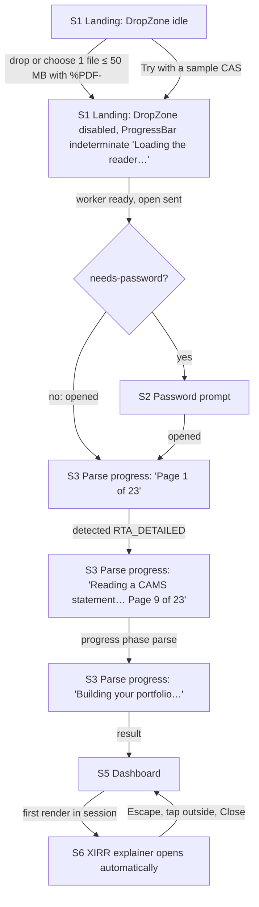
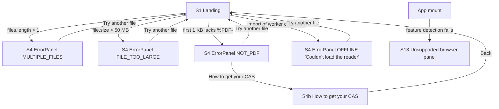
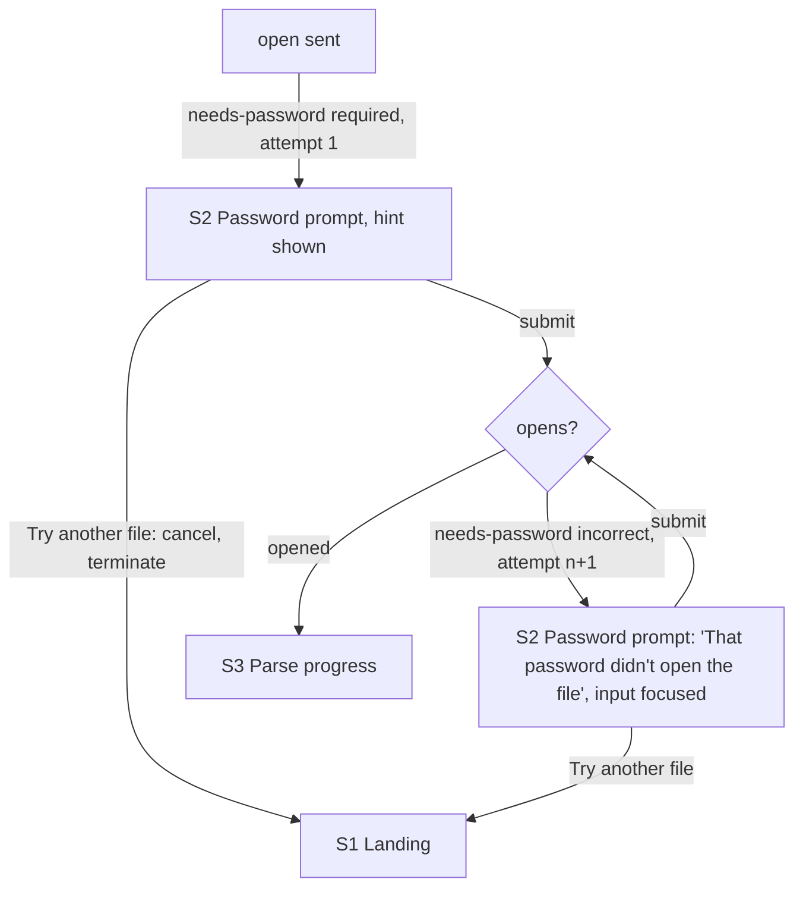
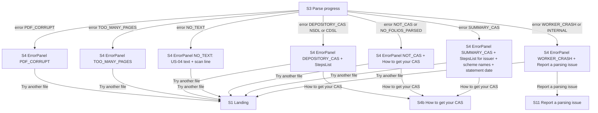
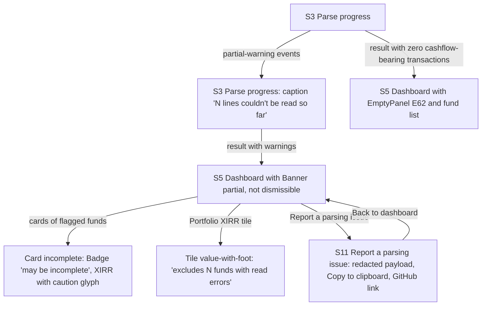
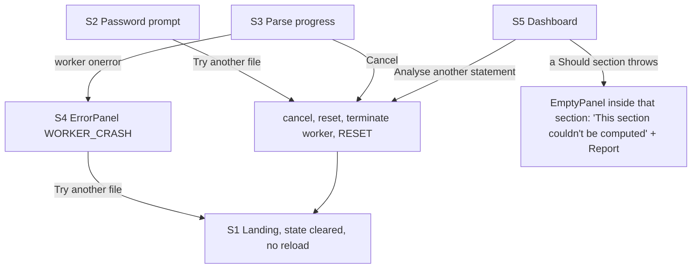
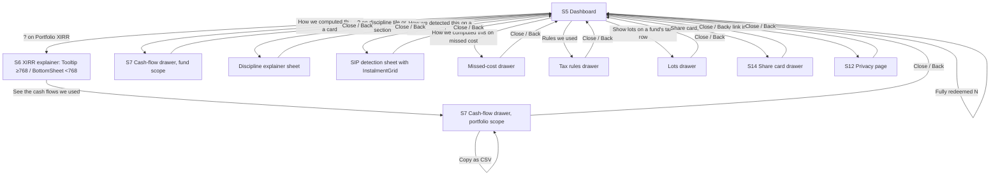

# SIP Lens v1.0 — UI design

Input: `00-spec.md` (approved by ajvelhal on 2026-10-26) and `01-system-design.md` (sections 3, 4, 6, 7, 8, 9 are authoritative for what may be shown and what triggers it).
Downstream reader: `ui-developer` (work packages F1, F2, F3). `backend-engineer` reads section 6 for label strings that `format.ts` and `useAnalysis` must produce.
Status: covers Must (US-01 to US-22) and Should (US-23 to US-34) in full; Could (US-35, US-36) specified so the kit is complete; US-37 has no UI beyond a privacy-page paragraph.

How to read this document: section 1 defines the only vocabulary used afterwards. Every screen in section 4 is a composition of section 1 components; every number named in section 4 is a field from `01-system-design.md` section 4 (the field is given in the component map); every action maps to a worker request, a reducer action or a pure UI toggle. Copy rules: sentence case everywhere; rupees with Indian grouping and no decimals outside the cash-flow drawer (`₹12,34,567`); dates as `30 Sep 2026`; XIRR to one decimal without sign (`13.2%`); gaps to one decimal with sign and unit (`+2.3 pp`); unknown as `—`; no emoji; no "current"; no advice or forecast language.

No visual mockup artifact was built: the ASCII layouts and component maps below are sufficient for the UI developer and a mockup would not add information the tokens do not already carry.

---

## 1. Design system

### 1.1 Principles

1. **Honest numbers first.** The number, its unit, its sign and its as-of date are one visual unit. Nothing is coloured without a text label that says the same thing.
2. **Calm by default.** Hairline borders, one accent, no gradients, no shadows on resting surfaces. The only loud elements are the data and the error panels.
3. **One system, two themes.** Every colour is a role token with a light and a dark value chosen separately (dark is not an inverted light). Components never reference a hex.
4. **Phone is the primary surface.** Every screen is laid out at 360 px first; 768 and 1024 px add columns, never new components.
5. **Nothing moves without a reason.** Motion is limited to the progress bar, the drawer and sheet transitions, and the ring fill on first render; all honour `prefers-reduced-motion`.

### 1.2 Colour tokens

Values are hex. "Light" is the default and the `[data-theme="light"]` value; "Dark" applies under `prefers-color-scheme: dark` when no theme is stored, and always under `[data-theme="dark"]`. Each token becomes a CSS custom property `--color-<token>` on `:root` and a Tailwind colour of the same name (`bg-surface`, `text-ink-2`, `border-border-strong`, `text-gain`, `fill-chart-equity`), so the developer pastes the table into `theme.extend.colors` as `name: 'var(--color-name)'`. Contrast ratios were computed with the WCAG 2.1 formula against the surfaces each token is allowed on (section 8.5 has the full matrix).

| Token | Role | Light | Dark | Allowed on | Contrast (light / dark) |
|---|---|---|---|---|---|
| `page` | Page background behind everything | `#f6f6f3` | `#111317` | — | — |
| `surface` | Tiles, cards, drawers, sheets, inputs | `#ffffff` | `#1a1d22` | `page` | decorative |
| `sunken` | Table headers, drawer headers, drop-zone fill, code box, skeletons | `#eeeeea` | `#22262c` | `surface`, `page` | decorative |
| `info-bg` | Information banners, sample ribbon, tooltip body | `#e8eefb` | `#1c2a45` | any | decorative |
| `caution-bg` | Caution banners, "may be incomplete" and "unverified" chips, partial and stale notes | `#fff3d1` | `#3a2d0e` | any | decorative |
| `gain-bg` | Gain chip background | `#e3f4ea` | `#10301f` | any | decorative |
| `loss-bg` | Loss chip background | `#fbe5e3` | `#3b1917` | any | decorative |
| `ink-1` | Headings, primary values | `#15181c` | `#f3f4f6` | all surfaces | ≥ 14.8 / ≥ 12.2 |
| `ink-2` | Body text, labels | `#444a53` | `#c2c7cf` | all surfaces | ≥ 7.4 / ≥ 7.9 |
| `ink-3` | Captions, as-of labels, footnotes, axis text, placeholders | `#5e6570` | `#9aa1ab` | all surfaces | ≥ 4.9 / ≥ 5.2 |
| `accent` | Primary button fill, links, focus ring, selected state, progress and ring fill, "your portfolio" chart series | `#1f4fb3` | `#7fb0ff` | all surfaces as text | ≥ 6.2 / ≥ 6.1 |
| `accent-ink` | Text on `accent` | `#ffffff` | `#0b1428` | `accent` | 7.43 / 8.35 |
| `accent-track` | Unfilled part of progress bar and ring meter | `#c9d7f5` | `#2c3d63` | `surface` | 5.14 / 4.89 vs `accent` fill |
| `gain` | Positive XIRR, "ahead", positive gain text and glyph. Never without a sign or a label | `#0f7a3b` | `#4fd07f` | all surfaces incl. `gain-bg` | ≥ 4.50 / ≥ 6.8 |
| `loss` | Negative XIRR, "behind", loss text and glyph. Never without a sign or a label | `#b4261f` | `#ff8378` | all surfaces incl. `loss-bg` | ≥ 5.38 / ≥ 5.6 |
| `caution` | Partial, unverified, stale, estimate, "may be incomplete", multiple-roots text and glyph | `#7a4e00` | `#f1c24f` | all surfaces incl. `caution-bg` | ≥ 5.97 / ≥ 8.0 |
| `border` | Hairline on cards, tiles, dividers, table rows (decorative) | `#c9ccc6` | `#3a3f47` | `surface`, `page` | 1.62 / 1.59 (decorative only) |
| `border-strong` | Input borders, drop-zone dashed border, focusable control outlines (needs 3:1) | `#6f757f` | `#8a9099` | `surface`, `page` | 4.28 / 5.25 |
| `overlay` | Scrim behind drawers and sheets | `rgba(21,24,28,0.5)` | `rgba(0,0,0,0.6)` | — | — |
| `chart-equity` | Allocation bucket Equity | `#2a78d6` | `#3987e5` | `surface` | 4.42 / 4.64 |
| `chart-hybrid` | Allocation bucket Hybrid | `#eb6834` | `#d95926` | `surface` | 3.20 / 4.35 |
| `chart-debt` | Allocation bucket Debt | `#1baf7a` | `#199e70` | `surface` | 2.82 (relief: labels) / 4.96 |
| `chart-other` | Allocation bucket Other | `#eda100` | `#c98500` | `surface` | 2.17 (relief: labels) / 5.50 |
| `chart-unclassified` | Allocation bucket Unclassified | `#8a8f98` | `#8a8f98` | `surface` | 3.25 / 5.20 |
| `chart-benchmark` | "Index fund" series in the comparison chart (neutral, so `accent` is the one emphasised series) | `#7a8089` | `#9aa1ab` | `surface` | 3.98 / 6.49 |
| `chart-grid` | Hairline gridlines and baseline | `#e1e0d9` | `#2c2f35` | `surface` | decorative |

Rules that go with the colour tokens:
- `gain`, `loss` and `caution` are text and glyph colours. They are never used as a fill larger than a chip, never used for a series, and never appear without a sign (`+`, `−`) or a word (`gain`, `loss`, `ahead`, `behind`, `estimate`, `partial`, `unverified`, `may be incomplete`) in the same element.
- Red and green appear nowhere else in the product: not in buttons, not in charts, not in the ring.
- The allocation palette is the first four slots of the dataviz reference palette in its validated order. Validator result: light, worst adjacent CVD ΔE 9.1, normal-vision 22.9, contrast warning on `chart-debt` and `chart-other`; dark, worst adjacent CVD ΔE 8.4, normal-vision 19.8, all slots ≥ 3:1. The light warning is relieved as the method requires: every segment has a visible label, segments are separated by a 2 px `surface` gap, a legend with swatches sits under the bar and the table view is always one tap away.
- Theme switching: `app/theme.ts` sets `data-theme` on `<html>`; the only stored value is `sip-lens.theme` ∈ {`system`, `light`, `dark`}. Charts read the CSS variables at render through the Tailwind classes on SVG (`fill-chart-equity`), so a theme switch repaints without re-running any calculation.

### 1.3 Typography

Font: the system stack from A11, `ui-sans-serif, system-ui, -apple-system, "Segoe UI", Roboto, "Noto Sans", sans-serif`. No webfont. `font-variant-numeric: tabular-nums` on every `num-*` style so rupee columns, tiles in a grid and sortable tables align; `lining-nums` everywhere. The rupee sign is always the `₹` glyph followed by no space.

| Style | Size / line (px) | Weight | Numerals | Used for |
|---|---|---|---|---|
| `display` | 40 / 44 (1024 px) · 32 / 36 (360 px) | 600 | tabular | Tile values; the error panel's one big line is not a display, it is `h1` |
| `h1` | 28 / 34 (1024 px) · 24 / 30 (360 px) | 600 | — | Page title on landing, error panel heading |
| `h2` | 22 / 28 | 600 | — | Dashboard section headings ("Your funds", "Allocation", "SIP discipline", "vs Nifty 50 index fund", "Tax preview") |
| `h3` | 18 / 24 | 600 | — | Card titles (scheme names), drawer titles, sheet titles |
| `body` | 16 / 24 | 400 | — | Paragraphs, helper text, banner text, hint under the password field |
| `body-strong` | 16 / 24 | 600 | — | Button labels, emphasised words inside body |
| `small` | 14 / 20 | 400 | — | Table body, legend, secondary labels, steps in help panels |
| `caption` | 12 / 16 | 400 | — | As-of labels, footnotes, badges, units when separated from the number |
| `num-xl` | 32 / 36 | 600 | tabular | Tile value at 360 and 768 px (same as `display` phone) |
| `num-lg` | 22 / 28 | 600 | tabular | Fund-card value and XIRR, comparison headline figures, tax total |
| `num-md` | 16 / 24 | 500 | tabular | Table cells with money, drawer rows |
| `num-sm` | 14 / 20 | 500 | tabular | Legend values, badge numbers, ring per-fund percentages |
| `mono` | 13 / 20 | 400 | — | `ui-monospace, SFMono-Regular, Menlo, monospace`; only the redacted report box |

Minimum rendered size is 12 px (`caption`) and it is only ever set in `ink-3` or stronger. Body text is never below 14 px. Headings are sentence case. Line length is capped at 68 characters on prose pages.

### 1.4 Spacing, radii, elevation, motion, breakpoints

| Group | Token | Value |
|---|---|---|
| Spacing (4 px base) | `s-1` … `s-16` | 4, 8, 12, 16, 20, 24, 32, 40, 48, 64 px (`s-1, s-2, s-3, s-4, s-5, s-6, s-8, s-10, s-12, s-16`) |
| Page gutter | `gutter` | 16 px at 360, 24 px at 768, 32 px at 1024; content max width 1120 px, centred |
| Grid | `gap` | 12 px at 360, 16 px at 768, 24 px at 1024 |
| Radii | `r-sm` | 6 px: badges, chips, inputs, small buttons |
| | `r-md` | 10 px: buttons, tiles, cards, banners, tooltip |
| | `r-lg` | 16 px: drop zone, drawer and sheet top corners, error panel |
| | `r-full` | 9999 px: ring, progress track, toggle |
| Elevation | `e-0` | No shadow; 1 px `border` hairline. Resting tiles, cards, banners |
| | `e-1` | `0 4px 16px rgba(21,24,28,0.12)` light / `0 4px 16px rgba(0,0,0,0.6)` dark; plus the surface steps up one level in dark (`surface` on `page`). Drawers, bottom sheets |
| | `e-2` | `0 8px 24px rgba(21,24,28,0.16)` light / `0 8px 24px rgba(0,0,0,0.7)` dark. Tooltip popover on desktop |
| Focus | `focus` | 2 px solid `accent` ring, 2 px offset in `page`; never removed; applies to every interactive element including the drop zone and chart legend buttons |
| Motion | `m-fast` | 120 ms ease-out: hover, badge appear |
| | `m-base` | 200 ms ease-out: drawer and sheet slide, tooltip fade |
| | `m-ring` | 600 ms ease-in-out once on first render of the ring; the progress bar animates width with `m-fast` per event |
| | reduced motion | `prefers-reduced-motion: reduce` sets every duration to 0 ms; the progress bar still updates |
| Breakpoints | `base` | 360 px design width; layout is fluid from 320 px |
| | `md` | 768 px |
| | `lg` | 1024 px |
| Tap target | `tap` | minimum 44 × 44 px for every control, including the "?" buttons and the sort control |
| Z-order | `z` | banner 10, sticky bar 20, overlay 30, drawer and sheet 40, tooltip 50, live region none (visually hidden) |

### 1.5 Component vocabulary

Every component lists its variants and the tokens it is allowed to use. A screen in section 4 names a component and a variant; nothing else is permitted. Where a component shows a number it receives an already formatted string from `lib/format.ts` plus the raw sign so it can pick `gain`/`loss`.

| # | Component | Variants | Anatomy, tokens and rules |
|---|---|---|---|
| 1 | **AppBar** | `landing`, `dashboard`, `page` | 56 px tall, `page` background, hairline bottom `border`. Left: wordmark "SIP Lens" in `h3` `ink-1`. Right (`dashboard`): Button `secondary` "Analyse another statement". Right (`page`): Link "Back". Sticky only on `dashboard`. |
| 2 | **Button** | `primary`, `secondary`, `ghost`, `sm` modifier | `primary`: `accent` fill, `accent-ink` text, `r-md`, 44 px tall, `body-strong`. `secondary`: `surface` fill, 1 px `border-strong`, `ink-1` text. `ghost`: no border, `accent` text, used inside banners and cards. `sm`: 36 px tall, `small` text, still a 44 px hit area via padding. No destructive variant exists; nothing in the product is destructive. |
| 3 | **Link** | `inline`, `standalone`, `external` | `accent` text, underline always on (not only on hover). `external` appends the words "(opens GitHub)" visually hidden and uses `rel="noopener noreferrer"`. No link carries a query string. |
| 4 | **DropZone** | `idle`, `drag-over`, `disabled` | `r-lg`, 2 px dashed `border-strong`, `sunken` fill, min height 200 px at 360 px and 260 px at 1024 px. Contains: document glyph (24 px, `ink-3`), `h3` "Drop your CAS PDF here", `body` `ink-2` "or", Button `primary` "Choose file", Link `standalone` "Try with a sample CAS". `drag-over`: border becomes solid `accent` and fill `info-bg`. `disabled` (while `loading-engine`): 60 % opacity, `aria-disabled`. The whole zone is a drop target; only the Button is focusable (the native `<input type="file" accept="application/pdf,.pdf">` is visually hidden and labelled by the button). |
| 5 | **PrivacyLine** | — | `small` `ink-2`, lock glyph 16 px `ink-3`, text "Parsed in your browser. Nothing is uploaded, nothing is stored." followed by Link `inline` "How we keep your data on your device". |
| 6 | **PasswordField** | `required`, `incorrect` | Label `small` `ink-2` "Password for this PDF"; input 44 px tall, `surface`, 1 px `border-strong`, `r-sm`, `type="password"`, `autocomplete="off"`, `autocapitalize="characters"` (PAN is capitals), `spellcheck="false"`; trailing Button `ghost` `sm` "Show" / "Hide" toggling `type` only. Helper `small` `ink-3` under the field. `incorrect`: helper replaced by error text `small` `loss` with a glyph, border `loss`, `aria-invalid`, `aria-describedby` points at the error, focus stays in the input. Submit Button `primary` "Open statement" beside or under the field. |
| 7 | **ProgressBar** | `determinate`, `indeterminate` | Track 8 px, `accent-track`, `r-full`; fill `accent`. `determinate` width = page / pageCount. `indeterminate` (phase `loading-engine` and the final `parse` phase): fill slides with a 1.2 s loop, or a static 100 % fill with the label "Building your portfolio…" under reduced motion. `role="progressbar"` with `aria-valuenow`, `aria-valuemin=0`, `aria-valuemax=pageCount`, `aria-valuetext="Page 7 of 23"`. |
| 8 | **Tile** (stat tile) | `value`, `value-with-foot`, `dash`, `ring` | `surface`, hairline `border`, `r-md`, padding `s-4` (360) / `s-5` (1024). Rows: label `small` `ink-2` with optional InfoButton; value `num-xl`/`display` `ink-1` (or `gain`/`loss` with sign and word for XIRR); unit inline with the value (`%`, `₹` prefix, `/100` suffix in `h3`); as-of `caption` `ink-3` "as of 30 Sep 2026"; optional footnote `caption` `caution` with glyph. `dash`: value is `—` in `ink-3` with a `caption` reason. `ring`: value replaced by RingMeter 96 px. |
| 9 | **InfoButton** | — | 44 px hit area around a 20 px circled "?" glyph, `ink-3`, `accent` on focus/hover. `aria-label="About <label>"`, `aria-expanded`, opens Tooltip (desktop) or BottomSheet (below 768 px). Enter/Space open, Escape closes. |
| 10 | **Tooltip** | `popover` (≥ 768 px), delegates to BottomSheet below | `surface`, `e-2`, `r-md`, max width 360 px, padding `s-4`, `body` `ink-2`, title `h3`. Dismiss: Escape, click outside, focus leaving. Focus moves into it on open and returns to the InfoButton on close. Contains at most one Link. |
| 11 | **BottomSheet** | `auto`, `half` | Full width, `surface`, `e-1`, `r-lg` top corners, drag handle 36 × 4 px `border-strong`, `overlay` scrim, body scrolls. Dismiss: tap scrim, swipe down, Escape, Button `ghost` "Close" at top right. `role="dialog"`, `aria-modal`, `aria-labelledby`; focus trapped; returns to the opener. |
| 12 | **Drawer** | `right` (≥ 1024 px, 480 px wide), `sheet` (below: full-height BottomSheet) | Header `sunken` with `h3` title and Button `ghost` "Close"; body scrolls; sticky footer for actions ("Copy as CSV"). Same dialog semantics as BottomSheet. |
| 13 | **Banner** | `info`, `caution`, `partial` | Full content width, `r-md`, padding `s-3` `s-4`, glyph 20 px + `body` text + optional Link/Button `ghost`. `info`: `info-bg`, `accent` glyph, `ink-1` text, dismissible with an "×" Button `ghost` (sample ribbon, multi-PAN, 60-day note). `caution`: `caution-bg`, `caution` glyph and bold lead, `ink-1` text, dismissible. `partial`: as `caution` but **not dismissible**, contains a list of scheme names and the Link "Report a parsing issue". `role="status"` for `info`, `role="alert"` for `caution` and `partial` on first mount. |
| 14 | **Badge** | `category`, `elss`, `caution`, `info`, `neutral`, `sample` | `caption` 600, `r-sm`, padding 2 px 8 px, 24 px tall. `category`: `sunken` fill, `ink-2` text, a 8 px swatch dot in the bucket's `chart-*` colour, text "Equity" / "Hybrid" / "Debt" / "Other" / "Unclassified". `elss`: `sunken`, text "ELSS". `caution`: `caution-bg` fill, `caution` text and glyph, e.g. "may be incomplete", "estimate", "partial", "unverified". `info`: `info-bg`, `accent` text, e.g. "realised", "fully redeemed". `neutral`: `sunken`, `ink-3`, e.g. "ignored". `sample`: `info-bg`, `accent`, text "Sample data", used in the sticky ribbon. |
| 15 | **Money** | `plain`, `signed`, `gain-loss` | Formatted rupee string in a `num-*` style. `signed` prefixes `+`/`−` (true minus). `gain-loss`: colour `gain`/`loss` by sign, followed by the word in `caption` ("gain"/"loss" or "ahead"/"behind" as the screen specifies). Zero is `ink-1` with no word. |
| 16 | **Percent** | `xirr`, `gap`, `share` | `xirr`: `13.2%`, `gain` with word "gain" when positive, `loss` with word "loss" when negative, `ink-1` when zero; `—` in `ink-3` with a reason `caption` when not ok; a `caution` glyph and Badge "check cash flows" when `warning: 'multiple-roots'`. `gap`: `+2.3 pp` / `−0.9 pp` with "ahead"/"behind". `share`: `42.0%` plain. |
| 17 | **Card** (fund card) | `default`, `incomplete`, `redeemed` | `surface`, hairline, `r-md`, padding `s-4`. Header: Badge `category` (+ `elss`), `h3` scheme name (two-line clamp with full name in `title`), `caption` `ink-3` folio numbers. Body: 2 × 2 grid of label/value pairs (`small` `ink-2` over `num-lg`/`num-md` `ink-1`). Footer: SIP line, "How we computed this" Link, badges. `incomplete`: Badge `caution` "may be incomplete" in header; XIRR shows a `caution` glyph. `redeemed`: collapsed inside the "Fully redeemed (N)" Disclosure; Badge `info` "realised". |
| 18 | **FundTable** (≥ 1024 px) | — | `surface`, hairline, `r-md`. Header row `sunken` `small` `ink-2` with sort buttons; rows 56 px, hairline dividers; money and percent cells right-aligned in `num-md`; scheme cell holds Badge `category` + name + folio `caption`. Same data and same badges as Card; the Card/Table switch is CSS only. |
| 19 | **SortControl** | — | Segmented control, three options "Value", "XIRR", "Name"; `surface`, 1 px `border-strong`, selected segment `accent` fill with `accent-ink`; `role="radiogroup"`. Sorting re-orders in memory only. |
| 20 | **StackedBar** (Recharts) | — | Allocation chart; full spec in section 4.5.5. Height 28 px bar, 2 px `surface` gaps, `r-sm` ends, legend below. |
| 21 | **RingMeter** (Recharts) | `tile` (96 px), `section` (160 px) | Discipline score; full spec in section 4.6. Fill `accent`, track `accent-track`, centre text `num-xl` `ink-1` with "/100" in `h3` `ink-2`. |
| 22 | **ColumnPair** (Recharts) | — | Two columns "Your portfolio" (`accent`) and "Index fund" (`chart-benchmark`), value on cap, legend. Section 4.7. |
| 23 | **Meter** | — | HTML bar 8 px, `accent-track` track, `accent` fill, `r-full`, value text `num-sm` to the right. Per-fund discipline percent. `role="meter"` with `aria-valuenow`. |
| 24 | **InstalmentGrid** | — | Grid of month chips (one per `expected` entry), 36 px min, `caption`: `made` = `sunken` fill, `ink-2`, glyph "✓"; `missed` = `caution-bg`, `caution`, glyph "×" and visually-hidden word "missed"; `stopped` = dotted `border` outline, `ink-3`, word "stopped". Label under the grid: "✓ made · × missed · ⋯ stopped". Glyphs are text characters, not emoji. |
| 25 | **DataTable** | `plain`, `striped` | Generic table for the cash-flow drawer, tax lots, rules, chart fallbacks. `small` header in `sunken`, `num-md` cells right-aligned for numbers, `caption` `ink-3` for row notes, horizontal scroll inside the drawer at 360 px with the first column sticky. |
| 26 | **Disclosure** | — | Button `ghost` with chevron and `aria-expanded`, reveals a region. Used for "Fully redeemed (N)", "Ignored rows (N)", "Show lots", "Rules we used" inside sections. |
| 27 | **DisclaimerBlock** | `long`, `short` | `long`: `sunken` fill, `r-md`, left 3 px rule in `caution`, `body` `ink-1`, the US-34 text verbatim; always rendered above the numbers it governs. `short`: `caption` `caution` with glyph, the owner's short form. |
| 28 | **StepsList** | `cams`, `kfintech`, `both` | Ordered list with numbered 24 px circles in `sunken`/`ink-2`, `small` text, menu items in `body-strong`, arrows as the "→" character. Used in the "How to get your CAS" panel and page. |
| 29 | **ErrorPanel** | one per `ParseErrorCode` (section 4.4) | `surface`, `r-lg`, 1 px `border`, max width 560 px, padding `s-6`; glyph 32 px `ink-3` (never red: an error here is a wrong file, not a failure of the user); `h1` message; `body` `ink-2` detail; optional detail list; Button `primary` "Try another file" (returns to landing); Link "How to get your CAS"; optional Button `secondary` "Report a parsing issue". `role="alert"`, focus moves to the heading on mount. |
| 30 | **EmptyPanel** | — | As ErrorPanel but inside the dashboard, `sunken` fill, no "Try another file"; used for E62 and for a Should section whose calculation threw (7.4). |
| 31 | **Skeleton** | — | `sunken` blocks with a 1.2 s shimmer (none under reduced motion); used for the allocation and Should sections for ≤ 300 ms while data chunks load. |
| 32 | **LiveRegion** | `polite`, `assertive` | Visually hidden `div` pair mounted once in `App`. `polite` receives progress every 10 % of pages or every second, whichever is less frequent, and dashboard-ready; `assertive` receives error headings and password feedback. |
| 33 | **ThemeSwitch** | — | Three-option SortControl variant in the footer: "System", "Light", "Dark"; the only control that writes to storage. |
| 34 | **Footer** | — | `caption` `ink-3`: "Open source · MIT · GitHub" (Link `external`), "Privacy" (Link), ThemeSwitch, app version. |
| 35 | **ShareCard** (Could) | `wide` 1200 × 630, `square` 1080 × 1080 | Canvas-rendered composition of Tile-like blocks; section 7. Preview shown inside a Drawer with two ToggleSwitches and two download Buttons. |
| 36 | **ToggleSwitch** (Could) | — | 44 × 24 px track `border-strong` off / `accent` on, `r-full`, label `small`. Only used in the ShareCard drawer. |

Glyphs are a small inline SVG set (document, lock, info, caution triangle, check, cross, chevron, copy, close, external, ring-dash); each is `aria-hidden` and always sits next to text.

---

## 2. User flows

Every node is a screen or panel from section 3; edge labels are the worker event, reducer action or user action from `01-system-design.md` sections 3.2 and 3.5.

### 2.1 Drop to dashboard (happy path)



### 2.2 Rejections on the main thread (no worker)



### 2.3 Password branch



### 2.4 Rejections decided in the worker



### 2.5 Partial parse and the report flow



### 2.6 Reset, cancel and crash



### 2.7 Dashboard interactions



---

## 3. Screen inventory

| ID | Screen or panel | `AppState.phase` or sub-state | Trigger | Built from |
|---|---|---|---|---|
| S1 | Landing | `landing` (and `loading-engine` as a sub-state of the same layout) | App mount; any "Try another file"; "Analyse another statement" | AppBar `landing`, DropZone, PrivacyLine, Link "How to get your CAS", Footer |
| S2 | Password prompt | `needs-password` | `needs-password` event (`reason: required` or `incorrect`) | AppBar, PasswordField, Button, Link, ProgressBar hidden |
| S3 | Parse progress | `parsing` | `opened`, then `progress` and `detected` events | AppBar, ProgressBar `determinate`/`indeterminate`, Button `secondary` "Cancel", caption for live warnings |
| S4 | Error panels (one per code) | `rejected` | `error` event, or main-thread rejection | ErrorPanel variant, StepsList where stated |
| S4b | How to get your CAS | `landing` with the help panel open (a Drawer below 1024 px, a right Drawer at 1024 px); also a standalone page reachable from the footer | Link "How to get your CAS" anywhere | Drawer, StepsList `both`, body text |
| S5 | Dashboard | `dashboard` | `result` event | AppBar `dashboard`, Banners, Tiles, StackedBar, SortControl, Card/FundTable, Disclosure, RingMeter, ColumnPair, DisclaimerBlock, DataTable, Footer |
| S5a | Dashboard empty state (E62) | `dashboard` with no cashflow-bearing transaction | `result` where every fund's series is empty | EmptyPanel + Card list |
| S6 | XIRR explainer | `dashboard`, tooltip open | Auto on first dashboard render per session; InfoButton on the Portfolio XIRR tile | Tooltip ≥ 768 px / BottomSheet below |
| S7 | Cash-flow drawer ("How we computed this") | `dashboard`, drawer open with `scope: portfolio` or `fund` | Link in S6, Link on each Card/FundTable row, Link on the comparison and tax sections | Drawer, DataTable, Disclosure "Ignored rows", Button "Copy as CSV" |
| S8 | SIP discipline section and its sheets | `dashboard` | `DisciplineResult` present | Tile `ring`, RingMeter `section`, Meter list, InstalmentGrid sheet, Missed-cost drawer |
| S9 | vs Nifty 50 index fund section | `dashboard` | `IndexComparisonResult` present | ColumnPair, Percent `gap`, Money `gain-loss`, Badge `caution`, DataTable per fund |
| S10 | Tax preview section and its drawers | `dashboard` | `TaxEstimateResult` present | DisclaimerBlock `long`, Tiles, DataTable, Disclosure, Drawer "Rules we used", Drawer "Lots" |
| S11 | Report a parsing issue | page over `dashboard` or `rejected` (state kept) | Link in Banner `partial`, Button in WORKER_CRASH/INTERNAL panels | AppBar `page`, body, `mono` box, Button "Copy to clipboard", Link `external` to the GitHub issue template |
| S12 | How we keep your data on your device (privacy page) | page over any state | PrivacyLine link, Footer link | AppBar `page`, prose, Links to source files |
| S13 | Unsupported browser | `unsupported-browser` | Feature detection at mount (A13, E47) | ErrorPanel variant without "Try another file" |
| S14 | Share card drawer (Could) | `dashboard`, drawer open | Button "Share card" in the dashboard header | Drawer, ShareCard preview, ToggleSwitch × 2, Button × 2 |

Banners that live inside S5 and have their own trigger: `partial` (any `severity: 'flag'` warning), `info` multi-PAN (`investorCount > 1`), `info` 60-day note (`today − statementDate > 60` days; E55/E56), `info` sample ribbon (`source: 'sample'`), `caution` statement-date fallback (`MISSING_STATEMENT_DATE`), `caution` benchmark stale (`carriedForwardDays > 0`), `caution` tax rules FY mismatch (`exactFy === false`).

---

## 4. Screen specs

Conventions for the ASCII layouts: the left frame is 360 px, the right frame is 1024 px; 768 px is described in words where it differs from either. `[ ]` is a Button, `< >` is a Link, `( )` is an InfoButton, `###` is a chart area. Every region in a layout appears in the component map beneath it with its component, variant, type style, colour token, spacing and the data field it shows.

### 4.1 S1 Landing

```
360 px                                     1024 px
┌──────────────────────────────────┐       ┌──────────────────────────────────────────────────────────────┐
│ SIP Lens                         │       │ SIP Lens                                                     │
├──────────────────────────────────┤       ├──────────────────────────────────────────────────────────────┤
│                                  │       │                                                              │
│ See your real SIP returns        │       │        See your real SIP returns                             │
│ Drop your CAMS or KFintech       │       │        Drop your CAMS or KFintech detailed CAS. Your XIRR,   │
│ detailed CAS. Your XIRR, the     │       │        the index comparison and a tax preview, computed      │
│ index comparison and a tax       │       │        in this tab.                                          │
│ preview, computed in this tab.   │       │                                                              │
│                                  │       │   ┌ ─ ─ ─ ─ ─ ─ ─ ─ ─ ─ ─ ─ ─ ─ ─ ─ ─ ─ ─ ─ ─ ─ ─ ─ ─ ─ ─ ┐   │
│ ┌ ─ ─ ─ ─ ─ ─ ─ ─ ─ ─ ─ ─ ─ ─ ┐  │       │                         [doc glyph]                          │
│         [doc glyph]              │       │   │             Drop your CAS PDF here                     │   │
│ │  Drop your CAS PDF here     │  │       │                              or                              │
│              or                  │       │   │                      [ Choose file ]                   │   │
│ │     [ Choose file ]         │  │       │                                                              │
│                                  │       │   │              < Try with a sample CAS >                 │   │
│ │  < Try with a sample CAS >  │  │       │   └ ─ ─ ─ ─ ─ ─ ─ ─ ─ ─ ─ ─ ─ ─ ─ ─ ─ ─ ─ ─ ─ ─ ─ ─ ─ ─ ─ ┘   │
│ └ ─ ─ ─ ─ ─ ─ ─ ─ ─ ─ ─ ─ ─ ─ ┘  │       │   lock Parsed in your browser. Nothing is uploaded, nothing  │
│ lock Parsed in your browser.     │       │   is stored. < How we keep your data on your device >        │
│ Nothing is uploaded, nothing is  │       │   < How to get your CAS >                                    │
│ stored. < How we keep your data  │       │                                                              │
│ on your device >                 │       │   What you get      How it works        Why trust it         │
│ < How to get your CAS >          │       │   (three short columns, body text)                           │
│ ────────────────────────────────  │       │                                                              │
│ What you get · How it works ·    │       ├──────────────────────────────────────────────────────────────┤
│ Why trust it (stacked)           │       │ Open source · MIT · GitHub   Privacy   System Light Dark v1.0│
├──────────────────────────────────┤       └──────────────────────────────────────────────────────────────┘
│ footer                           │
└──────────────────────────────────┘
```

At 360 px the AppBar, title, lead, the whole DropZone (glyph, heading, button, sample link) and the PrivacyLine fit in the first 640 px of height (iPhone SE class viewport), satisfying US-01's "visible without scrolling". The three explainer columns are below the fold on purpose. At 768 px the layout is the 1024 one with the three columns stacked two-plus-one.

| Region | Component / variant | Type | Colour | Spacing | Data / action |
|---|---|---|---|---|---|
| App bar | AppBar `landing` | `h3` | `ink-1` on `page` | 56 px, gutter | — |
| Title | heading | `h1` | `ink-1` | `s-8` top | static copy (section 6.1) |
| Lead | paragraph | `body` | `ink-2` | `s-2` below title, max 48 ch | static |
| Drop zone | DropZone `idle` → `drag-over` on `dragenter` → `disabled` during `loading-engine` | `h3` heading, `body` "or", `body-strong` button | `sunken` fill, `border-strong` dashed, `accent` on drag-over | `s-6` top; inner padding `s-6`; 200 px min height | Drop or pick → main-thread checks → `useCasParser().open(file)` |
| Choose file | Button `primary` inside DropZone | `body-strong` | `accent` / `accent-ink` | 44 px tall, min width 160 px | Opens the hidden `<input type="file">` |
| Sample link | Link `standalone` | `body` | `accent` | `s-4` under the button, 44 px hit area | `open(sample)` with `source: 'sample'` through the identical path |
| Loading state | ProgressBar `indeterminate` replaces the button row inside the zone, label `small` `ink-2` "Loading the reader…" | `small` | `accent` on `accent-track` | — | Visible during `loading-engine` (worker and pdfjs chunks); cold 4G can take 2.5 s, so it must not look frozen |
| Privacy line | PrivacyLine | `small` | `ink-2`, lock `ink-3` | `s-4` under zone | Link → S12 |
| Help link | Link `standalone` "How to get your CAS" | `small` | `accent` | `s-2` under privacy line | Opens S4b |
| Explainers | three headings `h3` + `small` paragraphs | `h3`, `small` | `ink-1`, `ink-2` | `s-10` top, `gap` between | static copy (section 6.1) |
| Footer | Footer | `caption` | `ink-3` | `s-12` top, `s-6` padding | ThemeSwitch is the only stateful control here |

Keyboard path: Tab order is wordmark (skipped, not focusable) → "Choose file" → "Try with a sample CAS" → privacy link → "How to get your CAS" → footer links → ThemeSwitch. Enter or Space on "Choose file" opens the picker. A screen reader hears the DropZone as a group labelled "Drop your CAS PDF here, or choose a file" because the zone has `role="group"` and `aria-labelledby` pointing at the heading; drag-and-drop is a convenience, the button is the accessible path.

### 4.2 S2 Password prompt

```
360 px                                     1024 px (same card, centred, max width 480 px)
┌──────────────────────────────────┐       ┌──────────────────────────────────────────────────────────────┐
│ SIP Lens                         │       │ SIP Lens                                                     │
├──────────────────────────────────┤       ├──────────────────────────────────────────────────────────────┤
│ [lock glyph]                     │       │               ┌──────────────────────────────┐               │
│ This PDF is password-protected   │       │               │ [lock]                       │               │
│                                  │       │               │ This PDF is password-protected│              │
│ Password for this PDF            │       │               │ Password for this PDF        │               │
│ ┌────────────────────┐ [Show]    │       │               │ ┌──────────────┐ [Show]      │               │
│ │••••••••••          │           │       │               │ │••••••••••    │             │               │
│ └────────────────────┘           │       │               │ └──────────────┘             │               │
│ CAS PDFs are usually protected   │       │               │ CAS PDFs are usually…        │               │
│ with your PAN (in capitals) or   │       │               │ [ Open statement ]           │               │
│ the password you chose when      │       │               │ < Try another file >         │               │
│ requesting the statement.        │       │               │ lock It is checked in this   │               │
│                                  │       │               │ tab and never stored.        │               │
│ [      Open statement        ]   │       │               └──────────────────────────────┘               │
│ < Try another file >             │       └──────────────────────────────────────────────────────────────┘
│ lock It is checked in this tab   │
│ and never stored.                │
└──────────────────────────────────┘
```

| Region | Component / variant | Type | Colour | Spacing | Data / action |
|---|---|---|---|---|---|
| Card | `surface`, hairline, `r-lg` | — | — | padding `s-6`; `s-8` from AppBar | — |
| Heading | `h2` | `h2` | `ink-1` | `s-3` under glyph | static; `reason: 'required'` |
| Field | PasswordField `required` | `small` label, `body` input | `border-strong` | `s-5` under heading; input full width minus the Show button | Value held only in component state; cleared to `''` on submit |
| Hint | PasswordField helper | `small` | `ink-3` | `s-2` under input | US-03 text verbatim |
| Wrong password | PasswordField `incorrect` | `small` | `loss` text + cross glyph; border `loss` | replaces hint | `reason: 'incorrect'`: "That password didn't open the file"; input keeps focus and its text is selected for retyping; attempt counter is not shown (no limit, no shame) |
| Submit | Button `primary` "Open statement" | `body-strong` | `accent` | `s-5` under field, full width at 360 px | Sends `password{requestId, pw}`; button shows a 16 px inline spinner and the label "Opening…" until `opened` or the next `needs-password` |
| Try another file | Link `standalone` | `small` | `accent` | `s-4` under button | `cancel` → terminate → S1 |
| Reassurance | PrivacyLine variant text | `caption` | `ink-3` | `s-6` under link | static |

Focus lands in the input on mount. Enter submits. The Show/Hide button toggles `type` and has `aria-pressed`. LiveRegion `assertive` announces "That password didn't open the file" on each incorrect attempt.

### 4.3 S3 Parse progress

```
360 px                                     1024 px (same, centred, max width 560 px)
┌──────────────────────────────────┐
│ SIP Lens                         │
├──────────────────────────────────┤
│                                  │
│ Reading your statement           │
│ Reading a CAMS statement…        │  ← appears after `detected`
│ ████████████░░░░░░░░░░░░░░░░░░   │
│ Page 9 of 23                     │
│ 2 lines couldn't be read so far  │  ← only if partial-warning events arrived
│                                  │
│ [ Cancel ]                       │
│ lock Nothing leaves this tab.    │
└──────────────────────────────────┘
```

| Region | Component / variant | Type | Colour | Spacing | Data / action |
|---|---|---|---|---|---|
| Heading | `h2` "Reading your statement" | `h2` | `ink-1` | `s-8` top | static |
| Sub-line | `body` | `body` | `ink-2` | `s-1` | before `detected`: "Opening the PDF…"; after `detected`: "Reading a CAMS statement…" / "Reading a KFintech statement…" from `documentType` + `issuer` (RTA name from the detected event; issuer unknown until page 1 → "Reading your statement…") |
| Bar | ProgressBar `determinate` during `extract`; `indeterminate` during `parse` | — | `accent` / `accent-track` | `s-4` top, full width | `page / pageCount` |
| Page label | `small` | `small` | `ink-2` | `s-2` | "Page 9 of 23" (US-07); during `parse`: "Building your portfolio…" |
| Live warnings | `caption` with caution glyph | `caption` | `caution` | `s-2` | count of `partial-warning` events deduped by `id`: "1 line couldn't be read so far" / "N lines couldn't be read so far" |
| Cancel | Button `secondary` "Cancel" | `body-strong` | `ink-1` | `s-6` top | `cancel` → terminate → S1 |
| Reassurance | `caption` | `caption` | `ink-3` | `s-4` | static |

Live region: `polite` receives "Page 9 of 23" at most once per second, then "Building your portfolio", then "Your dashboard is ready" when S5 mounts. The bar reaches 100 % only on `result` (protocol note on `phase: 'parse'`). If no `progress` event arrives for 400 ms the bar keeps its width; nothing pulses faster than once per second.

### 4.4 S4 Error panels

One ErrorPanel per `ParseErrorCode`, all sharing the anatomy in component 29. Layout:

```
360 px                                     1024 px (centred card, max width 560 px)
┌──────────────────────────────────┐
│ SIP Lens                         │
├──────────────────────────────────┤
│ [glyph]                          │
│ <h1 message>                     │
│ <body detail>                    │
│ <optional list / steps>          │
│ [    Try another file        ]   │
│ < How to get your CAS >          │
│ < Report a parsing issue >       │  ← only where stated
└──────────────────────────────────┘
```

| Code | Heading (`h1`, `ink-1`) | Detail (`body`, `ink-2`) and extra regions | Actions |
|---|---|---|---|
| `NOT_PDF` | That's not a PDF. SIP Lens reads the CAS PDF from CAMS or KFintech. | "The file you dropped doesn't have PDF contents, whatever its name ends in." | Button "Try another file"; Link "How to get your CAS" |
| `MULTIPLE_FILES` | One statement at a time, please | "Drop one CAS PDF. To look at a second statement afterwards, use Analyse another statement." Nothing was parsed, so no detail list. | Button "Try another file" |
| `FILE_TOO_LARGE` | This file is too large to read here | "It is {sizeMB} MB; SIP Lens reads files up to 50 MB. A detailed CAS is normally well under 5 MB." `sizeBytes`/`limitBytes` from the error, MB to one decimal. | Button "Try another file"; Link "How to get your CAS" |
| `PDF_CORRUPT` | This PDF seems damaged or incomplete. Re-download it from the CAMS/KFintech email and try again. | none | Button "Try another file" |
| `TOO_MANY_PAGES` | This statement is longer than SIP Lens can read | "It has more than 400 pages. Request a CAS for a shorter period, or one per PAN." | Button "Try another file"; Link "How to get your CAS" |
| `NO_TEXT` | This doesn't look like a CAMS or KFintech CAS | "This PDF has no selectable text, so it is probably a scan or a photo. SIP Lens needs the original PDF from CAMS or KFintech." then the StepsList `both` under the heading "How to get your CAS" | Button "Try another file" |
| `NOT_CAS`, `NO_FOLIOS_PARSED` | This doesn't look like a CAMS or KFintech CAS | "It opened, but it has none of the markers of a consolidated account statement. If this is the monthly statement from your email, it is probably the NSDL or CDSL one." then StepsList `both` under "How to get your CAS" | Button "Try another file" |
| `SUMMARY_CAS` | This is a summary CAS. It shows what you hold but not your transactions, so XIRR can't be computed. Request the **detailed** statement instead: | StepsList `cams` or `kfintech` chosen by `issuer`, then a `sunken` box titled `small` "What we did read" listing `schemeNames` (each `small` `ink-1`, Badge `neutral` count) and "Statement date: {statementDate}" or "Statement date: not found". No XIRR, no value, no units anywhere on this panel. | Button "Try another file" |
| `DEPOSITORY_CAS` | This is the NSDL/CDSL depository statement. It lists holdings, not mutual fund transactions. SIP Lens needs the CAMS/KFintech detailed CAS. | `caption` `ink-3` "Detected: {depository} statement" then StepsList `both`. Nothing else from the file. | Button "Try another file" |
| `WORKER_CRASH`, `INTERNAL` | Something went wrong while reading the file | "The reader stopped before it finished. Nothing was sent anywhere. If this keeps happening, a statement covering a shorter period is lighter to read, and a redacted report helps us fix it." For `INTERNAL` the `stage` is appended in `caption`: "Stage: parse · RangeError". | Button "Try another file"; Button `secondary` "Report a parsing issue" → S11 |
| `OFFLINE` (client import failed, 7.3) | Couldn't load the reader (are you offline?) | "The part of SIP Lens that reads PDFs hadn't been downloaded yet. Reconnect and try again; after one successful load it stays in your browser cache." | Button "Try again" (re-runs the import with the same `File`), Button `secondary` "Try another file" |
| `CANCELLED` | no panel | returns to S1 silently | — |
| `UNSUPPORTED_BROWSER` (S13) | This browser can't run SIP Lens | "SIP Lens needs Chrome or Edge 100, Firefox 100, or Safari 15.4 and newer, because it reads the PDF inside a web worker on your device. Nothing is sent to a server in any browser." No file controls are rendered. | Link "Why these versions" → S12 anchor |

Glyph per family: document for `NOT_PDF`, `MULTIPLE_FILES`, `FILE_TOO_LARGE`, `PDF_CORRUPT`, `TOO_MANY_PAGES`; document-with-magnifier for `NO_TEXT`, `NOT_CAS`, `SUMMARY_CAS`, `DEPOSITORY_CAS`; caution triangle (`ink-3`, not `caution`) for `WORKER_CRASH`, `INTERNAL`, `OFFLINE`, `UNSUPPORTED_BROWSER`. Focus moves to the heading on mount (`tabindex="-1"`), LiveRegion `assertive` reads the heading. "Try another file" is the first Button in DOM order after the content.

#### S4b How to get your CAS (help panel and page)

Opens as a Drawer (`sheet` below 1024 px, `right` at 1024 px) from any "How to get your CAS" link, and is also the page `/how-to-get-your-cas` from the footer. Content, in order:

1. `h2` "How to get your CAS"
2. `body` "SIP Lens reads the **detailed** consolidated account statement from CAMS or KFintech. It lists every transaction in every folio. The monthly statement most people get by email is the NSDL or CDSL one, which lists holdings and doesn't work here."
3. `h3` "From CAMS" + StepsList `cams`:
   1. Go to **camsonline.com** → **Investor Services** → **CAS – CAMS+KFintech**
   2. Statement type: **Detailed**
   3. Period: **Since inception**
   4. Choose a password you will remember; the PDF arrives by email, usually within an hour
4. `h3` "From KFintech" + StepsList `kfintech`:
   1. Go to **mfs.kfintech.com** → **Investor services** → **Consolidated account statement**
   2. Statement type: **Detailed**
   3. Period: **Since inception**
   4. Choose a password; the PDF arrives by email
5. `small` `ink-3` "Since 2023 one request from either RTA can include folios serviced by both, so one file is usually enough. If you have folios the first file misses, request from the other RTA and analyse it as a second statement."
6. `small` `ink-3` "Opening the PDF: the password is usually your PAN in capitals, or the one you chose."
7. Button `secondary` "Close" (drawer) or Link "Back" (page).

The KFintech menu labels are recorded as an assumption (section 9.1).

### 4.5 S5 Dashboard

#### 4.5.1 Overall layout

```
360 px                                      1024 px
┌──────────────────────────────────┐        ┌──────────────────────────────────────────────────────────────────┐
│ SIP Lens   [Analyse another st.] │ sticky │ SIP Lens                 Statement date: 30 Sep 2026 ·           │
├──────────────────────────────────┤        │                          Period: 1 Apr 2015 – 30 Sep 2026        │
│ Sample data ribbon (if sample)   │        │                                    [Analyse another statement]   │
│ Statement date: 30 Sep 2026      │        ├──────────────────────────────────────────────────────────────────┤
│ Period: 1 Apr 2015 – 30 Sep 2026 │        │ Banners (partial · multi-PAN · 60-day · sample) full width       │
│ ┌ Banner partial (if any) ─────┐ │        │ ┌────────────┐ ┌────────────┐ ┌────────────┐ ┌────────────┐      │
│ │ We couldn't read 2 lines in  │ │        │ │Portfolio   │ │Total       │ │Value as of │ │SIP discipl.│      │
│ │ 2 folios. …                  │ │        │ │XIRR (?)    │ │invested    │ │statement d.│ │score  (?)  │      │
│ └──────────────────────────────┘ │        │ │13.2% gain  │ │₹18,40,000  │ │₹24,12,345  │ │  ◯ 91/100  │      │
│ ┌─────────────┐ ┌─────────────┐  │        │ │as of 30 Sep│ │as of 30 Sep│ │as of 30 Sep│ │as of 30 Sep│      │
│ │Portfolio    │ │Total        │  │        │ └────────────┘ └────────────┘ └────────────┘ └────────────┘      │
│ │XIRR     (?) │ │invested     │  │        │ Allocation                                       as of 30 Sep    │
│ │13.2%        │ │₹18,40,000   │  │        │ ████████████████████████▌██████▌████▌██▌                         │
│ │gain         │ │             │  │        │ ● Equity ₹15,60,000 64.7% ● Hybrid … ● Debt … ● Other … ● Uncl. │
│ │as of 30 Sep │ │as of 30 Sep │  │        ├──────────────────────────────────────────────────────────────────┤
│ └─────────────┘ └─────────────┘  │        │ Your funds (9)                    Sort: [Value] [XIRR] [Name]    │
│ ┌─────────────┐ ┌─────────────┐  │        │ ┌──────────────────────────────────────────────────────────────┐ │
│ │Value as of  │ │SIP          │  │        │ │ Fund            Net invested  Value   XIRR   SIP      How    │ │
│ │statement d. │ │discipline(?)│  │        │ │ ● Equity  Parag Parikh Flexi Cap – Direct – Growth           │ │
│ │₹24,12,345   │ │   ◯ 91/100  │  │        │ │   Folio 1234567/12   ₹4,80,000  ₹7,12,340  15.1% gain  …    │ │
│ │as of 30 Sep │ │as of 30 Sep │  │        │ └──────────────────────────────────────────────────────────────┘ │
│ └─────────────┘ └─────────────┘  │        │ ▸ Fully redeemed (1)                                             │
│ Allocation          as of 30 Sep │        ├──────────────────────────────────────────────────────────────────┤
│ ████████████▌████▌██▌█▌          │        │ SIP discipline                 │ vs Nifty 50 index fund          │
│ ● Equity  ₹15,60,000  64.7%      │        │ (ring, breakdown, missed cost) │ (ColumnPair, gap, assumptions)  │
│ ● Hybrid  ₹3,20,000   13.3%      │        ├──────────────────────────────────────────────────────────────────┤
│ ● Debt    ₹2,90,000   12.0%      │        │ Tax preview · FY 2026-27 rules · last verified 12 Oct 2026       │
│ ● Other   ₹1,42,345    5.9%      │        │ (disclaimer, tiles, per-fund table, rules drawer)                │
│ ● Unclassified ₹1,00,000 4.1%    │        ├──────────────────────────────────────────────────────────────────┤
│ 1 fund unclassified; <tell us…>  │        │ footer                                                           │
│ Your funds (9)                   │        └──────────────────────────────────────────────────────────────────┘
│ Sort: [Value] [XIRR] [Name]      │
│ ┌──────────────────────────────┐ │
│ │ ● Equity          ELSS       │ │
│ │ Parag Parikh Flexi Cap –     │ │
│ │ Direct Plan – Growth         │ │
│ │ Folio 1234567/12             │ │
│ │ Net invested   Value         │ │
│ │ ₹4,80,000      ₹7,12,340     │ │
│ │ XIRR           Units held    │ │
│ │ 15.1% gain     1,234.567     │ │
│ │ SIP ₹5,000 monthly since     │ │
│ │ Mar 2021 (?)                 │ │
│ │ < How we computed this >     │ │
│ └──────────────────────────────┘ │
│ … more cards …                   │
│ ▸ Fully redeemed (1)             │
│ SIP discipline (section)         │
│ vs Nifty 50 index fund (section) │
│ Tax preview (section)            │
│ footer                           │
└──────────────────────────────────┘
```

Section order top to bottom is fixed: header, banners, tiles, allocation, funds, discipline, index comparison, tax, footer. At 768 px: tiles 2 × 2, allocation full width, fund cards in two columns, discipline and index comparison stacked full width, tax full width. At 1024 px: tiles 1 × 4, fund list becomes FundTable, discipline and index comparison side by side (each 50 % minus half the gap), tax full width. The sticky AppBar on phone shrinks the "Analyse another statement" button to Button `secondary` `sm` with the same label (no abbreviation in production; the ASCII truncates for width only).

#### 4.5.2 Header

| Region | Component / variant | Type | Colour | Data |
|---|---|---|---|---|
| Greeting (optional) | `body` | `body` | `ink-2` | "Hello, {investorName}" only when `Portfolio.investorName` exists and `source === 'user'`; never on the sample, never anywhere else |
| Statement line | `small` | `small` | `ink-2`, dates `ink-1` | "Statement date: {statementDate} · Period: {statementPeriod.from} – {statementPeriod.to}" (US-15). When `MISSING_STATEMENT_DATE`: "As of {date} (latest transaction; statement date not found)" with a Badge `caution` "date inferred" |
| Fund count | `caption` | `caption` | `ink-3` | "{funds.length} funds · {folios} folios · {pageCount} pages read" from `ParseResult.stats` |
| Analyse another statement | Button `secondary` | `body-strong` | `ink-1` on `surface` | `reset()` → S1 (US-22). No confirmation dialog: nothing is lost that cannot be re-dropped |
| Share card (Could) | Button `secondary` beside it | — | — | Opens S14; hidden until US-35 ships |

#### 4.5.3 Banners (in this order when several apply)

| Banner | Variant | Copy | Data / dismissal |
|---|---|---|---|
| Sample ribbon | `info` with Badge `sample` | "Sample data. This is a synthetic statement so you can see what SIP Lens shows. Drop your own CAS to see your numbers." | `source === 'sample'`; dismissible; the Badge "Sample data" also sits in the sticky AppBar so it never scrolls away (US-11) |
| Partial parse | `partial` (not dismissible) | "We couldn't read {N} lines in {M} folios. Numbers for those funds may be incomplete." then `small` list of affected `schemeName`s (deduped, from warnings with `severity: 'flag'`), then Link "Report a parsing issue" | N = count of flag warnings with a `rowIndex` (`UNCLASSIFIED_ROW`, `UNIT_MISMATCH`, `COLUMN_DRIFT`, `ORPHAN_REVERSAL`, `FUTURE_DATED_ROW`); M = distinct `folioNumber`s among flag warnings. Pluralisation: "1 line in 1 folio", "1 line in 2 folios", "3 lines in 1 folio". Warnings without a row (`NO_CLOSING_BALANCE`, `PAGE_EXTRACT_FAILED`) add a second sentence: "{K} sections ended without a closing balance" / "{P} pages couldn't be read at all" |
| Multi-PAN | `info` | "This statement covers {investorCount} investors; numbers are combined." | `investorCount > 1` (A3); dismissible |
| Stale statement | `info` | "This statement is {N} days old. Request a fresh CAS for today's picture." + Link "How to get your CAS" | `today − statementDate > 60` days (E55); never shown when the statement date is in the future (E56); dismissible |
| Statement date inferred | `caution` | "We couldn't find the statement date, so every number is as of {date}, the latest transaction in the file." | `MISSING_STATEMENT_DATE`; dismissible |

#### 4.5.4 Summary tiles (US-12)

Grid: 2 × 2 at 360 and 768 px (`gap`), 1 × 4 at 1024 px. Each Tile is 160 px tall minimum at 360 px so the four read as equals.

| Tile | Variant | Label (`small` `ink-2`) | Value | As-of and footnotes | Data fields |
|---|---|---|---|---|---|
| 1 Portfolio XIRR | `value-with-foot` | "Portfolio XIRR" + InfoButton (opens S6) | Percent `xirr`: `13.2%` `num-xl`/`display` in `gain` with the word "gain" in `caption` beneath; negative in `loss` with "loss"; `—` state per US-14 | "as of 30 Sep 2026"; footnote `caption` `caution` "excludes {n} funds with read errors" when `skippedFundIds.length > 0`; Badge `caution` "check cash flows" when `warning: 'multiple-roots'` | `Analysis.portfolioXirr: XirrResult`, `buildCashflows(...).skippedFundIds` |
| 2 Total invested | `value` or `value-with-foot` | "Total invested" | Money `plain` `₹18,40,000` | "as of 30 Sep 2026"; same read-error footnote as tile 1 (A23) | `CashflowSeries.totals.invested` of the portfolio series |
| 3 Value as of statement date | `value-with-foot` | "Value as of statement date" | Money `plain` `₹24,12,345` | "as of 30 Sep 2026"; footnote "{n} funds without a printed value excluded" when applicable | `Σ Fund.closingValue` (A23) |
| 4 SIP discipline score | `ring` or `dash` | "SIP discipline score" + InfoButton (opens the discipline explainer) | RingMeter `tile` 96 px with `91` `num-xl` and "/100" `h3`; `dash` shows `—` | "as of 30 Sep 2026"; `dash` reason `caption`: "No regular SIP found in this statement" (score `null`) or "Coming in a later release" (US-25 not shipped, the Must-only build) | `DisciplineResult.score` |

Tile value styles: `num-xl` at 360 and 768 px, `display` at 1024 px. Units: the `%` is part of the value string; `₹` is the prefix in the same style; "/100" is `h3` `ink-2`. A `—` value is `ink-3` and its reason sits where the "gain"/"loss" word would. Tile 1's `—` reasons: `insufficient` → "Not enough history to compute XIRR"; `no-convergence` → "Couldn't compute; see cash flows" with the words "see cash flows" as a Link into S7.

#### 4.5.5 Allocation (US-18) — Recharts spec

Form: part-to-whole with ≤ 5 classes → horizontal **stacked bar**, one row, with a legend table under it. A donut was rejected: at 360 px it costs 200 px of height for five slices and the smallest slice becomes unlabelable.

| Item | Specification |
|---|---|
| Container | `ResponsiveContainer` width 100 %, height 44 px (28 px bar + padding) |
| Chart | `BarChart` `layout="vertical"`, `data=[{ name: 'Allocation', Equity, Hybrid, Debt, Other, Unclassified }]` with rupee values; `margin` 0; `barCategoryGap` 0 |
| Axes | `XAxis type="number" hide domain={[0, total]}`; `YAxis type="category" dataKey="name" hide`. No ticks, no grid: the legend carries the numbers |
| Series | Five `Bar`s with `stackId="a"`, `dataKey` per bucket in the fixed order Equity, Hybrid, Debt, Other, Unclassified; `fill` via class `fill-chart-equity` etc. (CSS variables, so the theme switch repaints); `stroke` = `surface`, `strokeWidth` 2 for the 2 px surface gap; `radius` `[6,0,0,6]` on the first visible bucket and `[0,6,6,0]` on the last (compute from which buckets are non-zero); `isAnimationActive={false}` under reduced motion, else 300 ms once |
| Labels on the bar | None inside the bar (a 5.9 % segment is too narrow at 360 px); the legend is the label layer and is always visible, which is the relief for the two light-mode slots under 3:1 |
| Legend | Not Recharts `Legend`; a DataTable `plain` with no header: swatch (10 px square, `r-sm`, bucket colour) · bucket name `small` `ink-1` · Money `plain` `num-sm` · Percent `share` `num-sm` `ink-2`. Rows for zero-value buckets are omitted |
| Tooltip | Recharts `Tooltip` on hover/focus of a segment: `surface`, `e-2`, shows "Equity · ₹15,60,000 · 64.7%" in `small`. Cursor fill `sunken` |
| Unclassified note | `caption` `ink-3` under the legend when `unclassifiedCount > 0`: "{n} funds unclassified; <tell us the ISIN on GitHub>" (Link `external` to the issue template). Singular "1 fund unclassified" |
| As-of | Section heading row right side `caption` `ink-3` "as of 30 Sep 2026" |
| Screen-reader summary | The SVG has `role="img"` and `aria-label` = "Allocation by value as of 30 Sep 2026: Equity ₹15,60,000, 64.7%; Hybrid ₹3,20,000, 13.3%; Debt ₹2,90,000, 12.0%; Other ₹1,42,345, 5.9%; Unclassified ₹1,00,000, 4.1%." (zero buckets omitted) |
| Fallback table | The legend DataTable is the fallback table (same numbers, real `<table>` markup with `<caption>` "Allocation by value as of 30 Sep 2026" visually hidden) |
| Data | `AllocationResult.buckets[]` (`category`, `value`, `percent`), `unclassifiedCount`, `total`, `asOf` |
| Skeleton | Skeleton bar + three rows for ≤ 300 ms while `isinCategory` loads |

#### 4.5.6 Fund list (US-13)

Heading row: `h2` "Your funds ({n})" where n counts funds with `closingUnits > 0`; right side SortControl ("Value", "XIRR", "Name"); default Value descending. Sorting with XIRR puts `—` results last. The fully redeemed funds (E25) sit in a Disclosure "Fully redeemed ({k})" after the list, collapsed by default.

Card at 360 and 768 px (two columns at 768 px):

| Region | Component / variant | Type | Colour | Data |
|---|---|---|---|---|
| Badges row | Badge `category` (+ Badge `elss` when `isElss`) (+ Badge `caution` "may be incomplete" when `mayBeIncomplete`) | `caption` | per bucket | `categoryOf(fund.isin)` |
| Scheme name | `h3`, two-line clamp, full name in `title` and visually hidden | `h3` | `ink-1` | `Fund.schemeName`; when E26 applies, `caption` `ink-3` "also printed as: {old name}" |
| Folios | `caption` | `caption` | `ink-3` | "Folio {folioNumber}" or "Folios {a}, {b}" from `Fund.folios[]` |
| Net invested | label `small` `ink-2` + Money `plain` `num-lg` | — | `ink-1` | `Σ outflows − Σ inflows` of the fund series (4.4); label "Net invested" |
| Value | label "Value as of statement date" (wraps to two lines at 360 px) + Money `num-lg` | — | `ink-1` | `Fund.closingValue`; `—` with `caption` "not printed in the CAS" when undefined |
| XIRR | label "XIRR" + Percent `xirr` `num-lg` with "gain"/"loss" word | — | `gain`/`loss`/`ink-3` | `Analysis.fundXirr[fund.id]`; `—` reasons as tile 1; E43 reason: "statement doesn't start at inception" with the Link "request a since-inception CAS" → S4b; caution glyph when `mayBeIncomplete` or `multiple-roots` |
| Units held | label "Units held" + `num-md` | — | `ink-1` | `Fund.closingUnits` at printed precision (3 or 4 dp) |
| SIP line | `small` `ink-2` + InfoButton "How we detected this" | `small` | — | "SIP ₹5,000 monthly since Mar 2021" from `DetectedSip` (`amounts[last].amount`, `frequency`, `firstDate` as "Mon YYYY"); step-ups: "SIP ₹6,000 monthly since Mar 2021 (₹5,000 until Feb 2024)"; stopped: "SIP ₹5,000 monthly, Mar 2021 – Jun 2025 (stopped)"; omitted when no SIP |
| How we computed this | Link `inline` | `small` | `accent` | Opens S7 with `scope: 'fund'` |
| As-of | `caption` | `caption` | `ink-3` | "as of 30 Sep 2026" bottom right |

FundTable at 1024 px, columns in order: Fund (badge, name, folios) · Net invested · Value as of statement date · Units held · XIRR · SIP · How we computed this (Link). Header cells are sort buttons for Value, XIRR and Name (the SortControl is hidden at 1024 px because the header does the job; `aria-sort` set on the active column). Row height 56 px minimum, two-line names allowed. The "may be incomplete" Badge appears under the name.

#### 4.5.7 Dashboard empty state (E62)

When no fund has a cashflow-bearing transaction: the tiles render with `—` (reason "No transactions to compute from"), the allocation renders from printed values if present, and an EmptyPanel replaces the fund list heading area: `h3` "We found {n} funds but no transactions we can compute returns from", `body` "Every row in this statement was a reversal, a unit adjustment or a row we couldn't classify. The funds are listed below so you can check the file was read." followed by the Card list (values present, XIRR `—`) and the Link "Report a parsing issue". There is never a "0 funds" screen (US-04); zero funds is `NOT_CAS` upstream.

### 4.6 S6 XIRR explainer (US-16)

Opens automatically once per session on the first S5 mount (a module-level boolean in `hooks`, not storage), anchored to tile 1's InfoButton; afterwards on demand. Tooltip `popover` at ≥ 768 px (anchored below the tile, arrow pointing at the "?"); BottomSheet `auto` below 768 px.

```
360 px BottomSheet                           768+ px Tooltip (max width 360 px)
┌──────────────────────────────────┐        ┌────────────────────────────────────┐
│ ══                       [Close] │        │ What XIRR means                    │
│ What XIRR means                  │        │ XIRR is the yearly rate that makes │
│ XIRR is the yearly rate that     │        │ all your investments, with their   │
│ makes all your investments, with │        │ dates, grow to today's value; here │
│ their dates, grow to today's     │        │ that is the value as of 30 Sep 2026│
│ value; here that is the value as │        │ The "absolute return" in your app… │
│ of 30 Sep 2026.                  │        │ < See the cash flows we used >     │
│ The "absolute return" in your    │        └────────────────────────────────────┘
│ app …                            │
│ < See the cash flows we used >   │
└──────────────────────────────────┘
```

| Region | Component | Type | Colour | Copy |
|---|---|---|---|---|
| Title | `h3` | `h3` | `ink-1` | "What XIRR means" |
| Sentence 1 | `body` | `body` | `ink-2` | "XIRR is the yearly rate that makes all your investments, with their dates, grow to today's value; here that is the value as of {statementDate}." |
| Sentence 2 | `body` | `body` | `ink-2` | "The "absolute return" your app shows compares what you put in with what it is worth, ignoring when each rupee went in, so money invested last month counts the same as money invested five years ago. XIRR gives every rupee credit only for the time it was actually invested." |
| Link | Link `standalone` | `body` | `accent` | "See the cash flows we used" → S7 `scope: 'portfolio'` (the sheet closes, the drawer opens, focus moves to the drawer title) |

Keyboard: Enter/Space on the InfoButton opens; Escape closes; focus moves to the title on open and back to the "?" on close. On the automatic first open, focus does **not** move (the user did not ask for it); the sheet is announced through LiveRegion `polite` as "Tip: what XIRR means. Press Escape to close." and the first Tab lands on the Close button. Swipe-down and scrim-tap close the sheet. No horizontal scroll at 360 px (max width 100 %, text wraps).

### 4.7 S7 Cash-flow drawer ("How we computed this", US-17)

Drawer `right` at 1024 px, `sheet` below. Title: "Cash flows we used · Portfolio" or "Cash flows we used · {schemeName}".

```
1024 px Drawer (480 px)                                     360 px sheet: same, table scrolls horizontally, Date column sticky
┌──────────────────────────────────────────────────────┐
│ Cash flows we used · Portfolio               [Close] │
│ XIRR 13.2% gain · as of 30 Sep 2026                  │
│ 142 cash flows from 9 funds · 6 rows ignored         │
│ ┌──────────────────────────────────────────────────┐ │
│ │ Date        Description          Fund    ₹ in/out│ │
│ │ 5 Apr 2015  Purchase + stamp duty PPFCF −10,000.50│ │
│ │ 5 May 2015  SIP                   PPFCF  −5,000.00│ │
│ │ …                                                 │ │
│ │ 12 Jan 2024 Redemption − STT      HDFC  +42,310.20│ │
│ │ 30 Sep 2026 Value as of statement date  +24,12,345.00 │
│ └──────────────────────────────────────────────────┘ │
│ ▸ Ignored rows (6)                                   │
│   3 Feb 2020  *** Reversal ***  HDFC  reversed pair  │
│   …                                                  │
│ Check it yourself: a spreadsheet XIRR() on the two   │
│ columns above gives 13.2%.                           │
│ ┌─ sticky footer ───────────────────────────────────┐│
│ │ [ Copy as CSV ]                 Copied · 148 rows ││
│ └───────────────────────────────────────────────────┘│
└──────────────────────────────────────────────────────┘
```

| Region | Component / variant | Type | Colour | Data |
|---|---|---|---|---|
| Summary line | `body` | `body` | Percent `xirr` colours | `XirrResult`; for `multiple-roots`: Badge `caution` "two rates fit these flows; the one nearest zero is shown"; for `no-convergence`: "Couldn't compute an XIRR from these flows" |
| Count line | `caption` | `caption` | `ink-3` | `cashflows.length`, number of distinct `fundId`s, `ignored.length` |
| Table | DataTable `striped`, columns Date · Description · Fund (portfolio scope only; abbreviation = first letters of the scheme name words, full name in `title`) · ₹ in/out | `small` / `num-md` | outflows `ink-1` with true minus; inflows `ink-1` with `+`; the terminal row `body-strong` with Badge `info` "value as of statement date" | `Cashflow[]` (`date`, `label`, `fundId`, `amount` 2 dp), then `terminal` |
| Ignored rows | Disclosure "Ignored rows ({n})" → DataTable with Date · Description as printed · Fund · Reason Badge `neutral` | `small` | `ink-2` | `IgnoredRow[]` joined to `Transaction.description`; reason words: "reversed pair" (`reversed`, `reversal`), "reinvested, no cash" (`dividend_reinvest`), "no cash effect" (`segregated`, `unit_adjustment`), "not recognised" (`unknown`, with Badge `caution`), "after statement date" (`future_dated`), "no amount printed" (`no_amount`) |
| Skipped funds (portfolio scope) | `caption` `caution` | `caption` | `caution` | "{n} funds with read errors are not in this series: {names}" from `skippedFundIds` |
| Check line | `small` | `small` | `ink-3` | "Check it yourself: a spreadsheet XIRR() on the date and amount columns gives {rate}." (`npv` is not shown; the sentence is enough) |
| Copy as CSV | Button `primary` in sticky footer | `body-strong` | `accent` | `navigator.clipboard.writeText` of `date,description,fund,amount` plus ignored rows with an `ignored_reason` column; confirmation `small` `ink-2` "Copied · {n} rows" for 3 s, also sent to LiveRegion `polite`; failure (clipboard denied) shows "Couldn't copy; select the table and copy instead" and the table becomes user-selectable |

### 4.8 S8 SIP discipline (US-23 to US-26)

Section heading `h2` "SIP discipline" with InfoButton (explainer below) and `caption` "as of 30 Sep 2026".

```
360 px                                       1024 px (left half)
┌──────────────────────────────────┐        ┌───────────────────────────────────────────┐
│ SIP discipline (?)  as of 30 Sep │        │ SIP discipline (?)         as of 30 Sep   │
│         ╭────────╮               │        │  ╭────────╮  How consistently you kept    │
│         │   91   │               │        │  │   91   │  your SIPs going.             │
│         │  /100  │               │        │  │  /100  │  132 of 144 instalments made  │
│         ╰────────╯               │        │  ╰────────╯  · 12 missed · 2 SIPs stopped │
│ How consistently you kept your   │        │  Parag Parikh Flexi Cap  ▓▓▓▓▓▓▓▓▓░ 97%   │
│ SIPs going.                      │        │  ₹5,000 monthly · 70/72 · 2 missed  (?)   │
│ 132 of 144 instalments made ·    │        │  Mirae Asset Large Cap   ▓▓▓▓▓▓▓░░░ 75%   │
│ 12 missed · 2 SIPs stopped       │        │  …                                        │
│ Parag Parikh Flexi Cap           │        │  Missed SIPs cost you about ₹18,400 in    │
│ ▓▓▓▓▓▓▓▓▓░ 97%                   │        │  growth (estimate)  < How we computed this>│
│ ₹5,000 monthly · 70/72 · 2 missed│        │  3 funds have purchases but no regular SIP│
│ (?)                              │        └───────────────────────────────────────────┘
│ Mirae Asset Large Cap            │
│ ▓▓▓▓▓▓▓░░░ 75%  … (?)            │
│ Missed SIPs cost you about       │
│ ₹18,400 in growth (estimate)     │
│ < How we computed this >         │
│ 3 funds have purchases but no    │
│ regular SIP                      │
└──────────────────────────────────┘
```

| Region | Component / variant | Type | Colour | Data |
|---|---|---|---|---|
| Ring | RingMeter `section` 160 px (Recharts spec below) | centre `num-xl` + `h3` | `accent` fill, `accent-track` | `DisciplineResult.score` |
| Definition | `body` | `body` | `ink-2` | "How consistently you kept your SIPs going." (US-25 wording; never a fund judgement) |
| Totals | `small` | `small` | `ink-2` | "{made} of {expected} instalments made · {missed} missed · {k} SIPs stopped" from `Σ sips[].counts`; segments with 0 are omitted |
| Per-fund rows | list; each: `small` `ink-1` scheme name, Meter with `num-sm` percent, `caption` `ink-2` "₹5,000 monthly · 70/72 · 2 missed", InfoButton "How we detected this" | — | `accent` meter | `DetectedSip` per fund: `percent`, `counts`, `amounts`, `frequency`; a stopped SIP adds Badge `neutral` "stopped Jun 2025" (`stoppedSince`) |
| Missed cost | `body` with Money `plain` in `body-strong`, Badge `caution` "estimate" | `body` | `ink-1` | "Missed SIPs cost you about ₹{growthForgone} in growth (estimate)" when `Σ growthForgone > 0`; when ≤ 0: "Skipping {n} instalments would have lost about ₹{|x|} at the fund's NAVs on those dates (estimate)"; omitted when no missed instalments; Link "How we computed this" → missed-cost drawer |
| No-SIP funds | `caption` | `caption` | `ink-3` | "{n} funds have purchases but no regular SIP" from `fundsWithoutSip` |
| No SIP anywhere | Tile 4 `dash` + this section shows only the heading and `body` "No regular SIP found in this statement. A SIP is three or more equal purchases at a regular interval, or rows the RTA marks as systematic." | — | — | `score === null` |

RingMeter — Recharts spec:

| Item | Specification |
|---|---|
| Chart | `RadialBarChart` `cx="50%" cy="50%"`, `innerRadius` 70 % and `outerRadius` 100 % of the box (`tile`: 96 px box, 10 px ring; `section`: 160 px box, 16 px ring), `startAngle={90}` `endAngle={-270}` (clockwise from 12 o'clock), `data=[{ value: score }]`, `barSize` = ring width |
| Domain | `PolarAngleAxis type="number" domain={[0, 100]} tick={false}` so 91 fills 91 % of the circle |
| Series | One `RadialBar` `dataKey="value"` `cornerRadius` = ring width / 2, `background` with `fill` = `accent-track`, bar `fill` = `accent` via class; `isAnimationActive` only when motion is allowed, 600 ms once |
| Centre | SVG `<text>` via `Label` content: score `num-xl` `ink-1`, "/100" `h3` `ink-2` beneath; `dash` state renders no chart, just `—` |
| Screen-reader summary | `role="img"` `aria-label` = "SIP discipline score 91 out of 100 as of 30 Sep 2026: 132 of 144 instalments made, 12 missed, 2 SIPs stopped." |
| Fallback table | The per-fund Meter list is real list markup with the numbers in text; a visually hidden `<table>` "SIP discipline by fund" duplicates fund · expected · made · missed · percent |
| Colour rule | The ring is never `gain`/`loss`; a 40 score and a 95 score use the same `accent`. The number is the judgement, the colour is not |

Discipline explainer (InfoButton on tile 4 and on the section; Tooltip/BottomSheet): title "What the discipline score means"; body "It is how consistently you kept your SIPs going: 100 × instalments made ÷ instalments expected, weighted by the instalment amount. Expected dates run from your first instalment to the statement date, with 7 days of grace. A SIP silent for more than two periods counts as stopped, not missed. Funds without a regular SIP don't affect the score. It says nothing about how good the funds are."

SIP detection sheet (InfoButton "How we detected this" on a card or a per-fund row; BottomSheet `half` / Tooltip): title "How we detected this SIP"; `small` "Evidence: {evidence}" where `description` → "rows marked Systematic Investment by the RTA", `pattern` → "{n} purchases of ₹5,000 (±1%) about a month apart", `both` → both sentences; then InstalmentGrid of `expected[]` (one chip per expected date, labelled "Mar 21", "Apr 21"…, status glyph and word), then `caption` legend "✓ made · × missed · ⋯ stopped", then `caption` "Step-ups: ₹5,000 from Mar 2021, ₹6,000 from Mar 2024" when `amounts.length > 1`.

Missed-cost drawer: title "How we computed the missed-SIP cost"; `body` "For each missed instalment we took the amount you would have invested, bought units at an estimate of the fund's NAV on that date, and valued them at the closing NAV on the statement date. The NAV is interpolated between the nearest transactions in your CAS, so this is an estimate, not a record."; DataTable columns Expected date · Amount · NAV estimate (Badge `neutral` "interpolated" / "nearest" / "closing") · Worth on 30 Sep 2026; totals row "Would be worth ₹{wouldBeWorth} · Not invested ₹{notInvested} · Growth forgone ₹{growthForgone}"; `caption` `caution` "Estimate from NAVs printed in your statement. It describes the past; it is not a projection." Data: `MissedCostResult`.

### 4.9 S9 vs Nifty 50 index fund (US-27 to US-29)

Section heading `h2` "vs Nifty 50 index fund" + InfoButton + `caption` "as of 30 Sep 2026".

```
360 px                                        1024 px (right half)
┌──────────────────────────────────┐         ┌───────────────────────────────────────────┐
│ vs Nifty 50 index fund (?)       │         │ vs Nifty 50 index fund (?)   as of 30 Sep │
│ Your portfolio   Index fund      │         │   Your portfolio    Index fund            │
│ 13.2%            14.1%           │         │   13.2%             14.1%                 │
│ XIRR             XIRR            │         │   ▐█████▌           ▐██████▌              │
│ ▐█████▌          ▐██████▌        │         │   −0.9 pp behind                          │
│ −0.9 pp behind                   │         │   The same cash flows in the index fund   │
│ The same cash flows in the index │         │   would have been worth ₹12,400 more      │
│ fund would have been worth       │         │   (behind)                                │
│ ₹12,400 more (behind)            │         │   Benchmark: UTI Nifty 50 Index Fund –    │
│ Benchmark: UTI Nifty 50 Index    │         │   Direct Plan – Growth · AMFI NAV history │
│ Fund – Direct Plan – Growth ·    │         │   · data to 30 Sep 2026 · Index fund NAV  │
│ AMFI NAV history · data to       │         │   already includes its expense ratio.     │
│ 30 Sep 2026 · Index fund NAV     │         │   ▸ By fund (9)                           │
│ already includes its expense     │         └───────────────────────────────────────────┘
│ ratio.                           │
│ ▸ By fund (9)                    │
└──────────────────────────────────┘
```

| Region | Component / variant | Type | Colour | Data |
|---|---|---|---|---|
| Headline pair | two labelled Percent `xirr` figures over the ColumnPair chart | labels `small` `ink-2`; values `num-lg` | your value `gain`/`loss` by sign with word; index value `ink-1` (it is not your gain or loss) | `yourXirr`, `benchmarkXirr` |
| Chart | ColumnPair (spec below) | — | `accent`, `chart-benchmark` | same two rates |
| Gap | Percent `gap` `num-lg` + word | `num-lg` | `gain` "ahead" when `gapPoints < 0` (yours higher), `loss` "behind" when `> 0`, `ink-1` "level" when `|gap| < 0.05` | `gapPoints` (sign flipped for display: shown as yours − benchmark) |
| Value difference | `body` with Money `gain-loss` | `body` | `gain`/`loss` word "ahead"/"behind" | "The same cash flows in the index fund would have been worth ₹{|valueDifference|} {more/less}" from `valueDifference` (positive = index more → "more", word "behind") |
| Assumptions line | `caption` | `caption` | `ink-3` | "Benchmark: {benchmark.fundName} · {source} · data to {lastBundledDate} · Index fund NAV already includes its expense ratio." (US-28) |
| Partial note | Badge `caution` "partial" in the heading row + `small` `caution` | `small` | `caution` | `status: 'partial'` with `excludedCount > 0`: "Partial comparison: ₹{excludedAmount} across {excludedCount} transactions before 1 Jan 2013 is left out because the direct plan did not exist yet." When exclusions are `after-carry-window`: "…after {lastBundledDate + 45 days} is left out because the benchmark data ends there." |
| Stale note | Banner `caution` inside the section | `body` | `caution` | `carriedForwardDays > 0`: "Benchmark NAV carried forward {n} days (data ends {lastBundledDate})." (A5) |
| Unavailable | EmptyPanel | `body` | `ink-2` | `status: 'unavailable'`: `series-too-old` → "Benchmark data ends {lastBundledDate} and is too old for this statement; a refresh is pending on GitHub" + Link `external`; `no-cashflows-in-range` → "None of your cash flows fall inside the benchmark data (from 1 Jan 2013 to {lastBundledDate}), so there is nothing to compare."; `no-benchmark-data` → "Benchmark data didn't load. Reload the page to try again." |
| Either XIRR not ok | the pair shows `—` for that side with its reason; gap and difference omitted | — | — | `gapPoints === undefined` |
| By fund | Disclosure "By fund ({n})" → DataTable: Fund · Your XIRR · Index fund XIRR · Gap (Percent `gap` with word) · Would have been worth (Money `signed`) · Badge `caution` "partial" where applicable | `small` / `num-md` | — | per-fund `IndexComparisonResult[]` |
| Legs drawer | Link "See the shadow cash flows" at the end of the By fund table → Drawer with DataTable Date · Your flow · Index fund flow · NAV used (date) · Excluded reason | — | — | `legs[]` |

ColumnPair — Recharts spec:

| Item | Specification |
|---|---|
| Container | `ResponsiveContainer` width 100 %, height 140 px |
| Chart | `BarChart` `data=[{ name: 'Your portfolio', rate }, { name: 'Index fund', rate }]`, `margin {top: 24, right: 8, bottom: 0, left: 8}`, `barCategoryGap="30%"`, `maxBarSize={24}` |
| Axes | `XAxis dataKey="name" tickLine={false} axisLine={{ stroke: var(--color-chart-grid) }}` tick `small` `ink-3`; `YAxis hide domain={[min(0, rates) , max(0, rates)]}` padded 10 %; a `ReferenceLine y={0}` in `chart-grid` so negative XIRRs hang below the baseline |
| Series | One `Bar dataKey="rate"` with two `Cell`s: first `fill-accent`, second `fill-chart-benchmark`; `radius` `[4,4,0,0]` (negative values `[0,0,4,4]`); `LabelList dataKey="rate" position="top"` formatted "13.2%" in `num-sm` `ink-1` (text wears ink, not the series colour) |
| Legend | Below the chart, two swatches with "Your portfolio" and "Index fund" (`small` `ink-2`); present because there are two series |
| Tooltip | Recharts `Tooltip` `cursor={{ fill: var(--color-sunken) }}`: "{name} · XIRR {rate}" |
| Single axis | Both columns are the same measure on one axis; no secondary axis exists anywhere in the product |
| Screen-reader summary | `role="img"` `aria-label` = "XIRR comparison as of 30 Sep 2026: your portfolio 13.2%, UTI Nifty 50 Index Fund Direct Plan Growth 14.1%; 0.9 percentage points behind; the same cash flows in the index fund would have been worth ₹12,400 more." |
| Fallback table | Visually hidden `<table>` with the two rows plus gap and value difference; the By fund DataTable is visible and real |

Comparison explainer (InfoButton): title "How the comparison works"; body "We take every rupee you invested, on the day you invested it, and buy units of the index fund at that day's NAV instead. When you redeemed or switched out, the shadow sells the same fraction of its units. On the statement date we compare what each path is worth plus what each paid out. It is a description of the past using published NAVs; it is not a forecast and it is not advice."

### 4.10 S10 Tax preview (US-30 to US-34)

The DisclaimerBlock `long` is the first child of the section, above the heading's numbers; nothing numeric renders above it.

```
360 px                                        1024 px (full width)
┌──────────────────────────────────┐         ┌──────────────────────────────────────────────────────────────────┐
│ Tax preview · FY 2026-27 rules · │         │ Tax preview · FY 2026-27 rules · last verified 12 Oct 2026       │
│ last verified 12 Oct 2026        │         │ [unverified]                                       as of 30 Sep  │
│ [unverified]        as of 30 Sep │         │ ┃ Tax calculations are estimates based on the information        │
│ ┃ Tax calculations are estimates │         │ ┃ provided and publicly available rules for FY 2026-27. Tax laws  │
│ ┃ based on the information       │         │ ┃ change. This is not tax advice. Consult a Chartered Accountant  │
│ ┃ provided and publicly available│         │ ┃ before filing.                                                  │
│ ┃ rules for FY 2026-27. Tax laws │         │ If you redeemed everything on the statement date                 │
│ ┃ change. This is not tax advice.│         │ ┌──────────┐ ┌──────────┐ ┌──────────┐ ┌──────────┐              │
│ ┃ Consult a Chartered Accountant │         │ │Short-term│ │Long-term │ │Exemption │ │Estimated │              │
│ ┃ before filing.                 │         │ │gain      │ │gain      │ │applied   │ │tax       │              │
│ If you redeemed everything on    │         │ │₹42,000   │ │₹5,12,000 │ │₹1,25,000 │ │₹56,775   │              │
│ the statement date               │         │ │gain      │ │gain      │ │once/FY   │ │estimate  │              │
│ ┌─────────────┐ ┌─────────────┐  │         │ └──────────┘ └──────────┘ └──────────┘ └──────────┘              │
│ │Short-term   │ │Long-term    │  │         │ This is an estimate only. Consult a CA.                          │
│ │gain         │ │gain         │  │         │ Debt funds: gain ₹38,000, taxed at your income-tax slab          │
│ │₹42,000 gain │ │₹5,12,000    │  │         │ 4 past redemptions not included in v1                            │
│ └─────────────┘ └─────────────┘  │         │ ┌──────────────────────────────────────────────────────────────┐ │
│ ┌─────────────┐ ┌─────────────┐  │         │ │ Fund  Class  Short-term  Long-term  Locked  Note      Lots  │ │
│ │Exemption    │ │Estimated    │  │         │ │ …                                                            │ │
│ │applied      │ │tax          │  │         │ └──────────────────────────────────────────────────────────────┘ │
│ │₹1,25,000    │ │₹56,775      │  │         │ ▸ Rules we used                                                  │
│ └─────────────┘ └─────────────┘  │         └──────────────────────────────────────────────────────────────────┘
│ This is an estimate only.        │
│ Consult a CA.                    │
│ Debt funds: gain ₹38,000, taxed  │
│ at your income-tax slab          │
│ 4 past redemptions not included  │
│ in v1                            │
│ per-fund cards …                 │
│ ▸ Rules we used                  │
└──────────────────────────────────┘
```

| Region | Component / variant | Type | Colour | Data |
|---|---|---|---|---|
| Heading | `h2` | `h2` | `ink-1` | "Tax preview · {rules.fy as FY 2026-27} rules · last verified {rules.lastVerified}" (US-31); Badge `caution` "unverified" appended when `rules.status === 'to-verify'` |
| FY mismatch | Banner `caution` | `body` | `caution` | `exactFy === false`: "Rules for {rules.fy} applied to a statement dated in FY {fyOf(asOf)}." (A17) |
| Disclaimer | DisclaimerBlock `long` | `body` | `ink-1`, rule `caution` | `disclaimerLong` verbatim (US-34) |
| Scope line | `body-strong` | `body-strong` | `ink-1` | "If you redeemed everything on the statement date" (US-30) |
| Tiles | four Tile `value` in 2 × 2 (360, 768) / 1 × 4 (1024), values `num-lg` | — | gains in `gain`/`loss` with word; exemption and tax in `ink-1` | "Short-term gain" = `equity.shortTermGain`; "Long-term gain" = `equity.longTermGain`; "Exemption applied" = `equity.exemptionApplied` with `caption` "₹1,25,000 limit, once per FY"; "Estimated tax" = `estimatedTaxIfRedeemed` with Badge `caution` "estimate" and `caption` "equity only" |
| Short disclaimer | DisclaimerBlock `short` | `caption` | `caution` | `disclaimerShort` verbatim, directly under the tiles |
| Debt line | `small` | `small` | `ink-2` | "Debt funds: gain ₹{debt.gain}, taxed at your income-tax slab" (US-32); negative → "loss ₹{x}" with `loss` word |
| Hybrid line | `small` | `small` | `ink-2` | "Hybrid funds (35–65% equity): gain ₹{hybridOther.gain}, special hybrid rules; not computed in v1" when non-zero |
| Realised line | `small` | `small` | `ink-2` | "{n} past redemptions not included in v1" from `Σ realisedEventsNotIncluded`; omitted when 0 |
| Excluded line | `caption` | `caption` | `caution` | "{n} funds excluded: {names with reason}" where reason words are "unclassified ISIN", "may be incomplete", "no closing NAV" |
| Per-fund table / cards | FundTable-style DataTable at 1024 px; Cards below: Fund (Badge `category`, `elss`) · Tax class ("Equity", "Debt", "Hybrid (other)", "Unclassified") · Short-term gain · Long-term gain · Locked gain (ELSS) · Note · Link "Show lots" | `small` / `num-md` | gain/loss words | `FundTax[]`; ELSS locked → Badge `caution` "locked until {unlockOn}" for the nearest unlock date and "₹{lockedGain} locked" (US-33); note strings from `FundTax.note` |
| Lots drawer | Drawer, title "Lots · {schemeName}"; DataTable Acquired on · Source · Units · Cost per unit · Closing NAV · Gain · Term (Badge `neutral` "long" / "short", `caution` "locked until {date}" / "holding period unknown") | `small` / `num-md` | — | `LotTax[]`; the synthetic opening lot adds `caption` "units held before the statement period; holding period unknown; request a since-inception CAS" |
| Rules we used | Disclosure → DataTable Fund type · Holding period · Tax rate · Notes, followed by `small` list "Simplifications" and `caption` "{financeActReference} · verified by {verifiedBy} on {lastVerified}" | `small` | — | `rules.displayTable[]`, `rules.simplifications[]` |
| Section failure | EmptyPanel "This section couldn't be computed" + Button `secondary` "Report a parsing issue" | — | — | calculation boundary (7.4) |

Nothing in this section uses the words redeem (other than the fixed "If you redeemed everything…" scope), sell, hold, switch or buy as an instruction.

### 4.11 S11 Report a parsing issue

Page layout (AppBar `page`, max width 640 px): `h1` "Report a parsing issue"; `body` "SIP Lens has no way to see your file, and this report contains none of it: no amounts, names, PAN, folio numbers or dates. It describes the structure that confused the reader so we can fix the pattern."; `h3` "What to include in the issue"; StepsList: 1 which RTA and the statement year (already in the report), 2 the kind of row that was misread, in your own words (for example "a switch-out row with the amount in brackets"), 3 the transaction description text with digits removed, 4 do not attach the CAS and do not paste PAN or folio numbers; `h3` "Report"; `mono` box (`sunken`, `r-md`, read-only `<pre>`, 240 px tall, scrolls) with the `ParseIssueReport` JSON; Button `primary` "Copy to clipboard" (confirmation "Copied" `small` + LiveRegion); Link `external` "Open a GitHub issue (opens GitHub)" to the static issue template URL; Link "Back to dashboard" (or "Back" to the error panel). Focus lands on the `h1`.

### 4.12 S12 How we keep your data on your device

Prose page (AppBar `page`, max width 640 px, `body` at 68 ch): `h1` "How we keep your data on your device"; sections `h3`: "What happens when you drop a PDF" (read in this tab, transferred to a web worker, never posted anywhere; the only network traffic is the app's own files, which you can confirm in the browser's network panel), "Your password" (passed to the PDF reader inside the worker, cleared from the field on submit, never stored, never logged; JavaScript cannot wipe memory on demand, so "cleared" means unreferenced and destroyed with the worker when you analyse another statement), "What is stored" (only your theme choice under the key `sip-lens.theme`; no cookies, no local storage of statement data, no IndexedDB), "What leaves the tab" (nothing; the report you can copy contains counts and masked text only), "Service worker" (paragraph added only when US-37 ships: lists the cached files), "Check it yourself" (Links `external` to `src/workers/client.ts`, `src/parser/pdfWorker.ts`, `src/app/theme.ts`, `tests/privacy/`, and the deployed CSP in `index.html`), "Supported browsers" (anchor for S13). Link "Back".

### 4.13 S14 Share card drawer (Could)

Drawer titled "Share card"; ShareCard preview (`wide` by default) scaled to the drawer width; SortControl-style segmented "Wide 1200 × 630" / "Square 1080 × 1080"; two ToggleSwitches, both off by default: "Include rupee amounts", "Include fund names"; `caption` `ink-3` "Never on the card: your name, PAN, email, address, folio numbers, password."; Button `primary` "Download PNG" (`blob:` download, name `sip-lens-{statementDate}.png`), Button `secondary` "Close". Section 7 specifies the card itself.

---

## 5. States

| State | Where | Trigger (field or event) | What the user sees | Returns via |
|---|---|---|---|---|
| Loading engine | S1 | `phase: 'loading-engine'` | DropZone `disabled` with ProgressBar `indeterminate` and "Loading the reader…" | `ready` → S2 or S3; import failure → `OFFLINE` panel |
| Drag over | S1 | `dragenter` with files | DropZone `drag-over` | `dragleave` / `drop` |
| Parse progress, extract | S3 | `progress.phase === 'extract'` | Determinate bar, "Page n of N", sub-line from `detected` | — |
| Parse progress, parse | S3 | `progress.phase === 'parse'` | Indeterminate bar, "Building your portfolio…" | `result` |
| Live partial warnings | S3 | `partial-warning` | `caption` `caution` count | — |
| Password required | S2 | `reason: 'required'` | Field + hint | `opened` |
| Password incorrect | S2 | `reason: 'incorrect'` | `incorrect` field state, error text, focus kept | `opened` |
| Not a PDF | S4 | `NOT_PDF` | panel per 4.4 | Try another file |
| Multiple files | S4 | `MULTIPLE_FILES` | panel | Try another file |
| Too large / too many pages / corrupt | S4 | respective codes | panel | Try another file |
| Not a CAS | S4 | `NOT_CAS`, `NO_FOLIOS_PARSED` | panel + StepsList | Try another file |
| Scanned PDF | S4 | `NO_TEXT` | panel + scan line + StepsList | Try another file |
| Summary CAS | S4 | `SUMMARY_CAS` | panel + issuer steps + "What we did read" | Try another file |
| Depository CAS | S4 | `DEPOSITORY_CAS` | panel + StepsList, nothing else from the file | Try another file |
| Worker crash / internal | S4 | `WORKER_CRASH`, `INTERNAL` | panel + report | Try another file |
| Offline reader load | S4 | import rejection | panel with "Try again" | Try again / Try another file |
| Unsupported browser | S13 | feature detection | panel, no file controls | — |
| Dashboard ready | S5 | `result` | full dashboard; LiveRegion "Your dashboard is ready" | — |
| First-visit XIRR explainer | S6 | first S5 mount in session | Tooltip/BottomSheet open without stealing focus | Escape / tap outside / Close |
| Partial parse | S5 | any `severity: 'flag'` warning | Banner `partial`, Card `incomplete`, tile 1 and 2 footnotes | not dismissible |
| Zero transactions after filtering | S5a | no cashflow-bearing transaction | EmptyPanel with fund list; tiles `—` | — |
| Fully redeemed funds | S5 | `closingUnits === 0` | Disclosure "Fully redeemed (n)", Badge `info` "realised" | — |
| XIRR insufficient | tiles, cards, drawers | `status: 'insufficient'` | `—` + "Not enough history to compute XIRR" (or the inception reason for E43) | — |
| XIRR no convergence | same | `status: 'no-convergence'` | `—` + "Couldn't compute; see cash flows" (Link) | — |
| XIRR multiple roots | same | `warning: 'multiple-roots'` | number + caution glyph + Badge "check cash flows"; drawer explains | — |
| Negative XIRR | same | `rate < 0` | `−4.2%` in `loss` with word "loss" | — |
| Multi-PAN | S5 | `investorCount > 1` | Banner `info` | dismiss |
| Stale statement | S5 | > 60 days old | Banner `info` | dismiss |
| Statement date inferred | S5 | `MISSING_STATEMENT_DATE` | Banner `caution` + header wording | dismiss |
| Sample data | S5 | `source: 'sample'` | Banner `info` + sticky Badge `sample` | dismiss banner only |
| Allocation unclassified | S5 | `unclassifiedCount > 0` | grey bucket + note with GitHub link | — |
| Allocation loading | S5 | categories chunk pending | Skeleton ≤ 300 ms | — |
| Discipline tile not shipped | tile 4 | Must-only build | `dash` "Coming in a later release" | — |
| No SIP found | tile 4, S8 | `score === null` | `dash` "No regular SIP found in this statement"; section explanatory `body` | — |
| SIP stopped | S8, cards | `stoppedSince` | Badge `neutral` "stopped {Mon YYYY}"; InstalmentGrid `stopped` chips | — |
| Missed cost negative | S8 | `growthForgone ≤ 0` | "would have lost" sentence | — |
| Comparison ok | S9 | `status: 'ok'` | full section | — |
| Comparison partial | S9 | `status: 'partial'` | Badge `caution` "partial" + exclusion sentence | — |
| Benchmark carried forward | S9 | `carriedForwardDays > 0` | Banner `caution` inside section | — |
| Comparison unavailable | S9 | `status: 'unavailable'` | EmptyPanel with reason | — |
| Tax unverified | S10 | `status: 'to-verify'` | Badge `caution` "unverified" in heading | — |
| Tax FY mismatch | S10 | `exactFy === false` | Banner `caution` | — |
| ELSS locked | S10 | `term: 'locked'` | "locked until {date}", excluded from total | — |
| Debt at slab | S10 | `taxClass: 'debt'` | gain shown, no rupee tax, slab sentence | — |
| Hybrid other | S10 | `taxClass: 'hybrid-other'` | gain shown, "not computed in v1" | — |
| Unknown holding | lots drawer | `term: 'unknown-holding'` | Badge `caution` + since-inception note | — |
| Section threw | S8, S9, S10 | calculation boundary | EmptyPanel "This section couldn't be computed" + report | — |
| Copy confirmation | S7, S11 | clipboard success/failure | "Copied · n rows" / fallback sentence | 3 s |
| Reset | S5 → S1 | "Analyse another statement" | landing with empty state, no reload | — |

---

## 6. Content

All strings below are final. `{braces}` are substitutions formatted by `lib/format.ts`. Pluralisation uses "1 fund" / "{n} funds", "1 line" / "{n} lines", "1 folio" / "{n} folios". No string contains "current", "should", "recommend", "will grow", "expected return", "projected" or an emoji.

### 6.1 Landing

- Title: "See your real SIP returns"
- Lead: "Drop your CAMS or KFintech detailed CAS. Your XIRR, the index comparison and a tax preview, computed in this tab."
- Drop zone: "Drop your CAS PDF here" · "or" · "Choose file" · "Try with a sample CAS"
- Privacy line: "Parsed in your browser. Nothing is uploaded, nothing is stored." · link "How we keep your data on your device"
- Help link: "How to get your CAS"
- Loading: "Loading the reader…"
- Explainer columns: "What you get" — "Portfolio and per-fund XIRR with every cash flow behind it, how consistently you kept your SIPs, what the same cash flows in a Nifty 50 index fund would have been worth, and an unrealised-gains tax preview."; "How it works" — "Your PDF is read by a web worker inside this tab. The only network traffic is the app's own files. Close the tab and nothing remains."; "Why trust it" — "Open source under MIT. Every XIRR is tested against a spreadsheet. You can see the cash flows we used for every number."
- Footer: "Open source · MIT · GitHub" · "Privacy" · "System" / "Light" / "Dark" · "v{version}"

### 6.2 Password

- Heading: "This PDF is password-protected"
- Label: "Password for this PDF"
- Hint: "CAS PDFs are usually protected with your PAN (in capitals) or the password you chose when requesting the statement."
- Wrong: "That password didn't open the file"
- Buttons: "Show" / "Hide" · "Open statement" · "Opening…" · link "Try another file"
- Reassurance: "It is checked in this tab and never stored."

### 6.3 Progress

"Reading your statement" · "Opening the PDF…" · "Reading a CAMS statement…" · "Reading a KFintech statement…" · "Page {n} of {N}" · "Building your portfolio…" · "{n} lines couldn't be read so far" · "Cancel" · "Nothing leaves this tab." · live: "Your dashboard is ready"

### 6.4 Error panels and help

Headings and details exactly as the table in 4.4. Shared actions: "Try another file" · "How to get your CAS" · "Report a parsing issue" · "Try again". "How to get your CAS" copy exactly as 4.4 S4b.

### 6.5 Dashboard header and banners

- "Statement date: {date} · Period: {from} – {to}"
- "As of {date} (latest transaction; statement date not found)"
- "{n} funds · {m} folios · {p} pages read"
- "Analyse another statement" · "Share card"
- Sample: "Sample data" · "Sample data. This is a synthetic statement so you can see what SIP Lens shows. Drop your own CAS to see your numbers."
- Partial: "We couldn't read {N} lines in {M} folios. Numbers for those funds may be incomplete." · "{K} sections ended without a closing balance" · "{P} pages couldn't be read at all" · "Report a parsing issue"
- Multi-PAN: "This statement covers {N} investors; numbers are combined."
- Stale: "This statement is {N} days old. Request a fresh CAS for today's picture."
- Date inferred: "We couldn't find the statement date, so every number is as of {date}, the latest transaction in the file."

### 6.6 Tiles, cards, allocation

- Tile labels: "Portfolio XIRR" · "Total invested" · "Value as of statement date" · "SIP discipline score"
- As-of: "as of {date}"
- Words: "gain" · "loss" · "ahead" · "behind" · "level" · "estimate" · "partial" · "unverified" · "may be incomplete" · "realised" · "check cash flows"
- Footnotes: "excludes {n} funds with read errors" · "{n} funds without a printed value excluded"
- XIRR dashes: "Not enough history to compute XIRR" · "Couldn't compute; see cash flows" · "Not enough history: this statement doesn't start at the fund's inception. Request a since-inception CAS." · "No transactions to compute from"
- Discipline tile dash: "No regular SIP found in this statement" · "Coming in a later release"
- Card labels: "Net invested" · "Value as of statement date" · "XIRR" · "Units held" · "Folio {n}" / "Folios {a}, {b}" · "also printed as: {name}" · "not printed in the CAS" · "How we computed this" · "How we detected this"
- SIP line: "SIP ₹{amount} {monthly|weekly|quarterly} since {Mon YYYY}" · "(₹{old} until {Mon YYYY})" · "SIP ₹{amount} {freq}, {Mon YYYY} – {Mon YYYY} (stopped)"
- Fund list: "Your funds ({n})" · "Sort" · "Value" · "XIRR" · "Name" · "Fully redeemed ({n})"
- Allocation: "Allocation" · "Equity" · "Hybrid" · "Debt" · "Other" · "Unclassified" · "{n} funds unclassified; tell us the ISIN on GitHub"
- Empty: "We found {n} funds but no transactions we can compute returns from" and the body in 4.5.7

### 6.7 XIRR explainer and cash-flow drawer

Explainer sentences exactly as 4.6. Drawer: "Cash flows we used · Portfolio" · "Cash flows we used · {scheme}" · columns "Date" · "Description" · "Fund" · "₹ in/out" · "Value as of statement date" · "Ignored rows ({n})" · reasons "reversed pair" · "reinvested, no cash" · "no cash effect" · "not recognised" · "after statement date" · "no amount printed" · "{n} funds with read errors are not in this series: {names}" · "two rates fit these flows; the one nearest zero is shown" · "Couldn't compute an XIRR from these flows" · "Check it yourself: a spreadsheet XIRR() on the date and amount columns gives {rate}." · "Copy as CSV" · "Copied · {n} rows" · "Couldn't copy; select the table and copy instead". Cashflow labels come from `Cashflow.label`: "SIP", "Purchase", "Purchase + stamp duty", "Switch in", "Switch out", "Redemption", "Redemption − STT", "IDCW payout", "Stamp duty (no matching purchase)", "Value as of statement date".

### 6.8 Discipline

Section and sheets exactly as 4.8: "SIP discipline" · "How consistently you kept your SIPs going." · "{made} of {expected} instalments made · {missed} missed · {k} SIPs stopped" · "₹{amount} {freq} · {made}/{expected} · {missed} missed" · "stopped {Mon YYYY}" · "Missed SIPs cost you about ₹{x} in growth (estimate)" · "Skipping {n} instalments would have lost about ₹{x} at the fund's NAVs on those dates (estimate)" · "{n} funds have purchases but no regular SIP" · explainer title "What the discipline score means" and body as 4.8 · "How we detected this SIP" · "Evidence: rows marked Systematic Investment by the RTA" · "Evidence: {n} purchases of ₹{amount} (±1%) about a {month|week|quarter} apart" · "✓ made · × missed · ⋯ stopped" · "Step-ups: ₹{a} from {Mon YYYY}, ₹{b} from {Mon YYYY}" · missed-cost drawer title, body, columns and caution exactly as 4.8.

### 6.9 Index comparison

"vs Nifty 50 index fund" · "Your portfolio" · "Index fund" · "XIRR" · "{±x.x} pp {ahead|behind}" · "level" · "The same cash flows in the index fund would have been worth ₹{x} {more|less}" · "Benchmark: {fund} · AMFI NAV history · data to {date} · Index fund NAV already includes its expense ratio." · "Partial comparison: ₹{x} across {n} transactions before 1 Jan 2013 is left out because the direct plan did not exist yet." · "Partial comparison: ₹{x} across {n} transactions after {date} is left out because the benchmark data ends there." · "Benchmark NAV carried forward {n} days (data ends {date})." · "Benchmark data ends {date} and is too old for this statement; a refresh is pending on GitHub" · "None of your cash flows fall inside the benchmark data (from 1 Jan 2013 to {date}), so there is nothing to compare." · "Benchmark data didn't load. Reload the page to try again." · "By fund ({n})" · "Would have been worth" · "See the shadow cash flows" · explainer title "How the comparison works" and body as 4.9.

### 6.10 Tax

Heading "Tax preview · FY {yy-yy} rules · last verified {date}" · "unverified" · "Rules for {fy} applied to a statement dated in FY {fy2}." · long disclaimer verbatim: "Tax calculations are estimates based on the information provided and publicly available rules for FY 2026-27. Tax laws change. This is not tax advice. Consult a Chartered Accountant before filing." · short: "This is an estimate only. Consult a CA." · "If you redeemed everything on the statement date" · "Short-term gain" · "Long-term gain" · "Exemption applied" · "₹1,25,000 limit, once per FY" · "Estimated tax" · "equity only" · "Debt funds: gain ₹{x}, taxed at your income-tax slab" · "Hybrid funds (35–65% equity): gain ₹{x}, special hybrid rules; not computed in v1" · "{n} past redemptions not included in v1" · "{n} funds excluded: {list}" · "unclassified ISIN" · "may be incomplete" · "no closing NAV" · "locked until {date}" · "₹{x} locked" · "Show lots" · "Lots · {scheme}" · "holding period unknown" · "units held before the statement period; holding period unknown; request a since-inception CAS" · "Rules we used" · "Simplifications" · "This section couldn't be computed".

### 6.11 Report and privacy pages

As 4.11 and 4.12.

---

## 7. Share card (US-35, US-36; Could)

Rendered on a canvas from `ShareSummary` only (section 8.4 of the system design), so the card cannot contain anything the type lacks.

Layout, `wide` 1200 × 630 (the `square` stacks the same blocks vertically):

```
┌────────────────────────────────────────────────────────────────────────────┐
│ SIP Lens                                                 Sample data (if)  │
│                                                                            │
│ My SIP returns, as of 30 Sep 2026                                          │
│                                                                            │
│ ┌──────────────────┐ ┌──────────────────┐ ┌──────────────────┐             │
│ │ Portfolio XIRR   │ │ vs Nifty 50      │ │ SIP discipline   │             │
│ │ 13.2% gain       │ │ index fund       │ │ score            │             │
│ │ as of 30 Sep 2026│ │ 14.1% XIRR       │ │ 91/100           │             │
│ │                  │ │ 0.9 pp behind    │ │ as of 30 Sep 2026│             │
│ └──────────────────┘ └──────────────────┘ └──────────────────┘             │
│ 9 funds · 1 Apr 2015 – 30 Sep 2026                                        │
│ (optional) Invested ₹18,40,000 · Value ₹24,12,345 · Index fund would have │
│ been worth ₹12,400 more                                                    │
│ (optional) Funds: Parag Parikh Flexi Cap, Mirae Asset Large Cap, …        │
│                                                                            │
│ Made with SIP Lens, computed in my browser · siplens.github.io            │
└────────────────────────────────────────────────────────────────────────────┘
```

Rules:
- Always present: "Portfolio XIRR" with value and word, "vs Nifty 50 index fund" verbatim with the benchmark XIRR and the gap with "ahead"/"behind", "SIP discipline score" with "/100" (or "—"), statement date on every number block, the period line, fund count, the footer "Made with SIP Lens, computed in my browser" and the URL. The words "XIRR" and "vs Nifty 50 index fund" appear verbatim (US-36).
- Off by default, behind "Include rupee amounts": invested, value, value difference. Behind "Include fund names": up to eight scheme names, then "and {n} more".
- Never, by type construction: investor name, PAN, email, address, folio numbers, password, transactions, units, NAVs, the greeting, the partial-parse scheme list, any date other than the statement date and period, any wording that forecasts or recommends.
- Tokens: light theme only (shared images are read on unknown backgrounds): `page` background, Tile blocks in `surface` with hairline, `display`-size values in `ink-1` with the gain/loss colour reserved for the XIRR value, and the words beside it. The sample ribbon text "Sample data" is burned into the card when `source === 'sample'` so a demo card cannot pass as real.
- Output: 1200 × 630 and 1080 × 1080 PNG via `canvas.toBlob`, downloaded through a `blob:` URL that is revoked after the click; no network, no clipboard.
- Comparison unavailable or partial: the middle block shows "vs Nifty 50 index fund — partial comparison" with the two rates, or "vs Nifty 50 index fund — not available" with no rates.

---

## 8. Accessibility

### 8.1 Focus order per screen

| Screen | Order |
|---|---|
| S1 | Choose file → Try with a sample CAS → How we keep your data on your device → How to get your CAS → footer GitHub → Privacy → ThemeSwitch (arrow keys inside) |
| S2 | password input (auto-focused) → Show/Hide → Open statement → Try another file |
| S3 | Cancel (only control); the heading receives focus on mount with `tabindex="-1"` so the announcement starts there |
| S4 | heading (focus on mount) → steps links if any → Try another file → How to get your CAS → Report a parsing issue |
| S4b drawer | title → steps' links → Close; trap inside; Escape closes; focus returns to the opener |
| S5 | Analyse another statement → Share card → banner dismiss buttons and links in DOM order → tile 1 InfoButton → "see cash flows" link if present → tile 4 InfoButton → allocation legend GitHub link → SortControl (arrow keys) → each card: How we detected this → How we computed this → Fully redeemed disclosure → discipline InfoButton → per-fund InfoButtons → missed-cost link → comparison InfoButton → By fund disclosure → shadow cash flows link → tax Show lots links → Rules we used → footer |
| S6 | Tooltip: title (focus) → link → Close; BottomSheet same |
| S7 | title → table (scrollable region, `tabindex="0"`) → Ignored rows disclosure → Copy as CSV → Close |
| S11 | heading → report box (`tabindex="0"`, scrollable) → Copy to clipboard → Open a GitHub issue → Back |

Skip link "Skip to dashboard" is the first focusable element on S5 (visually hidden until focused).

### 8.2 Keyboard path for the drop zone

The DropZone contains a visually hidden `<input type="file" accept="application/pdf,.pdf">` labelled by the "Choose file" Button; the Button is a `<label>` styled as Button `primary` so Enter/Space open the native picker in every browser. The zone itself is `role="group"` with `aria-labelledby` the heading and `aria-describedby` the privacy line. Drag-and-drop is additive; nothing is only reachable by dragging. iOS: the same input opens the Files app (E46). While `disabled`, the label has `aria-disabled="true"` and the ProgressBar is announced.

### 8.3 Live regions

- `polite`: "Loading the reader", "Page n of N" (throttled to once per second and at least every 10 % of pages), "Building your portfolio", "Your dashboard is ready", "Tip: what XIRR means. Press Escape to close.", "Copied, n rows", sort changes ("Sorted by XIRR, highest first").
- `assertive`: every ErrorPanel heading on mount, "That password didn't open the file", the partial banner's first sentence on mount.
- Banners use `role="status"` (`info`) or `role="alert"` (`caution`, `partial`) so they are announced once without being in the live region twice: the LiveRegion only announces the partial banner when the banner is rendered off-screen (scrolled) on mount, which on phone it is not.

### 8.4 Screen-reader text for every chart

| Chart | `aria-label` template |
|---|---|
| StackedBar (allocation) | "Allocation by value as of {date}: {bucket} ₹{value}, {percent}%; … ({n} funds unclassified)." |
| RingMeter (tile and section) | "SIP discipline score {score} out of 100 as of {date}: {made} of {expected} instalments made, {missed} missed, {k} SIPs stopped." / "SIP discipline score not available: no regular SIP found in this statement." |
| Meter (per fund) | `aria-label` "{scheme}: {percent} percent of SIP instalments made, {made} of {expected}" with `aria-valuenow` |
| ColumnPair (comparison) | "XIRR comparison as of {date}: your portfolio {x}%, {benchmark fund} {y}%; {gap} percentage points {ahead|behind}; the same cash flows in the index fund would have been worth ₹{d} {more|less}." Partial adds " Partial comparison: ₹{x} excluded." |
| InstalmentGrid | list semantics; each chip "{Mon YYYY}, {made|missed|stopped}" |
| ProgressBar | `aria-valuetext` "Page n of N" |

Every chart has a real `<table>` twin: visible (allocation legend, By fund table, per-fund discipline list) or visually hidden (comparison headline, ring numbers), reachable in reading order right after the chart.

### 8.5 Contrast, confirmed against the tokens

WCAG 2.1 relative-luminance ratios, computed for this document (script run on 2026-10-26). Text requirement 4.5:1 (all text is below 24 px regular / 19 px bold except `display`, which is held to 4.5:1 anyway); non-text requirement 3:1 for UI boundaries, focus rings and chart marks that carry meaning.

| Pair | Light | Dark | Requirement | Result |
|---|---|---|---|---|
| `ink-1` on `surface` / `page` / `sunken` | 17.81 / 16.45 / 15.31 | 15.35 / 16.90 / 13.81 | 4.5 | pass |
| `ink-2` on `surface` / `page` / `sunken` | 8.94 / 8.25 / 7.68 | 9.95 / 10.95 / 8.95 | 4.5 | pass |
| `ink-3` on `surface` / `page` / `sunken` / `loss-bg` (worst) | 5.88 / 5.43 / 5.06 / 4.88 | 6.49 / 7.14 / 5.83 / 6.03 | 4.5 | pass |
| `accent` on `surface` / `page` / `sunken` / `info-bg` | 7.43 / 6.86 / 6.38 / 6.38 | 7.69 / 8.46 / 6.92 / 6.52 | 4.5 | pass |
| `accent-ink` on `accent` | 7.43 | 8.35 | 4.5 | pass |
| `gain` on `surface` / `page` / `sunken` / `gain-bg` / `loss-bg` (worst) | 5.43 / 5.02 / 4.67 / 4.76 / 4.50 | 8.58 / 9.44 / 7.72 / 7.28 / 7.97 | 4.5 | pass |
| `loss` on `surface` / `page` / `sunken` / `loss-bg` | 6.49 / 5.99 / 5.58 / 5.38 | 7.06 / 7.77 / 6.35 / 6.56 | 4.5 | pass |
| `caution` on `surface` / `page` / `sunken` / `caution-bg` | 7.20 / 6.65 / 6.19 / 6.51 | 10.11 / 11.13 / 9.10 / 8.05 | 4.5 | pass |
| `border-strong` on `surface` / `page` | 4.64 / 4.28 | 5.25 / 5.78 | 3.0 | pass |
| `accent` focus ring on `page` | 6.86 | 8.46 | 3.0 | pass |
| `accent` fill vs `accent-track` (ring, progress) | 5.14 | 4.89 | 3.0 | pass |
| `chart-equity` / `chart-hybrid` / `chart-unclassified` / `chart-benchmark` on `surface` | 4.42 / 3.20 / 3.25 / 3.98 | 4.64 / 4.35 / 5.20 / 6.49 | 3.0 | pass |
| `chart-debt` / `chart-other` on `surface` | 2.82 / 2.17 | 4.96 / 5.50 | 3.0 | light below 3:1; relieved by always-visible labels, 2 px gaps, legend swatches bordered by the gap, and the table twin (dataviz relief rule); dark passes |
| `border` hairline | 1.62 | 1.59 | none (decorative) | acceptable; never the only boundary of a control |

Colour is never the only signal: every `gain`/`loss` value carries a sign or a word; every `caution` state carries a glyph and a word; the allocation buckets carry names in the legend; InstalmentGrid chips carry glyph and word; the ring carries the number.

### 8.6 Other

- Touch targets ≥ 44 × 44 px everywhere, including InfoButtons, legend links, sort segments, chips in the InstalmentGrid (36 px chip inside a 44 px cell).
- Text resizes to 200 % without horizontal scroll at 360 px: tiles wrap to one column below 320 px effective width; tables scroll inside their container with a sticky first column.
- `prefers-reduced-motion` honoured (1.4); `prefers-contrast: more` swaps `border` for `border-strong` on cards and tiles.
- Language `lang="en-IN"`; numbers announced with their unit because the unit is in the text node, not in CSS.
- Dialogs (Drawer, BottomSheet, Tooltip) use `aria-modal`, trap focus, restore focus, close on Escape.
- No content is conveyed by hover only; every Recharts tooltip has a table twin.

---

## 9. Deviations

None. Every screen is composed from section 1.5; the three components that did not exist in the role's starting list (InstalmentGrid, Meter, ColumnPair) were added to the system in section 1.5 before use.

### 9.1 Assumptions recorded for the owner

| # | Assumption | Why |
|---|---|---|
| UA1 | Dates render without a leading zero ("1 Apr 2015"), matching `format.ts`'s "30 Sep 2026" example; the spec's "DD Mon YYYY" is read as a pattern, not a demand for "01". | Readability; nothing downstream depends on width because `num-*` styles are tabular and date columns are left-aligned. |
| UA2 | The XIRR explainer keeps the spec's quoted sentence verbatim ("grow to today's value") and adds "; here that is the value as of {date}" so it agrees with C4. | US-16 quotes the sentence; US-15 forbids "current" but not "today's"; the addition keeps both true. |
| UA3 | The KFintech request path is written as "mfs.kfintech.com → Investor services → Consolidated account statement → Detailed → Since inception". The exact menu labels must be checked against the live site before release; the CAMS path is from the spec. | The spec says "KFintech equivalent" without the labels. |
| UA4 | Allocation is a horizontal stacked bar, not a donut. | US-18 allows either; the bar labels five buckets at 360 px without a 200 px donut. |
| UA5 | The gap is displayed as yours − benchmark ("−0.9 pp behind" when the index did better), i.e. the sign of `gapPoints` is flipped for display, and the word carries the meaning. | The investor reads "my number minus theirs"; the contract defines `gapPoints` as benchmark − yours. `format.ts` owns the flip. |
| UA6 | The SIP discipline ring uses `accent`, never gain/loss colours, at every score. | US-25: consistency, not a quality judgement; US-19 reserves red/green for gain/loss. |
| UA7 | The discipline tile in the Must-only build shows "—" with "Coming in a later release" rather than hiding the tile. | US-12 fixes four tiles and the "—" state. |
| UA8 | The share card is light-theme only and burns in "Sample data" for the sample. | Shared images land on unknown backgrounds; a demo card must not pass as a real result. |
| UA9 | Partial-banner counts N and M are derived from flag warnings with a `rowIndex` and distinct `folioNumber`s; warnings without a row get their own sentence. | US-08 fixes the sentence shape but not the counting rule. |
| UA10 | "Analyse another statement" has no confirmation step. | Nothing is lost that cannot be re-dropped; a confirmation would be the only modal interruption in the product. |
| UA11 | The dashboard's fund count in the heading counts only funds with units; fully redeemed funds are counted in their own disclosure. | Keeps "Your funds (9)" equal to the visible cards. |
| UA12 | No Design artifact mockup was produced; the tooling exists but the ASCII layouts plus tokens are the deliverable the developer needs, and a mockup would duplicate them. | Role: "if a visual mockup helps". |
